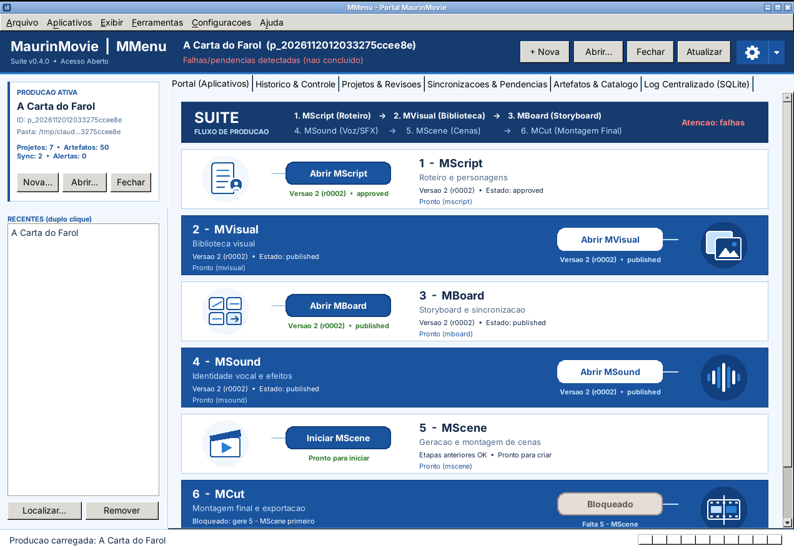

# MaurinMovie

Suíte de criação de filmes com IA em Lazarus/Free Pascal: sete programas integrados, da sinopse ao filme montado.

| Programa | Função |
|---|---|
| **MMenu** | portal, produções, configuração centralizada, integridade e sincronizações |
| **MScript** | sinopse, roteiro em cenas e personagens |
| **MVisual** | biblioteca visual e referências padronizadas |
| **MBoard** | storyboard, segmentos e cascata de ajustes |
| **MSound** | vozes, efeitos e ensaio sonoro |
| **MScene** | geração e montagem de uma cena por vez |
| **MCut** | montagem final, avaliação de público e exportação |

- **Manual com telas:** [docs/manual](docs/manual/README.md)
- **Requisitos e especificações:** [docs](docs/README.md)
- **Compilação e instalador:** [install/README.md](install/README.md)
