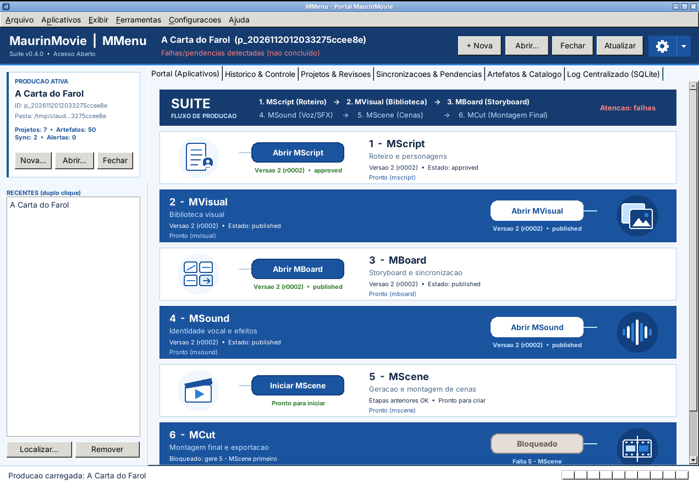
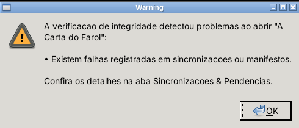
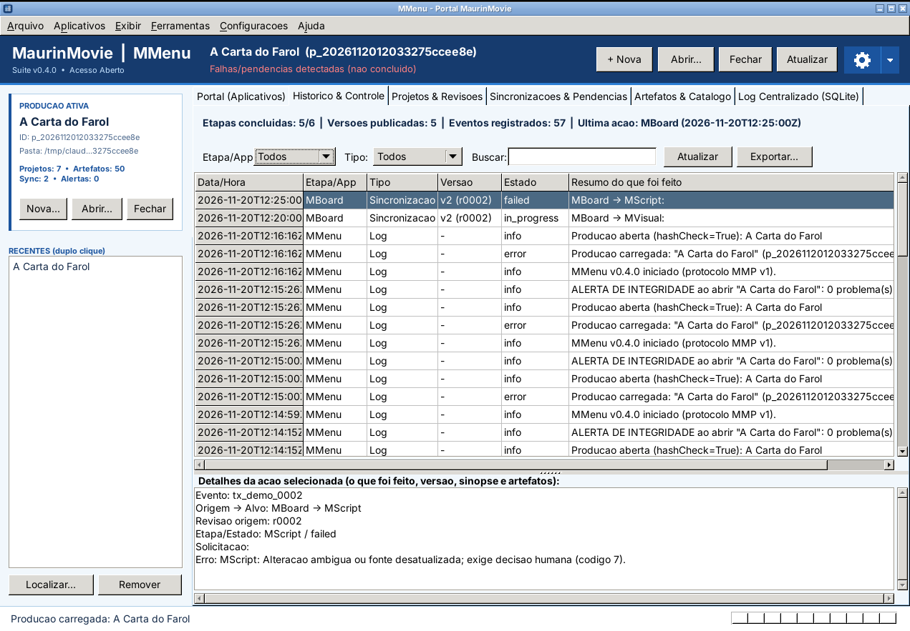
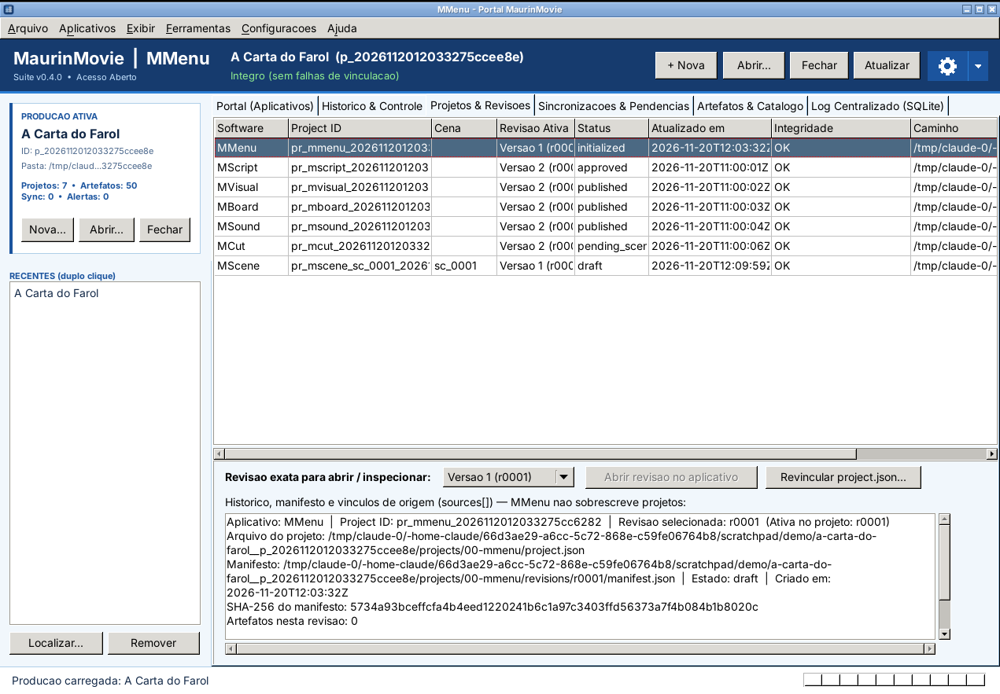
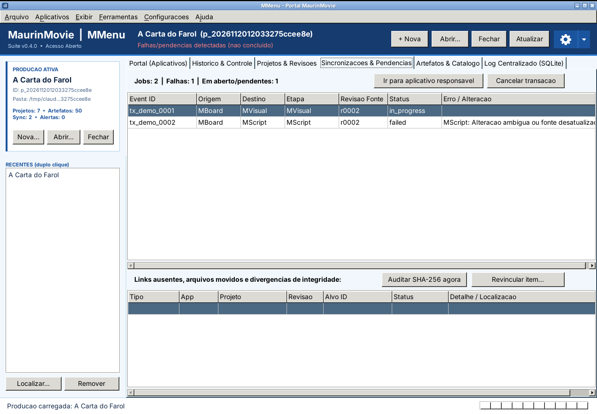
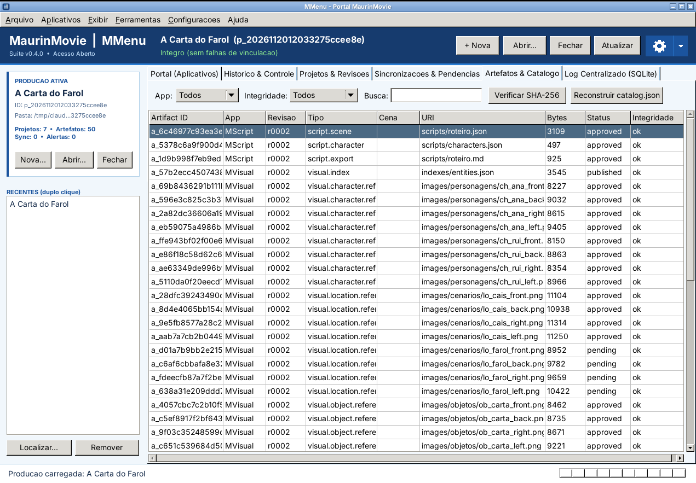
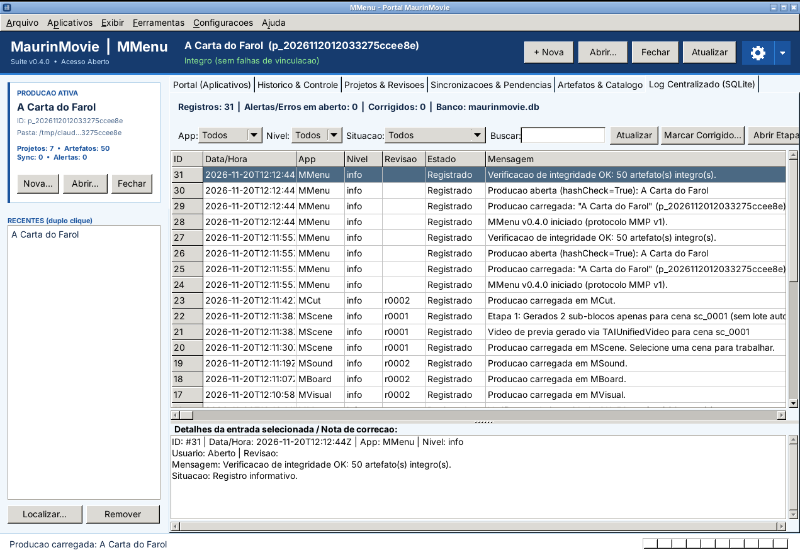
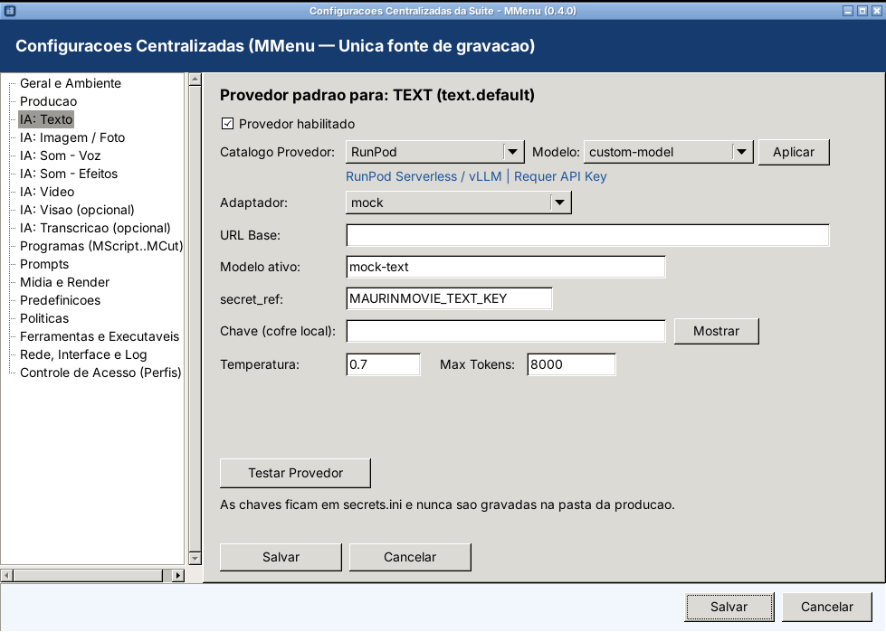

# 0 — MMenu (portal da suíte)

Executável: `mmenu` / `mmenu.exe` · código: [src/mmenu](../../src/mmenu) · especificação: [docs/specs/01-mmenu.md](../specs/01-mmenu.md)

O MMenu é a porta de entrada do MaurinMovie e o **único lugar onde a configuração é gravada**. Ele cria e abre produções, mostra o estado de cada etapa, abre o programa certo já na revisão exata, acompanha sincronizações e verifica a integridade dos arquivos. Ele nunca altera o conteúdo editorial nem os projetos dos outros programas.

## Tela principal — Portal (Aplicativos)



| Área | O que mostra / faz |
|---|---|
| Menu | Arquivo, Aplicativos, Exibir (troca de aba), Ferramentas, Configurações, Ajuda |
| Cabeçalho | Produção aberta, `production_id` e estado geral ("Íntegro" ou "Falhas/pendências detectadas (não concluído)"). Botões **+ Nova**, **Abrir...**, **Fechar**, **Atualizar** e a engrenagem (Configurações) |
| Produção ativa | Título, ID, pasta e contadores (projetos, artefatos, sincronizações, alertas) |
| Recentes | Últimas produções (duplo clique abre); **Localizar...** procura uma produção movida pelo `production_id`; **Remover** tira da lista |
| Faixa SUITE | O fluxo 1 → 6 e o selo geral ("Suíte íntegra" ou "Atenção: falhas") |
| Cartões 1–6 | Um por programa: revisão ativa, estado e o botão **Abrir <programa>**. O botão fica **Bloqueado** enquanto falta uma etapa anterior (ex.: "Falta 5 - MScene") |

Ao abrir um programa, o MMenu passa `--production`, `--project-id`, `--revision` (e `--scene-id` para um projeto de cena do MScene). Só é permitida uma instância de cada programa.

### Alerta de integridade ao abrir



Se a produção tiver sincronização com falha, arquivo ausente, hash divergente ou manifesto inválido, o MMenu avisa ao abrir e indica a aba de detalhes. Nada é dado como concluído enquanto houver falha.

## Histórico & Controle



Linha do tempo da produção: revisões publicadas, entradas de log e sincronizações, com filtros por etapa e tipo, busca e exportação. O painel inferior mostra os detalhes da linha selecionada (para o MScript, inclui título, gênero, duração, cenas e sinopse da versão).

## Projetos & Revisões



Lista os projetos dos sete programas (e os projetos por cena do MScene) com revisão ativa, estado, data e integridade. Embaixo, escolha qualquer revisão e use **Abrir revisão no aplicativo** (revisões antigas para consulta). **Revincular project.json...** aponta um projeto que mudou de lugar; o mapeamento é gravado só em `projects/00-mmenu/relinks.json`.

## Sincronizações & Pendências



- **Transações e eventos de cascata** (`shared/transactions`, `shared/events`): origem, destino, etapa atual, estado e erro. No exemplo, `tx_demo_0001` já passou pelo MScript e espera o MVisual; `tx_demo_0002` falhou no MScript por alteração ambígua (código 7).
- **Ir para aplicativo responsável** abre o programa da etapa; **Cancelar transação** marca como `cancelled` (com confirmação) sem apagar revisões publicadas.
- **Links ausentes e divergências:** arquivos não encontrados, movidos (localizados por ID ou hash) e com SHA-256 divergente. **Auditar SHA-256 agora** refaz a verificação completa; **Revincular item...** aceita o novo arquivo somente se o hash for igual ao registrado e grava em `catalog.json` (`relinks[]`), sem tocar no manifesto.

## Artefatos & Catálogo



Todos os arquivos registrados nos manifestos: `artifact_id`, programa, revisão, tipo, cena, caminho, tamanho, estado e integridade. Filtros por programa, integridade e busca; **Verificar SHA-256** confere os itens; **Reconstruir catalog.json** regrava o índice a partir dos manifestos (preservando as revinculações).

## Log Centralizado (SQLite)



Log de todos os programas gravado no banco da produção, com filtros por programa, nível e situação. **Marcar Corrigido** registra quem resolveu um erro e como; **Abrir Etapa** abre o programa ligado à linha.

## Configurações centralizadas



Aberta pela engrenagem, pelo menu Configurações, por **Alterar no MMenu...** de qualquer programa ou por `mmenu --settings --tab <aba>`.

| Seção | Conteúdo |
|---|---|
| Geral e Ambiente | Usuário (autor das aprovações), verificação do ambiente |
| Produção | Idioma, fps, resolução, proporção, áudio, estilo visual, duração-alvo, nome-base |
| IA: Texto, Imagem/Foto, Som — Voz, Som — Efeitos, Vídeo, Visão, Transcrição | Provedor padrão de cada tipo: catálogo/adaptador, URL, modelo, `secret_ref` e chave (gravada no cofre local), parâmetros e **Testar Provedor** |
| Programas (MScript..MCut) | Qual provedor cada programa usa e seus padrões de geração |
| Prompts, Mídia e Render, Predefinições, Políticas | Modelos de prompt, perfis de mídia, listas de estilos/transições, regras de aprovação, custo e retenção |
| Ferramentas e Executáveis | Caminhos dos seis programas, ffmpeg, ffprobe, mpv e pastas |
| Rede, Interface e Log; Controle de Acesso | Proxy e modo offline, aparência e nível de log; modo de acesso aberto ou restrito (com login e perfis) |

Sem produção aberta, só a configuração da máquina pode ser editada.

## Linha de comando

```
mmenu [--production <pasta>] [--settings [--tab <aba>]] [--check-integrity --production <pasta>] [--version] [--help]
```

`--check-integrity` verifica a produção sem abrir janela e termina com código 0 (íntegra) ou 4 (problemas).

## Arquivos que o MMenu grava

- Ao criar uma produção: a árvore completa, `production.json`, `catalog.json`, `settings/*.json`, o `project.json` e a revisão `r0001` de cada programa e o banco `maurinmovie.db`.
- Depois: `catalog.json` (índice), `settings/` (configuração), `projects/00-mmenu/` e, na máquina, `mmenu.ini`, `secrets.ini` e `access-control.json`.

## Ainda não implementado

Retomada automática de transação (`--resume-transaction`), monitoramento por varredura a cada 5 s e exportação do relatório de integridade em arquivo.
