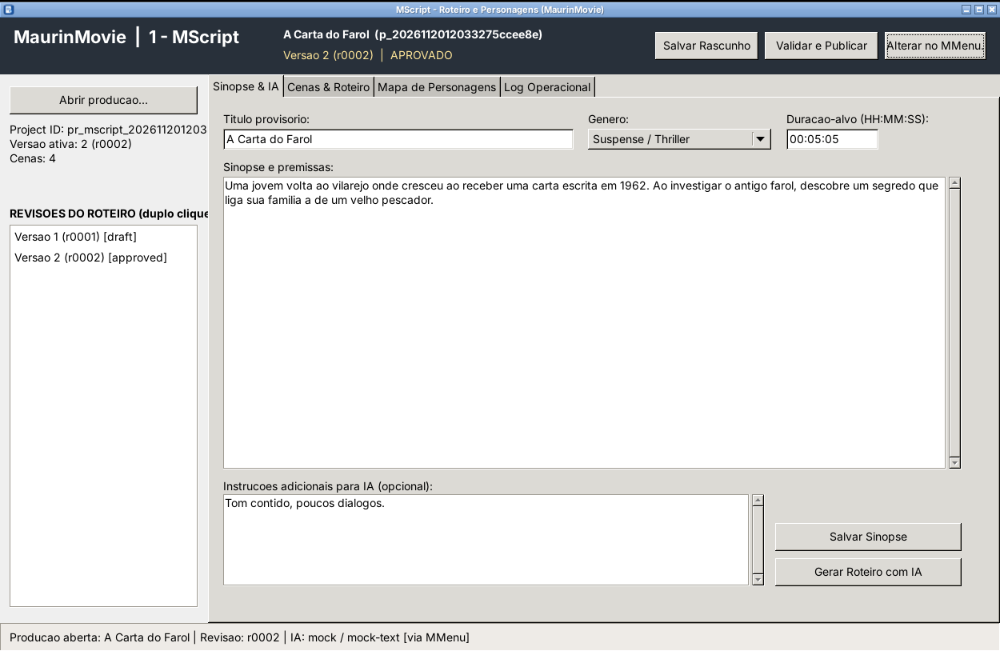
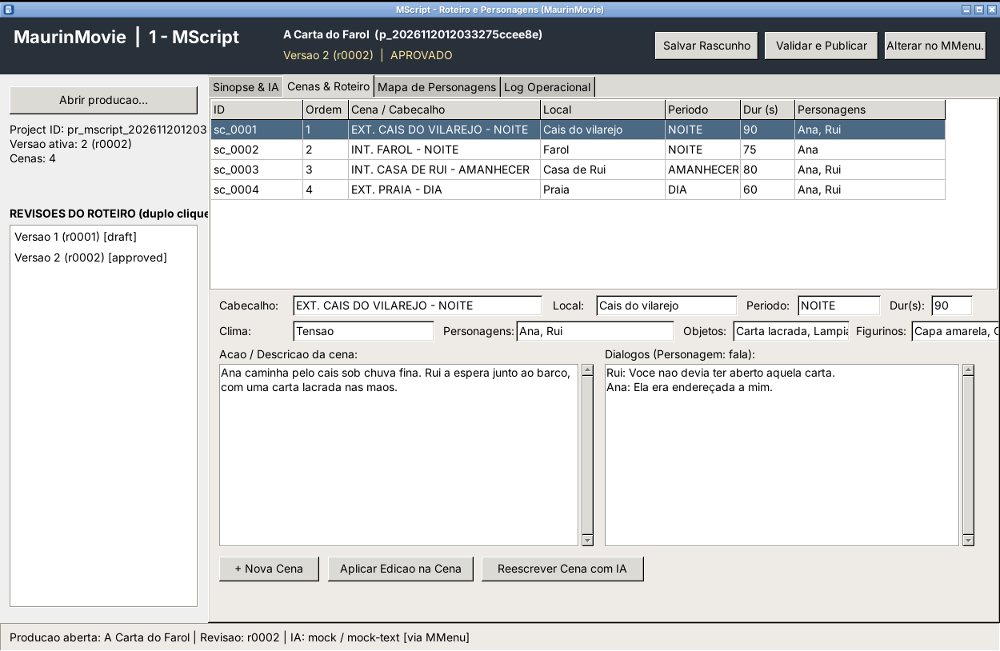
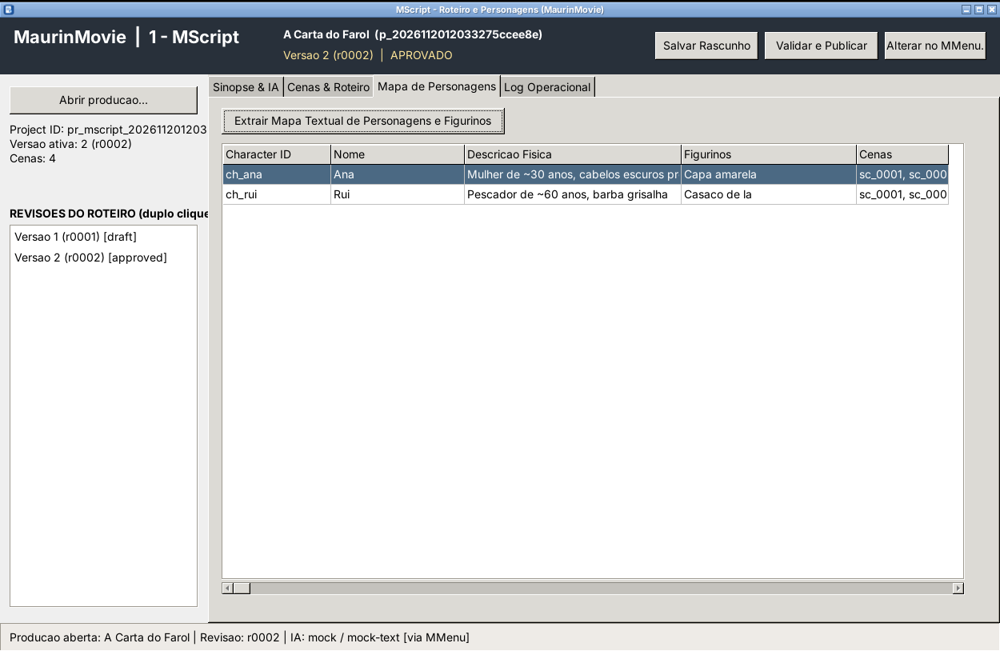

# 1 — MScript (sinopse, roteiro e personagens)

Executável: `mscript` / `mscript.exe` · código: [src/mscript](../../src/mscript) · requisitos: [docs/01-roteiro.md](../01-roteiro.md) · especificação: [docs/specs/02-mscript.md](../specs/02-mscript.md)

Transforma uma sinopse em roteiro dividido em cenas com IDs permanentes, permite editar, valida a revisão e extrai o mapa de personagens. O roteiro **aprovado** é a fonte editorial de toda a produção: o MVisual só importa revisões aprovadas.

## Cabeçalho e painel esquerdo

- Cabeçalho: produção, versão aberta e o selo **APROVADO** ou **Rascunho (não aprovado)**. Botões **Salvar Rascunho** (publica uma revisão `draft`), **Validar e Publicar** (publica `approved`, com confirmação) e **Alterar no MMenu...**.
- Painel esquerdo: **Abrir produção...**, ID do projeto, versão ativa, número de cenas e a lista **Revisões do roteiro** (duplo clique abre a versão para leitura/edição).

## Aba Sinopse & IA



| Campo / botão | Uso |
|---|---|
| Título provisório, Gênero, Duração-alvo | Duração no formato `HH:MM:SS` (validado) |
| Sinopse e premissas | Texto livre que orienta a geração |
| Instruções adicionais para IA | Pedido desta geração (tom, ritmo...) |
| **Salvar Sinopse** | Grava o rascunho local `work/roteiro.json` |
| **Gerar Roteiro com IA** | Pede à IA de texto configurada no MMenu o roteiro em cenas. Se o provedor estiver no modo simulado, o programa avisa e oferece abrir a configuração; resposta inválida não substitui o roteiro atual |

## Aba Cenas & Roteiro



A grade lista as cenas (ID, ordem, cabeçalho, local, período, duração, personagens). Ao selecionar uma cena, os campos abaixo permitem editar cabeçalho, local, período, duração, clima, personagens, objetos, figurinos, ação e diálogos (`Personagem: fala`, um por linha).

- **+ Nova Cena** acrescenta uma cena com novo `scene_id`.
- **Aplicar Edição na Cena** grava as alterações no rascunho.
- **Reescrever Cena com IA** pede uma nova versão da cena a partir de uma instrução.

Qualquer edição tira o selo de aprovado até a próxima validação.

## Aba Mapa de Personagens



**Extrair Mapa Textual de Personagens e Figurinos** monta a lista a partir das cenas: `character_id`, nome, descrição física, figurinos e cenas em que aparece. O `character_id` de um personagem já conhecido é preservado (é por ele que o MVisual e o MSound ligam imagens e vozes). Objetos não entram neste mapa; eles ficam nas cenas e são indexados pelo MVisual.

## Aba Log Operacional

Mensagens da sessão, também gravadas no log centralizado da produção.

## Arquivos de uma revisão

`projects/01-mscript/revisions/rNNNN/`
- `scripts/roteiro.json` (`script.scene`): filme, cenas e personagens.
- `scripts/characters.json` (`script.character`): mapa de personagens.
- `scripts/roteiro.md` (`script.export`): versão legível, derivada.
- `manifest.json`: artefatos com SHA-256 e estado.

## Modo sem janela (cascata)

```
mscript --launcher mmenu --mmenu-version <v> --production <pasta> --headless --event <arquivo.json>
```

Aplica um evento `script.patch` vindo do MBoard sobre a revisão **ativa** e publica uma nova revisão `approved` com `change_event_id`. Operações aceitas: `replace_text` (campos `action`, `dialogue`, `heading`), `replace_entity`, `set_duration`, `set_scene_field`. O mesmo evento aplicado de novo não cria outra revisão. Recusa com código 7 (e marca o evento como `failed`) quando a fonte está desatualizada, o texto não é encontrado, a operação é desconhecida ou o evento não tem operações. No Linux, mesmo este modo precisa de um display (use `xvfb-run`).

## Ainda não implementado

Comparação de revisões, avisos de consistência por IA, reordenação de cenas, reescrita do roteiro inteiro com proposta lado a lado e as operações `set_dialogue`, `add_dialogue` e `remove_dialogue`.
