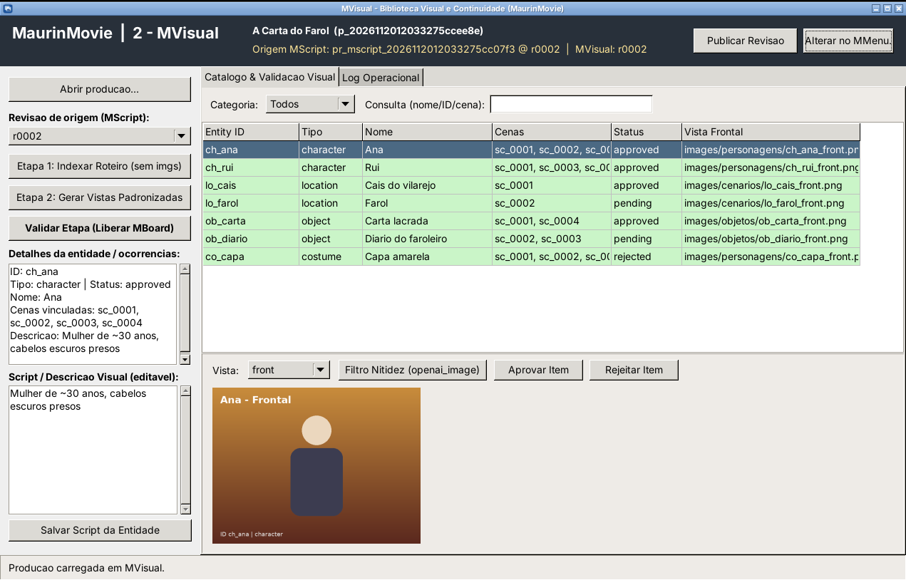

# 2 — MVisual (biblioteca visual e continuidade)

Executável: `mvisual` / `mvisual.exe` · código: [src/mvisual](../../src/mvisual) · requisitos: [docs/02-biblioteca-visual.md](../02-biblioteca-visual.md) · especificação: [docs/specs/03-mvisual.md](../specs/03-mvisual.md)

A partir de uma revisão **aprovada** do roteiro, identifica personagens, locais, objetos e figurinos, gera imagens de referência padronizadas para cada um e permite aprovar item a item.

## Etapas (painel esquerdo)

| Botão | O que faz |
|---|---|
| Revisão de origem (MScript) | Escolhe a revisão do roteiro. Por padrão sugere a aprovada mais recente; revisões não aprovadas são recusadas |
| **Etapa 1: Indexar Roteiro (sem imgs)** | Cria as entidades a partir das cenas: locais, personagens (com o mesmo `character_id` do MScript), objetos e figurinos, cada um com as cenas em que aparece. Não gera imagens |
| **Etapa 2: Gerar Vistas Padronizadas** | Gera frontal, costas, perfil direito e perfil esquerdo de cada entidade com a IA de imagem configurada no MMenu, usando a frontal como referência das demais. Mostra o progresso e permite **Parar**; ao retomar, o que já foi gerado é pulado. Sem provedor de imagem, grava quadros provisórios |
| **Validar Etapa (Liberar MBoard)** | Confere pendências e imagens ausentes, permite aprovar o que falta (com confirmação) e publica a revisão aprovada |

Abaixo ficam os detalhes da entidade selecionada e a **Descrição visual** editável (**Salvar Script da Entidade**), usada nos prompts.

## Aba Catálogo & Validação Visual

- Filtro por **Categoria** e **Consulta** por nome, ID ou cena (ex.: `sc_0002` mostra tudo o que aparece na cena 2).
- A grade mostra ID, tipo, nome, cenas, estado e a vista frontal; linhas com imagem gerada ficam em verde.
- **Vista** escolhe qual das quatro imagens aparece na prévia.
- **Aprovar Item** / **Rejeitar Item** grava a decisão no banco da produção; quando todos ficam aprovados, a revisão é publicada automaticamente como aprovada.
- **Filtro Nitidez** aplica um filtro de nitidez à vista frontal (gera uma nova versão no rascunho).
- Clique direito na grade: **Gerar Item (4 Vistas)**, **Gerar Apenas Vista Atual**, **Gerar Costas/Dir/Esq da Frontal**.

## Cabeçalho

Origem (projeto e revisão do MScript) e revisão do MVisual. **Publicar Revisão** grava `approved` só se todos os itens estiverem aprovados; senão grava `published`.

## Rascunho e revisões

Imagens e o índice em edição ficam em `projects/02-mvisual/work/draft/`. Ao publicar, são copiados para `revisions/rNNNN/` (`indexes/entities.json` e `images/personagens|cenarios|objetos/<id>_<vista>.png`) e o rascunho é limpo. A revisão publicada nunca é reescrita.

## Cascata (sem janela)

Na cascata iniciada pelo MBoard, o MVisual roda sem janela (`mvisual --headless --event <arquivo>`): relê a revisão ativa do roteiro, recalcula a lista de cenas de cada entidade, inclui entidades novas como pendentes (sem imagens) e publica uma revisão `published` com o `change_event_id` do evento. Se o mesmo evento chegar de novo, nada é republicado. Se houver rascunho não publicado no MVisual, o evento é recusado (código 7) para não sobrescrever o trabalho aberto.

## Ainda não implementado

Ambiguidades e correferências ("o velho", "ele"), mesclar/separar entidades, variantes (pose, expressão, estado), comparação de versões e geração automática das vistas das entidades novas que a cascata cria.
