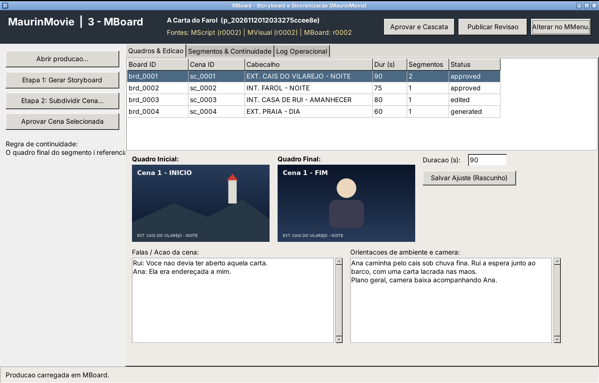
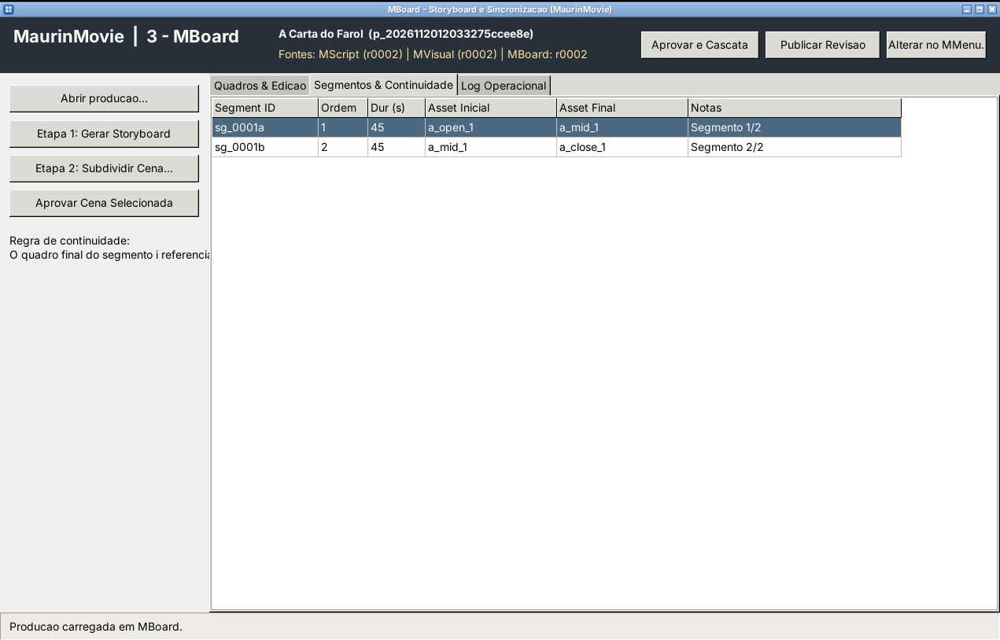
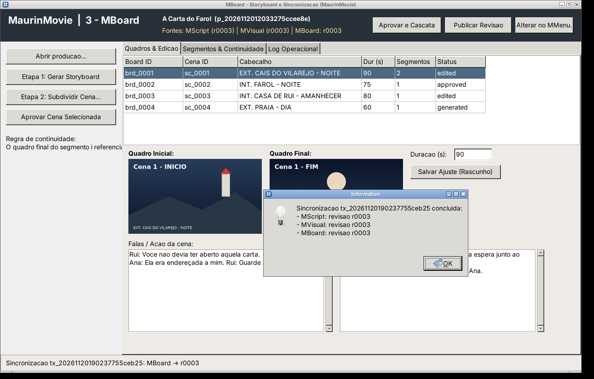
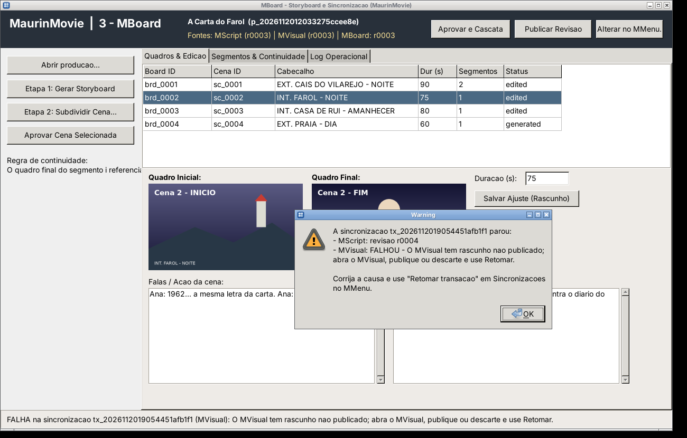

# 3 — MBoard (storyboard e sincronização)

Executável: `mboard` / `mboard.exe` · código: [src/mboard](../../src/mboard) · requisitos: [docs/05-storyboard.md](../05-storyboard.md) · especificação: [docs/specs/04-mboard.md](../specs/04-mboard.md)

Transforma as cenas do roteiro e as referências visuais em storyboards com quadro inicial e final, duração e falas; subdivide cenas em segmentos com continuidade exata e propaga ajustes editoriais aprovados para o roteiro.

## Aba Quadros & Edição

| Elemento | Uso |
|---|---|
| **Etapa 1: Gerar Storyboard** | Percorre todas as cenas do roteiro ativo e gera quadro inicial e final de cada uma (imagem pela IA quando configurada, senão quadro provisório). Tudo fica `generated` |
| Grade de storyboards | Board, cena, cabeçalho, duração, número de segmentos e estado (`generated`, `edited`, `approved`) |
| Quadro Inicial / Quadro Final | Imagens da cena selecionada, lado a lado |
| Duração, Falas/Ação, Orientações de câmera | Campos editáveis; **Salvar Ajuste (Rascunho)** marca o storyboard como `edited` sem mexer no roteiro |
| **Aprovar Cena Selecionada** | Aprova o storyboard |

## Aba Segmentos & Continuidade

**Etapa 2: Subdividir Cena...** divide a cena em N segmentos (até 60). A soma das durações é igual à da cena e o quadro final do segmento *i* é **o mesmo `asset_id`** do quadro inicial do segmento *i+1* (no exemplo, `a_mid_1` fecha o segmento 1 e abre o 2); o primeiro começa no quadro inicial da cena e o último termina no final.

## Cabeçalho

- **Publicar Revisão:** `approved` se todas as cenas estiverem aprovadas, senão `published`.
- **Aprovar e Cascata:** compara os storyboards `edited` com o roteiro de origem e monta as operações (`replace_text` de ação e falas, `set_duration`). Depois registra o evento e a transação e executa os três estágios em ordem, sem abrir outras janelas:
  1. **MScript** aplica o patch e publica a nova revisão do roteiro;
  2. **MVisual** recebe um evento `source.update`, reindexa as entidades a partir do roteiro novo e publica;
  3. **MBoard** publica o storyboard apontando para as novas revisões do roteiro e da biblioteca visual.

  A transação é acompanhada no MMenu (aba Sincronizações).

Se um estágio falhar (programa aberto, alteração ambígua, fonte desatualizada, rascunho não publicado no MVisual), a cascata para ali, a transação fica `failed` com o motivo e nada além do que já foi publicado muda. Os ajustes ficam guardados no rascunho; depois de corrigir a causa, use **Retomar transação** no MMenu, que continua do estágio que parou.

## Arquivos

Rascunho em `projects/03-mboard/work/draft/` (`storyboard/scenes.json` com os ajustes ainda não publicados e `images/quadros/`); ao abrir, o MBoard retoma esse rascunho; revisão em `revisions/rNNNN/storyboard/scenes.json` (`storyboard.segment`) e `images/quadros/*` (`storyboard.frame`), com as revisões do MScript e do MVisual como fontes.

## Ainda não implementado

Regenerar quadros das cenas afetadas pela cascata, "Atualizar fontes" ao abrir, substituição de quadro por arquivo e critérios de subdivisão por falas.
