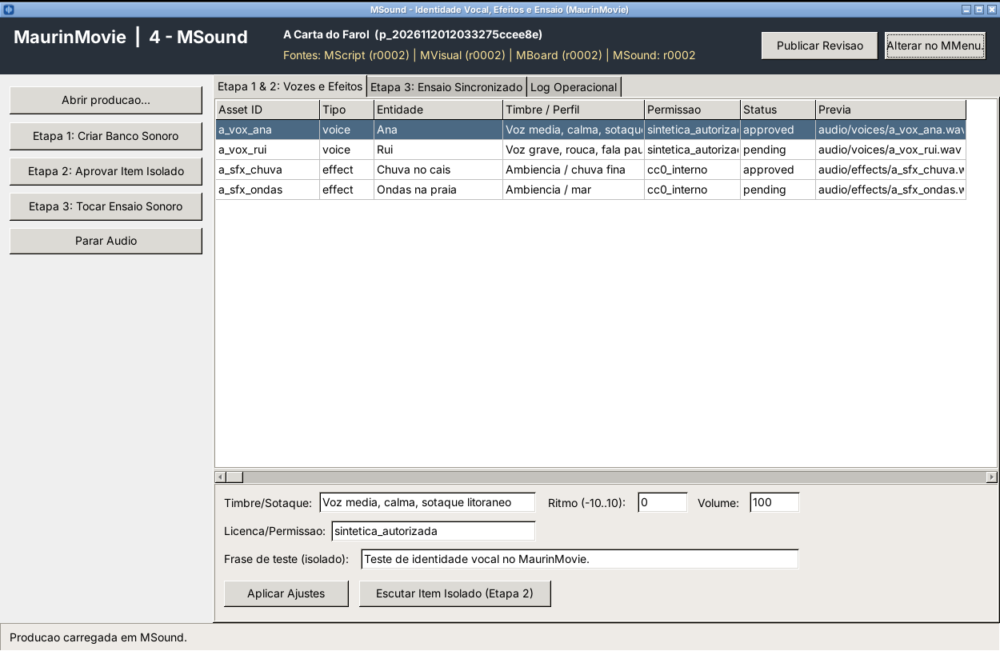
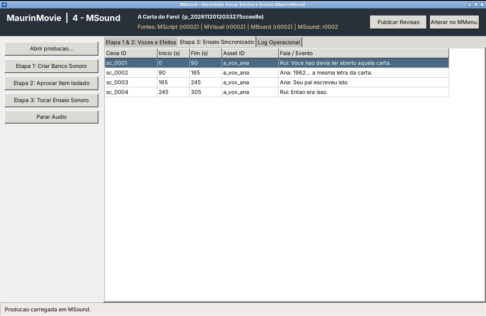

# 4 — MSound (identidade vocal, efeitos e ensaio)

Executável: `msound` / `msound.exe` · código: [src/msound](../../src/msound) · requisitos: [docs/06-identidade-sonora.md](../06-identidade-sonora.md) · especificação: [docs/specs/05-msound.md](../specs/05-msound.md)

Cria e aprova um banco reutilizável de vozes (uma por personagem) e efeitos sonoros e permite ouvir a cena apenas com som. Não produz a trilha final do filme.

## Aba Etapa 1 & 2: Vozes e Efeitos

| Elemento | Uso |
|---|---|
| **Etapa 1: Criar Banco Sonoro** | Cria um perfil de voz para cada personagem do roteiro (ligado ao `character_id`) e um efeito de ambiente, com prévias WAV provisórias |
| Grade | ID, tipo (`voice`/`effect`), entidade, timbre/perfil, permissão, estado e arquivo de prévia |
| Timbre/Sotaque, Ritmo (-10..10), Volume, Licença/Permissão | Ajustes do item selecionado; **Aplicar Ajustes** grava |
| Frase de teste + **Escutar Item Isolado (Etapa 2)** | Voz: sintetiza a frase com a IA de voz configurada no MMenu (ou com o sintetizador do sistema). Efeito: toca a prévia (gerando-a pela IA de efeitos se ainda não existir) |
| **Etapa 2: Aprovar Item Isolado** | Aprova o perfil ou efeito selecionado |

## Aba Etapa 3: Ensaio Sincronizado

Linha do tempo sonora por cena (início, fim, voz, fala). **Etapa 3: Tocar Ensaio Sonoro** reproduz a fala da cena selecionada, só áudio, para avaliar ritmo; **Parar Áudio** interrompe.

## Cabeçalho

**Publicar Revisão** grava `voices/profiles.json` e os WAV em `revisions/rNNNN/audio/`, com as revisões do MScript, MVisual e MBoard como fontes. Fica `approved` só com todos os itens aprovados.

Áudios gerados antes de publicar ficam em `projects/04-msound/work/draft/`.

## Ainda não implementado

Efeitos por objeto e ação a partir do roteiro, vínculo com eventos por segmento e linha de diálogo, camadas e volume na linha do tempo, exportação da prévia em WAV e clonagem de voz com autorização anexada.
