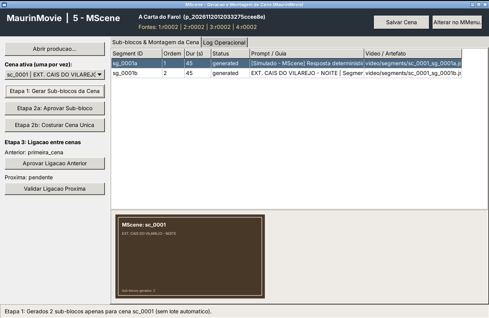

# 5 — MScene (geração e montagem de cenas)

Executável: `mscene` / `mscene.exe` · código: [src/mscene](../../src/mscene) · requisitos: [docs/07-geracao-e-montagem-de-cenas.md](../07-geracao-e-montagem-de-cenas.md) · especificação: [docs/specs/06-mscene.md](../specs/06-mscene.md)

Gera o vídeo de **uma cena por vez**, a partir do storyboard e dos bancos visual e sonoro; valida cada sub-bloco, costura a cena e confere a ligação com a cena anterior e a próxima. Não monta o filme inteiro (isso é do MCut).

## Painel esquerdo

| Elemento | Uso |
|---|---|
| **Cena ativa (uma por vez)** | Escolhe a cena do roteiro. Cada cena tem projeto próprio em `projects/05-mscene/scenes/<scene_id>/`, criado na primeira abertura |
| **Etapa 1: Gerar Sub-blocos da Cena** | Gera a descrição de cada segmento definido no MBoard e uma prévia da cena (vídeo pela IA de vídeo ou FFmpeg, quando disponível). Só a cena selecionada é processada |
| **Etapa 2a: Aprovar Sub-bloco** | Aprova o segmento selecionado |
| **Etapa 2b: Costurar Cena Única** | Registra a ordem dos segmentos aprovados como a cena montada |
| **Etapa 3: Ligação entre cenas** | **Aprovar Ligação Anterior** e **Validar Ligação Próxima**. Se a próxima cena ainda não existir, a ligação fica **pendente**, nunca aprovada por suposição |

## Aba Sub-blocos & Montagem da Cena

Segmentos da cena (ID, ordem, duração, estado, prompt e arquivo) e a prévia gerada.

## Cabeçalho

Fontes 1 a 4 (revisões ativas de MScript, MVisual, MBoard e MSound). **Salvar Cena** publica a revisão do projeto da cena com os segmentos e a cena montada; o estado registra a ligação (`finalizada` ou `ligacao_posterior_pendente`). Arquivos gerados antes de salvar ficam em `scenes/<scene_id>/work/draft/`.

## Ainda não implementado

Geração real de vídeo por segmento com quadros, referências e áudio-guia; costura com ffmpeg; reprodução anterior → atual → próxima; regras de sequência (só a próxima cena não aprovada) e retomada por segmento.
