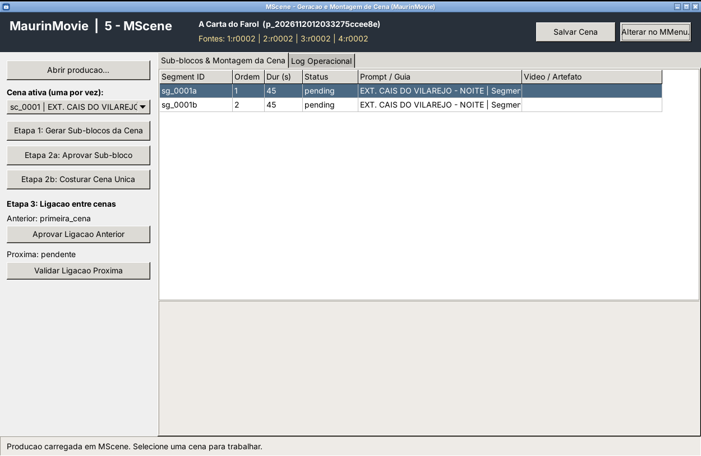
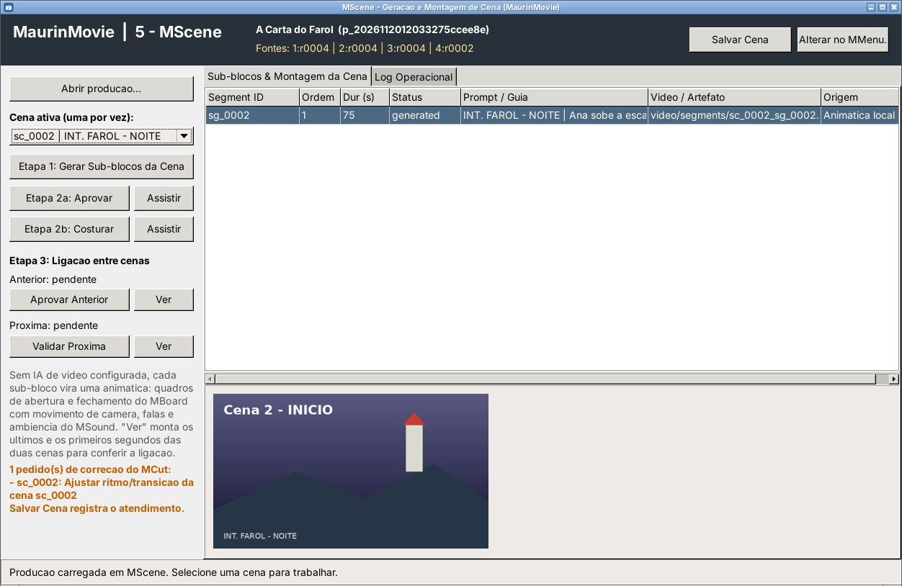

# 5 — MScene (geração e montagem de cenas)

Executável: `mscene` / `mscene.exe` · código: [src/mscene](../../src/mscene) · requisitos: [docs/07-geracao-e-montagem-de-cenas.md](../07-geracao-e-montagem-de-cenas.md) · especificação: [docs/specs/06-mscene.md](../specs/06-mscene.md)

Gera o vídeo de **uma cena por vez**, a partir do storyboard e dos bancos visual e sonoro; valida cada sub-bloco, costura a cena e confere a ligação com a cena anterior e a próxima. Não monta o filme inteiro (isso é do MCut).

## Painel esquerdo

| Elemento | Uso |
|---|---|
| **Cena ativa (uma por vez)** | Escolhe a cena do roteiro. Cada cena tem projeto próprio em `projects/05-mscene/scenes/<scene_id>/`, criado na primeira abertura. Ao voltar a uma cena, os vídeos, aprovações e a cena costurada já salvos (no rascunho ou na revisão ativa) são retomados |
| **Etapa 1: Gerar Sub-blocos da Cena** | Gera o vídeo de cada segmento definido no MBoard (detalhes abaixo). Só a cena selecionada é processada |
| **Etapa 2a: Aprovar** · **Assistir** | Aprova o segmento selecionado; **Assistir** (ou duplo clique na grade) abre o vídeo do segmento no reprodutor |
| **Etapa 2b: Costurar** · **Assistir** | Junta os vídeos dos segmentos, na ordem, em `video/assembled/<cena>.mp4` e mostra um quadro da cena. Se algum segmento não estiver aprovado, pede confirmação |
| **Etapa 3: Ligação entre cenas** | **Aprovar Anterior** e **Validar Próxima**; **Ver** monta os últimos 4 s de uma cena e os primeiros 4 s da outra num vídeo curto (`video/previews/`) para conferir a passagem. Se a próxima cena ainda não existir, a ligação fica **pendente**, nunca aprovada por suposição |
| Pedidos de correção do MCut | Quando o MCut pede correção de uma cena, o pedido aparece em laranja no painel. **Salvar Cena** dessa cena registra o atendimento: o evento vai para `shared/events/archive` e a transação fica concluída |

## Como o vídeo de cada segmento é feito

1. **Falas:** cada linha `Nome: fala` do segmento vira áudio. Com um provedor de voz real configurado no MMenu, a fala é sintetizada; sem ele, entra a amostra de voz do personagem gravada no MSound, como voz-guia.
2. **Ambiência:** o efeito do MSound ligado à cena (pela linha do tempo do MSound ou pelo local da cena no índice do MVisual), em volume baixo e repetido até o fim.
3. **Áudio do segmento:** falas em sequência, com pausas curtas, sobre a ambiência. A duração é a do MBoard ou, se as falas forem mais longas, a das falas.
4. **Imagem:**
   - com uma IA de vídeo real configurada, o vídeo é pedido a ela (a partir do quadro de abertura) e recebe o áudio do segmento; se a IA falhar, entra a animática;
   - sem IA de vídeo, uma **animática**: quadro de abertura com aproximação lenta, fusão no meio e quadro de fechamento com afastamento lento.
5. O vídeo vai para `video/segments/<cena>_<segmento>.mp4` (H.264/AAC, 1280×720, 25 quadros/s) e os dados (origem, falas, fontes, duração real) para o `.json` ao lado. A coluna **Origem** mostra "IA de vídeo" ou "Animática local".

É preciso ter o **ffmpeg** (e o ffprobe) instalado: o caminho vem de MMenu → Configurações → Ferramentas ou do PATH. Sem ele, a Etapa 1 avisa e não gera nada.

## Aba Sub-blocos & Montagem da Cena

Segmentos da cena (ID, ordem, duração, estado, prompt, arquivo de vídeo e origem) e um quadro do vídeo selecionado ou da cena costurada.

## Cabeçalho

Fontes 1 a 4 (revisões ativas de MScript, MVisual, MBoard e MSound). **Salvar Cena** publica a revisão do projeto da cena com os vídeos dos segmentos (`video.segment`) e a cena costurada (`video.scene`), em `video/mp4`, mais os `.json` de cada um; o estado registra a ligação (`finalizada` ou `ligacao_posterior_pendente`). Arquivos gerados antes de salvar ficam em `scenes/<scene_id>/work/draft/`.

## Ainda não implementado

Reprodução embutida na janela (hoje o vídeo abre no reprodutor configurado — mpv — ou no programa padrão), regras de sequência (só a próxima cena não aprovada), regeneração de um único segmento e uso de referências visuais do MVisual pela IA de vídeo.
