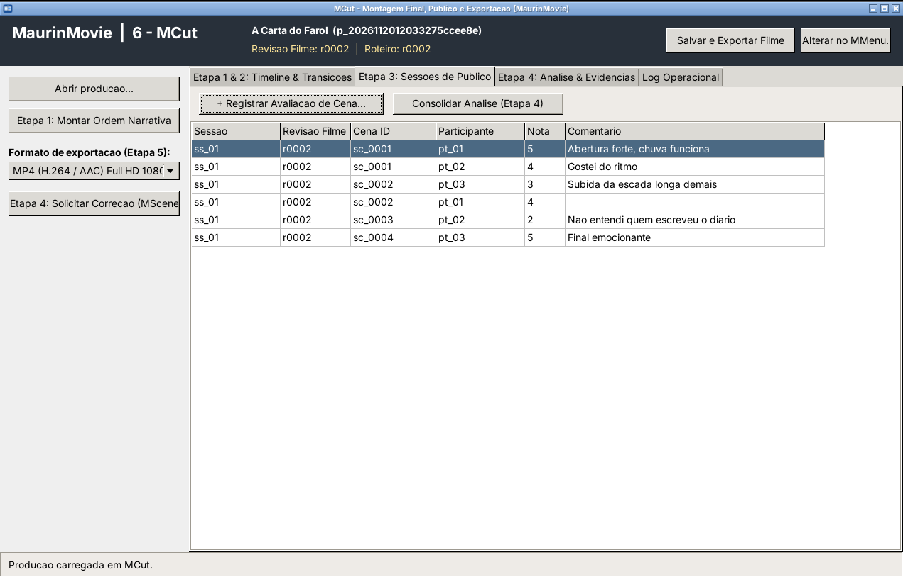
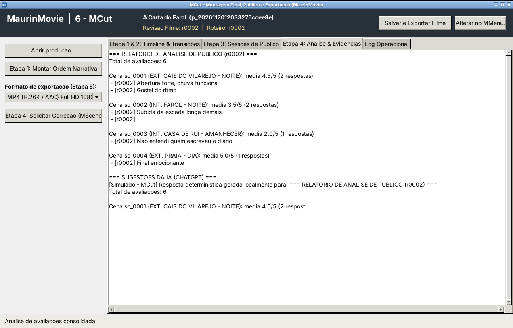
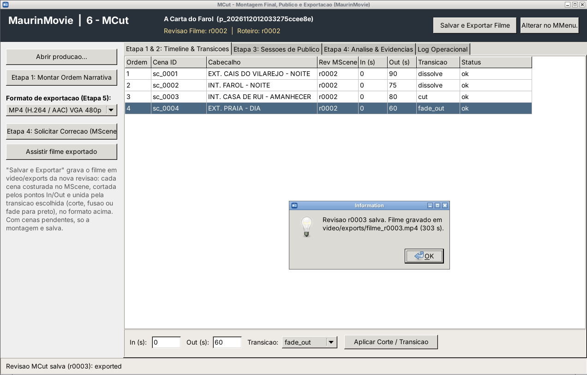
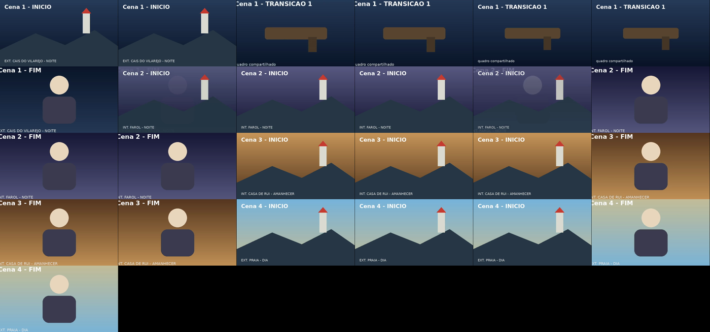

# 6 — MCut (montagem final, público e exportação)

Executável: `mcut` / `mcut.exe` · código: [src/mcut](../../src/mcut) · requisitos: [docs/08-montagem-final.md](../08-montagem-final.md) · especificação: [docs/specs/07-mcut.md](../specs/07-mcut.md)

Monta o filme na ordem narrativa do roteiro com as cenas do MScene, ajusta cortes e transições, registra avaliações de público por cena, consolida a análise e **grava o filme**.

## Aba Etapa 1 & 2: Timeline & Transições

| Elemento | Uso |
|---|---|
| **Etapa 1: Montar Ordem Narrativa** | Cria a timeline na ordem das cenas do roteiro, apontando cada uma para a revisão ativa do seu projeto no MScene e para o vídeo costurado dela; o **Out** inicial é a duração real desse vídeo. Cena sem projeto aparece como `missing_scene`; cena ainda não finalizada, como `pending_approval`; cena finalizada sem vídeo costurado, como `missing_video` — nunca substituída em silêncio |
| Grade | Ordem, cena, cabeçalho, revisão no MScene, in/out, transição e estado |
| In (s), Out (s), Transição + **Aplicar Corte / Transição** | Trecho de cada cena que entra no filme e a transição para a cena seguinte: `cut` (corte seco), `dissolve` (fusão) ou `fade_out` (fade para preto; na última cena, fade no fim do filme). Os vídeos de origem não são alterados |
| Formato de exportação (Etapa 5) | MP4 (H.264/AAC) de 480p a 4320p, ou MKV sem perdas (FFV1/FLAC) para matriz |
| **Assistir filme exportado** | Abre o filme da revisão atual no reprodutor configurado |
| **Etapa 4: Solicitar Correção (MScene)** | Registra um pedido de correção (evento e transação) para o projeto da cena selecionada no MScene, acompanhado em Sincronizações no MMenu |

## Aba Etapa 3: Sessões de Público

Avaliações por sessão, revisão do filme, cena, participante, nota (1–5) e comentário. **+ Registrar Avaliação de Cena...** inclui uma avaliação; **Consolidar Análise (Etapa 4)** gera o relatório.

## Aba Etapa 4: Análise & Evidências

Média e número de respostas por cena, comentários (sempre ligados à revisão avaliada) e sugestões da IA de texto. A decisão sobre correções é do usuário.

## Cabeçalho

**Salvar e Exportar Filme** grava o filme e publica a revisão com `timeline/timeline.json`, `feedback/ratings.json`, `analysis/report.json`, `video/exports/export_report.json` e o filme `video/exports/filme_<revisão>.mp4` (ou `.mkv`), registrado como `video.film`. O relatório traz arquivo, duração, tamanho, SHA-256, resolução e os cortes usados. As fontes do manifesto incluem o MScript e cada projeto de cena do MScene.

No exemplo, as quatro cenas (90 + 75 + 80 + 60 s) com duas fusões de 1 s resultam em 303 s. Quadros do filme, um a cada 12 s:

Com cenas pendentes, o filme não é gravado: o estado fica `pending_scenes_missing` e o programa avisa. Se o ffmpeg faltar ou falhar, a montagem é salva com estado `export_failed` e o erro no relatório. A gravação usa o ffmpeg configurado no MMenu (ou o do PATH); em 1080p ou mais pode levar alguns minutos.

## Ainda não implementado

Player embutido com timecode, cortes dentro da cena (mais de um trecho por cena), prévia de transição antes de gravar, trilha musical e mixagem final, sessões com cadastro de participantes e consentimento e reavaliação de fragmento.
