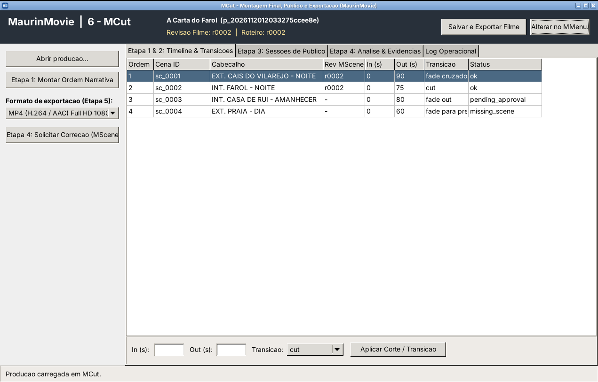

# 6 — MCut (montagem final, público e exportação)

Executável: `mcut` / `mcut.exe` · código: [src/mcut](../../src/mcut) · requisitos: [docs/08-montagem-final.md](../08-montagem-final.md) · especificação: [docs/specs/07-mcut.md](../specs/07-mcut.md)

Monta o filme na ordem narrativa do roteiro com as cenas do MScene, ajusta cortes e transições, registra avaliações de público por cena, consolida a análise e salva o pacote de exportação.

## Aba Etapa 1 & 2: Timeline & Transições

| Elemento | Uso |
|---|---|
| **Etapa 1: Montar Ordem Narrativa** | Cria a timeline na ordem das cenas do roteiro, apontando cada uma para a revisão do seu projeto no MScene. Cena sem projeto aparece como `missing_scene`; cena ainda não finalizada, como `pending_approval` — nunca substituída em silêncio |
| Grade | Ordem, cena, cabeçalho, revisão no MScene, in/out, transição e estado |
| In (s), Out (s), Transição + **Aplicar Corte / Transição** | Cortes e transições (corte seco, fades...) como dados da montagem; os vídeos de origem não são alterados |
| Formato de exportação (Etapa 5) | Contêiner, codec e resolução do pacote de exportação |
| **Etapa 4: Solicitar Correção (MScene)** | Registra um pedido de correção (evento e transação) para o projeto da cena selecionada no MScene, acompanhado em Sincronizações no MMenu |

## Aba Etapa 3: Sessões de Público

Avaliações por sessão, revisão do filme, cena, participante, nota (1–5) e comentário. **+ Registrar Avaliação de Cena...** inclui uma avaliação; **Consolidar Análise (Etapa 4)** gera o relatório.

## Aba Etapa 4: Análise & Evidências

Média e número de respostas por cena, comentários (sempre ligados à revisão avaliada) e sugestões da IA de texto. A decisão sobre correções é do usuário.

## Cabeçalho

**Salvar e Exportar Filme** publica a revisão com `timeline/timeline.json`, `feedback/ratings.json`, `analysis/report.json` e `video/exports/export_report.json`. As fontes do manifesto incluem o MScript e cada projeto de cena do MScene. Com cenas pendentes, o estado fica `pending_scenes_missing` e o programa avisa que a exportação **não** foi concluída.

## Ainda não implementado

Player do filme com timecode, cortes dentro da cena, prévia de transições, sessões com cadastro de participantes e consentimento, reavaliação de fragmento, ciclo de correção rastreado e renderização real do filme.
