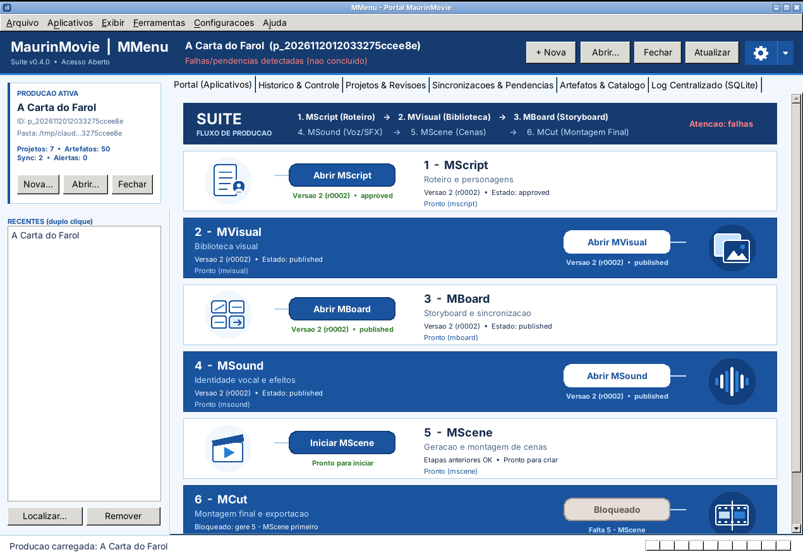
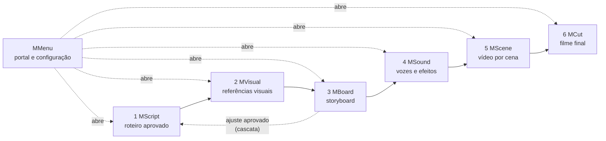

# Manual do MaurinMovie — visão geral

O MaurinMovie é uma suíte de sete programas desktop (Lazarus/Free Pascal) para produzir um filme com auxílio de IA, da sinopse à montagem final. Cada programa cuida de uma etapa, tem o seu próprio projeto versionado dentro da pasta da produção e lê as revisões exatas das etapas anteriores.

As telas deste manual foram capturadas com a produção de exemplo **"A Carta do Farol"** (4 cenas, 2 personagens), usando o provedor de IA simulado.

## Os sete executáveis

| Nº | Executável | Função | Manual |
|---|---|---|---|
| 0 | `mmenu` | Portal da suíte: cria e abre produções, abre os outros programas na revisão certa, mostra pendências, integridade e concentra **todas** as configurações | [00-mmenu.md](00-mmenu.md) |
| 1 | `mscript` | Sinopse, roteiro em cenas, edição, validação e mapa de personagens | [01-mscript.md](01-mscript.md) |
| 2 | `mvisual` | Biblioteca visual: indexa personagens, locais, objetos e figurinos e gera as vistas de referência | [02-mvisual.md](02-mvisual.md) |
| 3 | `mboard` | Storyboard: quadro inicial/final por cena, segmentos com continuidade e cascata de ajustes | [03-mboard.md](03-mboard.md) |
| 4 | `msound` | Identidade vocal, efeitos sonoros e ensaio apenas sonoro | [04-msound.md](04-msound.md) |
| 5 | `mscene` | Geração e montagem de **uma cena por vez** e validação das ligações entre cenas | [05-mscene.md](05-mscene.md) |
| 6 | `mcut` | Montagem do filme na ordem do roteiro, transições, avaliação de público e exportação | [06-mcut.md](06-mcut.md) |

## Fluxo de produção

O MMenu libera cada programa só quando as etapas anteriores têm atividade (no portal acima, o MCut aparece **Bloqueado** porque o MScene ainda não tem cena salva). Quando uma etapa anterior é refeita, as posteriores aparecem como "precisa de reajuste".

## Conceitos comuns

**Produção.** Uma pasta por filme (`productions/<titulo>__<production_id>/`) com `production.json`, `catalog.json`, `settings/` (configuração gravada pelo MMenu), `projects/00-mmenu` a `projects/06-mcut`, `shared/` (eventos, transações, logs, importações) e o banco `maurinmovie.db`.

**Projeto e revisão.** Cada programa grava `projects/NN-app/project.json` e revisões em `revisions/rNNNN/` com um `manifest.json` que lista os arquivos (com SHA-256) e as revisões exatas das fontes. Uma revisão publicada **nunca é alterada**; mudanças geram uma nova revisão. O trabalho ainda não publicado fica em `projects/NN-app/work/`.

**Estados.** Itens gerados pela IA começam como `generated`/`pending` e só ficam `approved` por ação explícita do usuário. Uma revisão só recebe o estado `approved` quando todos os seus itens foram aprovados; caso contrário é publicada como `published`.

**Configuração centralizada.** Provedores de IA (texto, imagem, voz, efeitos, vídeo), padrões de cada programa, executáveis e ferramentas são configurados **somente no MMenu**. Os demais programas apenas leem; o botão **Alterar no MMenu...** de cada um abre a configuração. As chaves de API ficam no cofre local (`secrets.ini`), nunca na pasta da produção.

**Cascata.** Um ajuste editorial aprovado no MBoard vira um evento `script.patch` que o MScript aplica sem abrir a janela, criando nova revisão do roteiro. O MMenu acompanha a transação e nunca a mostra como concluída antes de todos os estágios publicarem.

## Tela comum

Todos os programas seguem o mesmo esqueleto (referência de layout MultiCNC/MultiSuite):

- **Cabeçalho escuro:** nome do programa, produção, revisão ativa e estado; à direita, as ações de salvar/publicar e **Alterar no MMenu...**.
- **Painel esquerdo:** abrir produção e os botões das etapas, na ordem em que devem ser usados.
- **Área central em abas:** o trabalho da etapa e a aba **Log Operacional**.
- **Rodapé:** última mensagem de estado.

## Como iniciar

1. Execute `mmenu` (Windows: `mmenu.exe`).
2. **+ Nova** cria uma produção (ou **Abrir...** escolhe um `production.json`).
3. No portal, clique em **Abrir MScript** e siga as etapas na ordem.

Os programas 1 a 6 só funcionam quando iniciados pelo MMenu, que informa produção, projeto, revisão e versão. Detalhes da linha de comando em [docs/specs/00-comum.md](../specs/00-comum.md#4-linha-de-comando-protocolo-mmp-v1); compilação e instalação em [install/README.md](../../install/README.md).

## Situação atual

Os sete programas compilam (Windows e Linux) e cobrem o fluxo principal descrito neste manual, mas não toda a especificação. Cada documento termina com a lista do que ainda falta; lacunas e decisões técnicas estão em [docs/specs/99-lacunas.md](../specs/99-lacunas.md).
