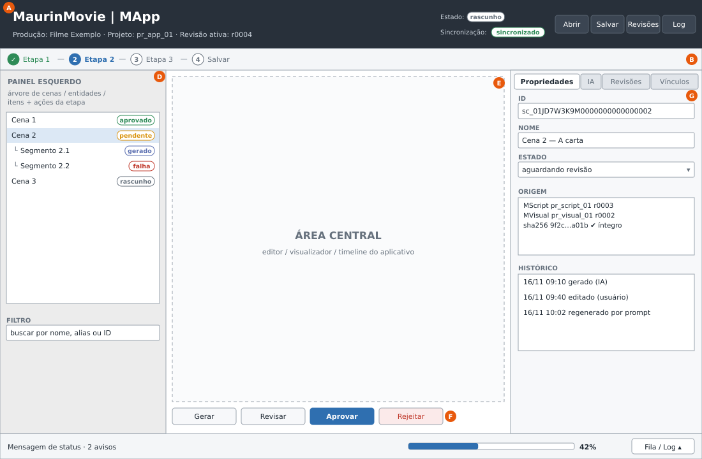
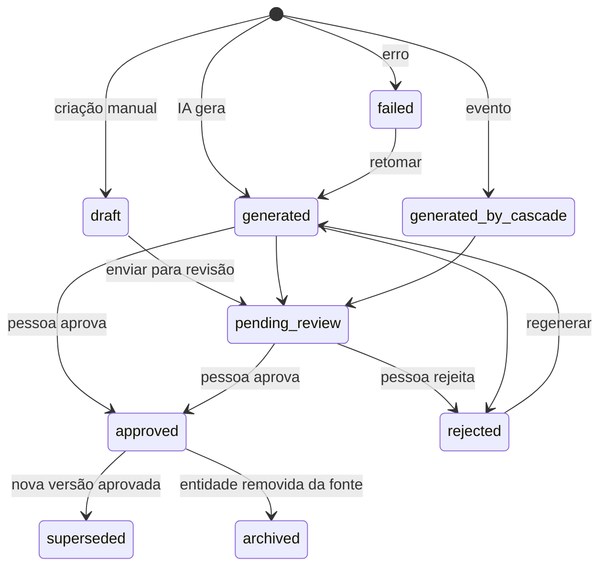
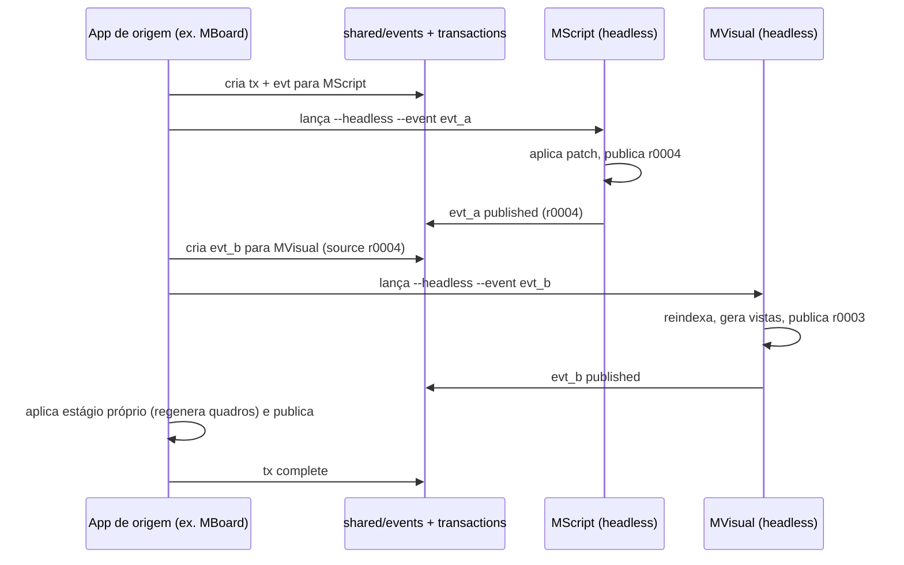

# Especificação comum a todos os programas

> Parte de [docs/specs](README.md). Vale para MMenu, MScript, MVisual, MBoard, MSound, MScene e MCut.
> Itens marcados **[PROPOSTA]** são decisões técnicas que a documentação original deixava em aberto; foram fixadas aqui para permitir a implementação e devem ser confirmadas pelo responsável (ver [99-lacunas.md](99-lacunas.md)).

Fontes: [10-escopo-consolidado](../10-escopo-consolidado.md), [11-protocolo-projetos-artefatos](../11-protocolo-projetos-artefatos.md), [12-arquivos-de-projeto](../12-arquivos-de-projeto.md), [09-padrao-layout-multicnc](../09-padrao-layout-multicnc.md), [03-modelo-de-dados](../03-modelo-de-dados.md).

---

## 1. Plataforma e dependências

| Item | Decisão | Origem |
|---|---|---|
| Linguagem / IDE | Object Pascal, Free Pascal, Lazarus, LCL | docs/10 |
| Modo do compilador | `{$mode objfpc}{$H+}` em todas as unidades (já usado no esqueleto) | código atual |
| Build | `lazbuild src/<app>/<app>.lpi`, saída em `bin/<app>`, intermediários em `build/<app>/` | código atual |
| JSON | `fpjson` + `jsonparser` (FPC) | [PROPOSTA] |
| HTTP para provedores de IA | `fphttpclient` + `opensslsockets`, ou a biblioteca CHATGPT quando a API existir | [PROPOSTA] / docs/10 |
| SHA-256 | unidade da FCL se existir na versão instalada (verificar `fpsha256` / fcl-hash); senão HashLib4Pascal ou DCPcrypt | [PROPOSTA] |
| Vídeo/áudio: decodificar, costurar, renderizar, forma de onda | `ffmpeg` e `ffprobe` externos chamados por `TProcess` | [PROPOSTA] |
| Reprodução de vídeo/áudio na interface | `mpv` embutido no painel via `--wid=<handle>` (ou libmpv); alternativa PasLibVlc | [PROPOSTA] |
| Imagens | PNG (padrão de geração), JPEG aceito na importação; exibição por `TImage`/`TPicture` | [PROPOSTA] |
| Sistemas operacionais | Linux e Windows (o esqueleto atual já trata `.exe` no MMenu) | [PROPOSTA] |
| Idioma da interface | Português do Brasil; textos em `resourcestring` numa unidade por app (`u<app>strings.pas`) para tradução futura | [PROPOSTA] |

A configuração (provedores de IA, padrões de geração, ferramentas) é **centralizada no MMenu** e apenas lida pelos demais programas (§12).

Todos os executáveis devem iniciar e funcionar **sem nenhum provedor de IA configurado**, usando o provedor simulado (§9.3). Isso permite testar o pipeline inteiro sem custo.

---

## 2. Arquitetura em camadas (todos os apps)

```
src/<app>/
  <app>.lpr              programa: lê argumentos, decide modo GUI ou headless
  u<app>main.pas/.lfm    formulário principal (somente UI)
  u<app>frames*.pas      frames das etapas (um por etapa)
  u<app>model.pas        classes do modelo de dados do app (sem LCL)
  u<app>service.pas      regras de negócio: gerar, aprovar, publicar, aplicar evento
  u<app>strings.pas      resourcestrings
src/common/
  mmpcommon.pas          (existe) constantes, argumentos, nomes de revisão
  mmpids.pas             geração e validação de IDs
  mmpjson.pas            leitura/gravação atômica de JSON, helpers fpjson
  mmphash.pas            SHA-256 de arquivo e de texto
  mmpproduction.pas      TMMProduction, TMMProject, TMMManifest, TMMArtifact, TMMSourceRef
  mmprevision.pas        área de rascunho, publicação transacional de revisão
  mmplock.pas            lock de projeto
  mmpevents.pas          envelope de evento, caixa de entrada, transações de cascata
  mmplog.pas             log JSON Lines
  mmpai.pas              interfaces de provedores de IA + provedor simulado
  mmpsettings.pas        leitura da configuração centralizada gravada pelo MMenu (§12)
  mmpmedia.pas           wrappers de ffmpeg/ffprobe/mpv
  mmpui.pas              frames visuais comuns: cabeçalho, barra de etapas, rodapé, janela de log
```

Regra: **unidades `*model`, `*service` e as de `common/` (exceto `mmpui`, `mmpmedia` na parte de player) não podem usar LCL**, para que o modo headless e os testes rodem sem interface gráfica.

---

## 3. Layout comum de tela (padrão MultiCNC)



Janela principal: 1100×720 inicial, mínimo 780×550, centralizada (`poScreenCenter`), redimensionável. Medidas e cor do cabeçalho iguais ao esqueleto já existente no código.

| Marca | Região | Componente LCL sugerido | Conteúdo obrigatório |
|---|---|---|---|
| A | Cabeçalho (`alTop`, 76 px, cor `$003A3028`) | `TPanel` + `TLabel` | "MaurinMovie \| <App>" (fonte 20 negrito branca); linha 2: produção, `project_id`, revisão ativa; selos de **estado editorial** e **sincronização**; botões Abrir, Salvar, Revisões, Log |
| B | Barra de etapas (34 px) | `TPanel` com botões planos | etapas numeradas do app; concluída = verde ✓, atual = azul, futura = cinza. Clicar numa etapa futura só é permitido se os pré-requisitos estiverem satisfeitos; senão mostra o motivo |
| C | Rodapé (`alBottom`, 40 px) | `TPanel` + `TProgressBar` | mensagem de status, contagem de avisos, barra de progresso da fila, botão "Fila / Log" que abre a janela de log (§10) |
| D | Painel esquerdo (260 px, `TSplitter`) | `TTreeView`/`TListView` + `TEdit` de filtro | navegação: cenas, entidades, segmentos etc.; cada item com selo de estado |
| E | Área central (`alClient`) | `TPageControl` ou frame da etapa | editor/visualizador principal da etapa |
| F | Barra de ações da etapa | `TButton` | sempre separadas: **Gerar**, **Revisar**, **Aprovar**, **Rejeitar** (gerar nunca aprova) |
| G | Painel direito (300 px, `TSplitter`) | `TPageControl` | abas Propriedades, IA (parâmetros e prompt), Revisões (histórico), Vínculos (fontes e dependentes) |

Regras de interface:
1. Larguras dos painéis, tamanho e posição da janela e última aba ativa são salvos em `GetAppConfigDir(False)/MaurinMovie/<app>.ini`. Isso é só **estado de janela**, não configuração: toda configuração fica no MMenu (§12).
2. Toda ação destrutiva (excluir, rejeitar em lote, cancelar transação, descartar rascunho) pede confirmação com `MessageDlg`.
3. Operações longas (IA, ffmpeg) rodam em `TThread`; a UI mostra progresso, permite **Pausar/Cancelar** e nunca congela. Atualizações de tela via `TThread.Queue`/`Synchronize`.
4. Itens sempre mostram ID e estado; nomes visíveis podem mudar, IDs não.
5. Abrir uma revisão publicada que não é a ativa mostra faixa amarela "Somente leitura — rNNNN" e o botão "Criar rascunho a partir desta revisão".
6. Selos de estado usam o mesmo texto e cor em todos os apps (§6.4).

Menu principal comum (`TMainMenu`):

| Menu | Itens |
|---|---|
| Arquivo | Abrir produção… (Ctrl+O), Salvar rascunho (Ctrl+S), Publicar revisão… (Ctrl+Shift+S), Revisões… , Abrir fonte no aplicativo de origem ▸, Sair |
| Editar | Desfazer (Ctrl+Z), Refazer (Ctrl+Y), Buscar (Ctrl+F) |
| Etapas | uma entrada por etapa (Ctrl+1…Ctrl+9) |
| IA | Gerar (F5), Regenerar seleção (Shift+F5), Pausar fila, Parâmetros… |
| Ferramentas | Verificar integridade, **Configurações (MMenu)…** (abre a tela de configuração do MMenu na aba deste app; ver §12). Nenhum app além do MMenu tem tela própria de configuração |
| Ajuda | Manual (F1), Sobre (mostra **versão do executável**, separada da revisão do projeto) |

Atalhos de revisão: Ctrl+Enter aprova o item selecionado, Ctrl+Backspace rejeita, ↑/↓ navegam na lista do painel esquerdo.

---

## 4. Linha de comando (protocolo MMP v1)

Já parcialmente implementado em `src/common/mmpcommon.pas` (`ParseLaunchArgs`).

| Argumento | Obrigatório | Descrição |
|---|---|---|
| `--production <pasta>` | não (GUI) / sim (headless) | Pasta-raiz da produção (contém `production.json`) |
| `--project-id <id>` | não | Projeto do app; se omitido, usa `active_projects[<App>]` de `production.json` |
| `--revision <rNNNN>` | não | Revisão a abrir; se omitida, usa `active_revision` de `project.json`. Revisão não ativa abre em somente leitura |
| `--scene-id <id>` | MScene; opcional nos demais | Cena a abrir/focar [PROPOSTA] |
| `--focus <id>` | não | Seleciona o item (cena, entidade, segmento, artefato) ao abrir [PROPOSTA] |
| `--new` | não | Cria o `project.json` do app se não existir (sem revisão) [PROPOSTA] |
| `--headless` | não | Executa sem janela; exige `--event` ou `--resume-transaction` [PROPOSTA] |
| `--event <arquivo>` | com `--headless` | Aplica um evento MMP (§7) e encerra [PROPOSTA] |
| `--resume-transaction <tx_id>` | com `--headless` | Retoma uma transação de cascata originada por este app [PROPOSTA] |
| `--log-level <debug\|info\|warn\|error>` | não | Padrão `info` |
| `--version` | não | Imprime `<App> <versão>` e sai com 0 |
| `--help` | não | Imprime a ajuda e sai com 0 |

Exemplo (docs/11): `mscript --production "/dados/MaurinMovie/productions/filme-exemplo__p_01J..." --project-id pr_script_01 --revision r0002`.

Códigos de saída [PROPOSTA]:

| Código | Significado |
|---|---|
| 0 | sucesso |
| 1 | erro inesperado |
| 2 | argumentos inválidos |
| 3 | produção, projeto ou revisão não encontrados |
| 4 | falha de integridade (hash, schema, fonte ausente) |
| 5 | projeto bloqueado por outro processo |
| 6 | evento falhou, pode ser retomado |
| 7 | evento recusado: mudança ambígua/incompatível, exige decisão humana |
| 10 | cancelado pelo usuário |

Sequência de inicialização de **todo** app:

```mermaid
flowchart TD
  A[Iniciar] --> B{--version / --help?}
  B -- sim --> Z[imprime e sai 0]
  B -- não --> C[ParseLaunchArgs]
  C --> D{--production informado?}
  D -- não --> G[GUI vazia: 'Abrir produção...']
  D -- sim --> E[Ler production.json e validar schema]
  E -- erro --> X[mensagem / sai 3 ou 4]
  E --> F[Resolver project_id e revision]
  F --> H{project.json existe?}
  H -- não e --new --> H2[criar project.json] --> I
  H -- não --> X
  H -- sim --> I[Validar manifest da revisão e hashes das fontes]
  I -- fonte alterada/ausente --> W[aviso + painel Vínculos marca 'revincular']
  I --> J{--headless?}
  W --> J
  J -- sim --> K[obter lock, aplicar evento, publicar, liberar lock, sair com código]
  J -- não --> L[obter lock de escrita se revisão ativa; senão somente leitura]
  L --> M[carregar rascunho em work/ se existir; abrir na etapa adequada]
```

---

## 5. Pasta da produção e arquivos

Layout definido em docs/11, com dois acréscimos [PROPOSTA] marcados com `+`:

```
productions/<slug>__<production_id>/
  production.json
  catalog.json
  settings/production.json
  settings/ai-providers.json     (gravado só pelo MMenu)
  + settings/apps.json           padrões por programa (gravado só pelo MMenu)
  projects/NN-app/
    project.json
    + work/                      rascunho mutável (autosave), nunca referenciado por outros apps
    + .lock                      lock do projeto
    revisions/rNNNN/manifest.json + arquivos
  shared/imports/  shared/cache/  shared/temp/<job_id>/  shared/logs/<app>/
  + shared/events/inbox/<App>/<event_id>.json
  + shared/events/archive/<event_id>.json
  + shared/transactions/<tx_id>.json
  + shared/blobs/sha256/<2 primeiros>/<hash>.<ext>   armazenamento de mídia por conteúdo
  backups/
```

### 5.1 Rascunho e publicação

- Todo trabalho em andamento fica em `projects/NN-app/work/` (`draft.json` + mídias novas). Autosave a cada 60 s e ao trocar de etapa. Implementação atual: o MScript usa `work/roteiro.json`; MVisual, MBoard, MSound e MScene usam `work/draft/` com a mesma estrutura relativa da revisão (`images/…`, `audio/…`, `video/…`, `indexes/…`), resolvida por `MmpResolveDraftOrRevisionFile` (rascunho primeiro, depois a revisão aberta). Uma publicação bem-sucedida copia os arquivos para a nova revisão e limpa `work/draft/`.
- **Publicar revisão** = processo transacional (docs/11 §7):
  1. copiar/gerar arquivos em `shared/temp/<job_id>/`;
  2. calcular SHA-256 e tamanho de cada artefato; mídias grandes vão para `shared/blobs/` e o manifesto registra `uri` relativa ao blob;
  3. gravar `manifest.json`;
  4. renomear `shared/temp/<job_id>` para `projects/NN-app/revisions/rNNNN` (próximo número livre);
  5. atualizar `project.json` (`active_revision`, `revision_history`, `updated_at`) e `catalog.json` com escrita atômica;
  6. limpar `work/` (o rascunho vira a nova revisão).
- Escrita atômica: gravar `arquivo.tmp`, `fsync`, copiar o anterior para `arquivo.bak`, renomear `.tmp` para o nome final.
- Revisão publicada nunca é alterada. Aprovações posteriores geram nova revisão.

### 5.2 `project.json` (todos os apps)

```json
{
  "schema": "mmp.project/1",
  "production_id": "p_01JD7W3K9M8X0Q1R2S3T4V5W6Y",
  "project_id": "pr_script_01JD7W4A",
  "application": "MScript",
  "name_base": "FilmeExemplo",
  "active_revision": "r0003",
  "revision_history": ["r0001", "r0002", "r0003"],
  "revision_labels": {"r0003": "FilmeExemplo_Roteiro_R003"},
  "created_at": "2026-11-16T09:00:00Z",
  "updated_at": "2026-11-16T10:02:19Z",
  "settings": {}
}
```

`revision_labels` concilia a convenção de docs 01/05/06/07/08 (`<NomeBase>_Roteiro_R001`) com o diretório `rNNNN` de docs/11: o diretório é a autoridade; o rótulo é exibido na interface e usado em exportações. Sufixos por app: `Roteiro`, `Visual`, `Storyboard`, `Sonoro`, `Cena_<SceneID>_Video`, `Filme`.

### 5.3 `manifest.json` (todos os apps)

Campos de docs/11 mais: `label`, `author`, `change_summary`, `approvals_summary`, `sync_status`. Cada artefato:

```json
{
  "artifact_id": "a_01JD…",
  "kind": "visual.object.reference",
  "entity_id": "ob_01JD…",
  "scene_id": "sc_01JD…",
  "uri": "../../../../shared/blobs/sha256/3b/3be1….png",
  "mime_type": "image/png",
  "sha256": "3be1…",
  "bytes": 1203345,
  "status": "pending_review",
  "created_in_revision": "r0003",
  "generation": {"provider": "image.default", "model": "…", "prompt": "…", "negative_prompt": "…",
                 "params": {"width": 1024, "height": 1024}, "seed": 4211,
                 "started_at": "…", "finished_at": "…"},
  "license": "interna"
}
```

`uri` relativa nunca pode escapar da pasta da produção (rejeitar `..` que saia da raiz após normalização).

---

## 6. Identificadores, tempos e estados

### 6.1 IDs [PROPOSTA]

Formato `<prefixo>_<ULID>` (ULID: 26 caracteres Crockford base32, ordenável por tempo). Gerado por `mmpids.NewId(prefixo)`. Nunca reutilizado, nunca derivado do nome.

| Prefixo | Objeto | Prefixo | Objeto |
|---|---|---|---|
| `p` | produção | `pr` | projeto de app |
| `sc` | cena | `dl` | linha de diálogo |
| `ch` | personagem | `lo` | local/cenário |
| `ob` | objeto | `co` | figurino |
| `vr` | variante visual | `a` | artefato/arquivo |
| `bd` | storyboard de cena | `sg` | segmento |
| `vo` | perfil vocal | `fx` | definição de efeito sonoro |
| `te` | evento na linha do tempo sonora | `ti` | item da timeline do filme |
| `tr` | transição | `ss` | sessão de público |
| `pt` | participante | `fb` | avaliação/feedback |
| `an` | análise | `cc` | ciclo de correção |
| `ex` | exportação | `evt` | evento MMP |
| `tx` | transação de cascata | `job` | tarefa de geração |

### 6.2 Tempo e duração

- Datas: ISO 8601 em UTC (`2026-11-16T10:02:19Z`); exibidas no fuso local.
- Durações e posições em JSON: **inteiros em milissegundos** (`duration_ms`). Exibição `HH:MM:SS` ou timecode `HH:MM:SS:FF` (FF conforme fps do projeto, padrão 24).

### 6.3 Tipos compartilhados (JSON)

```text
SourceRef      { application, project_id, revision_id, manifest_sha256, uri? }
Evidence       { scene_id, field ("action"|"dialogue"|"heading"), start, end, quote }
Approval       { target_id, decision ("approved"|"rejected"|"changes_requested"),
                 reviewer, timestamp, comment? }
HistoryEntry   { timestamp, author ("user:<nome>"|"ai:<provider>"|"cascade:<evt_id>"),
                 action, target_id, summary, prompt? }
GenerationMeta { provider, model, prompt, negative_prompt?, params{}, seed?, references[]
                 (artifact_id), started_at, finished_at, error? }
```

### 6.4 Estados de item (artefato, entidade, quadro, som, segmento)

| Valor JSON | Rótulo na UI | Cor | Significado |
|---|---|---|---|
| `draft` | rascunho | cinza | editado manualmente, ainda não submetido |
| `generated` | gerado | azul-acinzentado | produzido por IA, nunca revisado |
| `generated_by_cascade` | cascata | azul-acinzentado | produzido automaticamente por evento de cascata (docs/02 `gerado_por_cascata`) |
| `pending_review` | aguardando revisão | âmbar | aguardando decisão humana (docs/02 `pendente_de_revisao_visual`) |
| `approved` | aprovado | verde | aprovado por pessoa |
| `rejected` | rejeitado | vermelho | rejeitado; mantido no histórico |
| `failed` | falha | vermelho | geração falhou; pode ser retomada |
| `archived` | arquivado | cinza | removido da fonte; nunca apagado silenciosamente |
| `superseded` | substituído | cinza | existe versão mais nova aprovada |

Transições permitidas:



Proibido: qualquer transição para `approved` executada por código que não seja ação explícita do usuário.

### 6.5 Estados de revisão, tarefa e sincronização

- **Revisão** (`manifest.state`): `published` (tecnicamente íntegra, pode conter itens não aprovados) ou `approved` (todos os itens obrigatórios do app aprovados por pessoa). Rascunho não é revisão.
- **Tarefa** (docs/11): `queued → running → awaiting_review → approved → published`, ou `failed` / `cancelled`.
- **Sincronização**: `pending`, `in_progress`, `complete`, `failed`. `complete` só após todas as etapas da transação publicarem e a verificação de integridade passar.

---

## 7. Eventos e cascata entre apps

### 7.1 Envelope de evento (docs/11 §4, campos extras [PROPOSTA] com `+`)

```json
{
  "schema": "mmp.event/1",
  "event_id": "evt_01JD…7Q",
  "+transaction_id": "tx_01JD…9A",
  "+root_event_id": "evt_01JD…7Q",
  "production_id": "p_01JD…",
  "origin_app": "MBoard",
  "target_app": "MScript",
  "project_id": "pr_script_01JD…",
  "source_revision": "r0003",
  "requested_change": {
    "type": "script.patch",
    "operations": [
      {"op": "replace_text", "scene_id": "sc_…4", "field": "action",
       "from": "uma pistola antiga", "to": "uma bazuca enferrujada"},
      {"op": "replace_entity", "scene_id": "sc_…4", "from_id": "ob_…pistola", "to_name": "bazuca enferrujada",
       "to_kind": "object"}
    ]
  },
  "affected_ids": ["sc_…4", "ob_…pistola"],
  "+approved_by": "user:Marcelo",
  "+approved_at": "2026-11-16T10:02:11Z",
  "+idempotency_key": "evt_01JD…7Q:MScript",
  "created_at": "2026-11-16T10:02:11Z",
  "status": "queued",
  "+attempts": 0,
  "+result": {"new_revision": null, "error": null, "warnings": []}
}
```

### 7.2 Regras

1. O app de origem grava o evento em `shared/events/inbox/<target_app>/`. Só o app destino processa sua caixa.
2. O destino processa o evento **em modo headless** (lançado pelo orquestrador) ou, se estiver aberto em GUI, mostra faixa "Há 1 alteração aprovada vinda do MBoard" e processa ao confirmar (a aprovação já veio da origem; a confirmação é só para não sobrescrever um rascunho aberto).
3. **Idempotência**: antes de aplicar, o destino procura em seus manifestos um `change_event_id` igual; se já existe, marca o evento `published` com a revisão existente e não cria outra.
4. **Anti-laço**: um app nunca emite evento cujo `root_event_id` já passou por ele; os eventos derivados herdam `root_event_id`.
5. Evento aplicado → `status: published`, `result.new_revision` preenchido, movido para `shared/events/archive/`.
6. Mudança ambígua (ex.: texto `from` não encontrado) → `status: failed`, código 7, nada é publicado; a transação fica `failed` aguardando decisão humana.

### 7.3 Transação de cascata [PROPOSTA]

Orquestrada pelo **app de origem** (unit `mmpevents`, classe `TMMCascade`), monitorada pelo MMenu.

```json
{
  "schema": "mmp.transaction/1",
  "transaction_id": "tx_01JD…9A",
  "root_event_id": "evt_01JD…7Q",
  "origin": {"application": "MBoard", "project_id": "pr_board_…", "revision_id": "r0004"},
  "stages": [
    {"order": 1, "application": "MScript", "event_id": "evt_…a", "status": "complete",
     "revision_before": "r0003", "revision_after": "r0004"},
    {"order": 2, "application": "MVisual", "event_id": "evt_…b", "status": "in_progress",
     "revision_before": "r0002", "revision_after": null},
    {"order": 3, "application": "MBoard", "event_id": "evt_…c", "status": "pending",
     "revision_before": "r0004", "revision_after": null}
  ],
  "status": "in_progress",
  "errors": [],
  "created_at": "…", "updated_at": "…"
}
```

Ordem de dependência (docs/11 §6): MScript → MVisual → MBoard → MSound → MScene → MCut. Cada estágio só começa quando o anterior está `complete`. O orquestrador calcula quais estágios são necessários a partir de `affected_ids` (ex.: mudança só de voz não passa por MScript/MVisual/MBoard).



Se o app de origem fechar durante a cascata, o MMenu oferece "Retomar", que executa `<origem> --headless --resume-transaction tx_…`.

### 7.4 Lock de projeto

`projects/NN-app/.lock` contém `{"pid", "host", "application", "mode": "gui|headless", "started_at"}`. Lock é obtido para escrever (rascunho ou publicação). Lock com processo inexistente no mesmo host há mais de 5 min é considerado órfão e pode ser removido com confirmação. Leitura de revisões publicadas não precisa de lock.

---

## 8. Integridade e vínculos

- Ao abrir, cada app verifica: `schema` conhecido; `manifest_sha256` de cada fonte confere; arquivos dos artefatos existem e (na verificação completa) o SHA-256 confere.
- Fonte com hash diferente → selo "fonte alterada" e o app oferece: abrir mesmo assim em somente leitura, ou revincular.
- Arquivo não encontrado → procurar por `artifact_id`/`project_id` no `catalog.json`; se não achar, pedir revinculação (nunca presumir caminho).
- "Abrir fonte no aplicativo de origem" lança o app da fonte com `--production --project-id --revision` exatos (descoberta do executável: mesma regra do MMenu, §11 de [01-mmenu.md](01-mmenu.md)).

---

## 9. Provedores de IA

### 9.1 Configuração

**A configuração dos provedores é feita somente no MMenu** (tela Configurações, abas IA Texto, IA Imagem/Foto, IA Som, IA Vídeo; ver [01-mmenu §6.4](01-mmenu.md#64-configurações-centralizadas)). Os demais apps leem `settings/ai-providers.json` e nunca o gravam. Formato completo em §12.3.

Cinco tipos de provedor (`kind`): `text` (IA de texto), `image` (IA de imagem/foto), `voice` (IA de som — voz: síntese/clonagem), `sfx` (IA de som — efeitos), `video` (IA de vídeo). Dois tipos opcionais [PROPOSTA]: `vision` (verificação automática de continuidade, nunca aprova) e `asr` (transcrição para conferir falas). Detalhes em [08-recursos-e-configuracao §2](08-recursos-e-configuracao.md#2-provedores-de-ia).

`secret_ref` é resolvido por variável de ambiente ou pelo cofre local gerenciado pelo MMenu (`GetAppConfigDir(False)/MaurinMovie/secrets.ini`, permissão 600; no Windows, protegido com DPAPI [PROPOSTA]). Nunca gravar a chave em JSON da produção, log ou Git.

### 9.2 Interfaces (`mmpai.pas`)

```pascal
type
  TMMTextRequest = record
    SystemPrompt, UserPrompt: string;
    JsonSchema: string;       // quando a resposta deve ser JSON estruturado
    Temperature: Double;
    MaxTokens: Integer;
  end;
  TMMImageRequest = record
    Prompt, NegativePrompt: string;
    Width, Height: Integer;
    Seed: Int64;              // -1 = aleatório
    ReferenceFiles: TStringArray;
    OutputFile: string;
  end;
  TMMVoiceRequest = record
    VoiceProfileJson: string; // perfil do MSound
    Text, Emotion: string;
    OutputFile: string;       // WAV 48 kHz
  end;
  TMMVideoRequest = record
    Prompt: string;
    StartFrame, EndFrame: string;
    ReferenceFiles: TStringArray;
    GuideAudio: string;
    DurationMs: Integer;
    Width, Height, Fps: Integer;
    OutputFile: string;
  end;
  TMMAIResult = record
    Ok: Boolean;
    Text: string;             // texto ou JSON
    OutputFile: string;
    Meta: string;             // GenerationMeta em JSON
    ErrorKind: (aekNone, aekTransient, aekRateLimit, aekInvalidRequest, aekContentPolicy, aekFatal);
    ErrorMessage: string;
  end;

  IMMTextProvider  = interface function Complete(const R: TMMTextRequest; Cancel: PBoolean): TMMAIResult; end;
  IMMImageProvider = interface function Generate(const R: TMMImageRequest; Cancel: PBoolean): TMMAIResult; end;
  IMMVoiceProvider = interface function Synthesize(const R: TMMVoiceRequest; Cancel: PBoolean): TMMAIResult; end;
  IMMVideoProvider = interface function Generate(const R: TMMVideoRequest; Cancel: PBoolean): TMMAIResult; end;
  TMMSfxRequest = record
    Description: string;      // ex.: "disparo de bazuca com eco no cais"
    DurationMs: Integer;
    Seed: Int64;
    OutputFile: string;       // WAV 48 kHz
  end;
  IMMSfxProvider   = interface function Generate(const R: TMMSfxRequest; Cancel: PBoolean): TMMAIResult; end;

{ Todas as fábricas leem a configuração centralizada (§12) via TMMSettings.
  AId = '' usa o provedor padrão do kind para o app corrente
  (settings/apps.json → <App>.providers.<kind>, senão ai-providers.defaults.<kind>). }
function GetTextProvider(const AId: string = ''): IMMTextProvider;
function GetImageProvider(const AId: string = ''): IMMImageProvider;
function GetVoiceProvider(const AId: string = ''): IMMVoiceProvider;
function GetSfxProvider(const AId: string = ''): IMMSfxProvider;
function GetVideoProvider(const AId: string = ''): IMMVideoProvider;
```

Repetição: erros `aekTransient`/`aekRateLimit` são repetidos com espera exponencial (1, 2, 4… s, máx. `max_retries`); os demais falham o item sem repetir.

### 9.3 Provedor simulado (`adapter: "mock"`) — obrigatório

- Texto: devolve JSON válido determinístico a partir de modelos fixos (ex.: roteiro de 3 cenas derivado do título).
- Imagem: PNG da resolução pedida com cor derivada do hash do prompt e o texto do prompt/vista desenhado.
- Voz: WAV com tom senoidal de duração proporcional ao número de sílabas.
- Vídeo: `ffmpeg` gera MP4 a partir dos quadros inicial/final (transição) com a duração pedida e o áudio-guia.

É o provedor padrão de uma produção nova e o usado em todos os testes automatizados.

### 9.4 Prompts

Cada app guarda seus modelos de prompt em `src/<app>/prompts/*.txt` (compilados como recurso) com marcadores `{{campo}}`. O prompt final enviado sempre é gravado em `GenerationMeta.prompt`.

---

## 10. Log, erros e mensagens

- Log JSON Lines em `shared/logs/<app>/<AAAA-MM-DD>.jsonl`: `{"ts","level","app","pid","job_id?","event_id?","msg","data?"}`. Sem segredos.
- Janela de log (rodapé → "Fila / Log"): filtro por nível, por job, botão copiar, abrir pasta.
- Mensagens ao usuário em português, com ação sugerida: "Não foi possível gerar a vista frontal de Pistola (limite do provedor). O item ficou como falha; use Retomar falhas." Nunca mostrar só a exceção.
- Erro recuperável nunca é apresentado como sucesso. "Salvo" (rascunho) ≠ "Publicado" ≠ "Sincronizado".

---

## 11. Testes (pasta `tests/<app>/`)

- Framework: FPCUnit (`fpcunit`, `consoletestrunner`), um projeto `tests/<app>/test<app>.lpi` por app e `tests/common/testcommon.lpi`.
- Fixtures: `tests/fixtures/producao-minima/` com produção de 3 cenas criada pelo provedor simulado.
- Todos os testes rodam sem rede e sem GUI (camadas model/service).
- Cobertura mínima por app: criar projeto, publicar revisão, reabrir, idempotência de evento, anti-laço, integridade por hash, item gerado nunca aprovado automaticamente.

Testes do protocolo (docs/11 "Testes de aceite") ficam em `tests/common/`.

---

## 12. Configuração centralizada no MMenu

**Regra (decisão do usuário, 16/11/2026): todos os parâmetros de configuração ficam no MMenu.** Isso inclui provedores e parâmetros de IA de texto, imagem/foto, som (voz e efeitos) e vídeo, os padrões de geração de cada programa, ferramentas externas e caminhos. O MMenu é o único programa que grava configuração; MScript, MVisual, MBoard, MSound, MScene e MCut **leem** a configuração e a usam.

### 12.1 O que fica onde

| Nível | Arquivo | Conteúdo | Quem grava | Quem lê |
|---|---|---|---|---|
| Produção | `settings/production.json` | padrões técnicos do filme: idioma, fps, resolução, proporção, formato de áudio, estilo visual, duração-alvo | MMenu | todos |
| Produção | `settings/ai-providers.json` | provedores de IA (texto, imagem, voz, efeitos, vídeo), modelos, endpoints, limites, `secret_ref` | MMenu | todos |
| Produção | `settings/apps.json` | padrões de cada programa (provedor por tipo, parâmetros de geração, critérios) | MMenu | cada app lê sua seção |
| Produção | `settings/media-profiles.json` | perfis de imagem, áudio, vídeo de trabalho e presets de render | MMenu | MVisual, MBoard, MSound, MScene, MCut |
| Produção | `settings/presets.json` | estilos visuais, vistas, emoções, transições, checklists | MMenu | todos |
| Produção | `settings/prompts/<app>/*.txt` | substituições dos modelos de prompt | MMenu | cada app |
| Produção | `settings/policies.json` | aprovação, custos e limites, público e privacidade, armazenamento e backup | MMenu | todos |
| Máquina | `GetAppConfigDir(False)/MaurinMovie/mmenu.ini` | usuário (autor/revisor), executáveis dos apps, ffmpeg/ffprobe/mpv/OpenSSL, pastas, rede/proxy, interface, log, recentes | MMenu | todos |
| Máquina | `GetAppConfigDir(False)/MaurinMovie/secrets.ini` | chaves de API (cofre local) | MMenu | todos, via `mmpsettings` |

A configuração da produção viaja com a pasta da produção (sem segredos); a da máquina não. **O catálogo completo, item por item, com padrões e programas que usam cada um, está em [08-recursos-e-configuracao.md](08-recursos-e-configuracao.md).**

### 12.2 Como os programas usam a configuração

1. Unidade comum `mmpsettings.pas` (sem LCL) com `TMMSettings.Load(ProductionRoot, App)`; expõe `Production`, `Providers`, `AppDefaults(App)`, `Tool('ffmpeg')`, `ResolveSecret(ref)`.
2. Os apps leem a configuração ao abrir a produção e **recarregam antes de cada operação de IA ou mídia** se o `updated_at` dos arquivos de `settings/` mudou. Em GUI, mostram faixa "Configuração alterada no MMenu — recarregada".
3. Os painéis "Parâmetros de IA" dos apps mostram o provedor e os padrões **vindos do MMenu, em somente leitura**, com o link "Alterar no MMenu…", que executa `mmenu --production <pasta> --settings --tab <aba>` ([01-mmenu §5](01-mmenu.md#5-linha-de-comando)).
4. O que pode ser ajustado dentro de cada app é apenas **o pedido da vez** (prompt adicional de um item, semente de uma regeneração, comentário de correção). Esse ajuste fica registrado em `GenerationMeta` do item e não altera a configuração.
5. Provedor ausente, mal configurado ou sem chave: a operação falha com a mensagem "Provedor <id> não configurado. Abra Configurações no MMenu." e botão que abre o MMenu na aba certa. Nunca usar um provedor diferente em silêncio.
6. Toda geração grava em `GenerationMeta` o `provider`, `model` e o `settings_sha256` [PROPOSTA] (hash de `ai-providers.json` + seção do app em `apps.json`) usados, para rastrear qual configuração produziu cada artefato.
7. Em modo `--headless`, os apps usam a mesma configuração (não há argumentos de linha de comando para sobrepor provedores).

### 12.3 `settings/ai-providers.json`

```json
{
  "schema": "mmp.ai-providers/1",
  "updated_at": "2026-11-16T12:50:00Z",
  "providers": [
    {"id": "text.default", "kind": "text", "label": "Texto principal", "adapter": "openai-compatible",
     "base_url": "https://…", "model": "…", "secret_ref": "MAURINMOVIE_TEXT_KEY",
     "params": {"temperature": 0.7, "max_tokens": 8000}, "timeout_s": 120, "max_retries": 3,
     "rate_limit_per_min": 30, "enabled": true},
    {"id": "image.default", "kind": "image", "label": "Imagem/foto", "adapter": "mock",
     "params": {"width": 1024, "height": 1024, "steps": 30, "guidance": 7.0, "style": "realista cinematográfico",
                "negative_prompt": "texto, marca d'água, deformação"}},
    {"id": "voice.default", "kind": "voice", "label": "Voz (síntese/clonagem)", "adapter": "mock",
     "params": {"sample_rate": 48000, "format": "wav", "allow_cloning": false}},
    {"id": "sfx.default", "kind": "sfx", "label": "Efeitos sonoros", "adapter": "mock",
     "params": {"sample_rate": 48000, "max_duration_s": 20}},
    {"id": "video.default", "kind": "video", "label": "Vídeo", "adapter": "mock",
     "params": {"width": 1920, "height": 1080, "fps": 24, "max_segment_s": 10, "lip_sync": true}}
  ],
  "defaults": {"text": "text.default", "image": "image.default", "voice": "voice.default",
               "sfx": "sfx.default", "video": "video.default"}
}
```

Adaptadores previstos: `mock` (obrigatório, §9.3), `openai-compatible` (HTTP), `chatgpt-lib` (biblioteca CHATGPT, quando verificada), `local-cli` (executa um programa local com argumentos-modelo), `http-generic` (URL + modelo de corpo JSON). A lista final depende da lacuna L-09.

### 12.4 `settings/apps.json`

```json
{
  "schema": "mmp.apps-settings/1",
  "MScript":  {"providers": {"text": "text.default"},
               "defaults": {"scene_count": 10, "include_dialogue": true, "suggest_objects": true,
                            "creativity": 0.7, "language": "pt-BR", "consistency_checks": true}},
  "MVisual":  {"providers": {"text": "text.default", "image": "image.default"},
               "defaults": {"character_resolution": [1024, 1024], "location_resolution": [1920, 1080],
                            "base_seed": 4211, "style": "realista cinematográfico", "background": "#808080",
                            "skip_approved": true, "front_view_as_reference": true}},
  "MBoard":   {"providers": {"text": "text.default", "image": "image.default"},
               "defaults": {"aspect": "16:9", "style": "storyboard colorido", "approved_refs_only": true,
                            "min_segment_s": 1}},
  "MSound":   {"providers": {"text": "text.default", "voice": "voice.default", "sfx": "sfx.default"},
               "defaults": {"sample_rate": 48000, "bit_depth": 24, "test_phrase_source": "roteiro"}},
  "MScene":   {"providers": {"video": "video.default"},
               "defaults": {"resolution": [1920, 1080], "fps": 24, "lip_sync": true, "junction_preview_s": 5,
                            "duration_tolerance_frames": 1}},
  "MCut":     {"providers": {"text": "text.default"},
               "defaults": {"container": "mp4", "video_codec": "h264", "crf": 18, "audio": "aac 48k stereo",
                            "default_transition": "cut", "rating_scale": 5, "fragment_context_s": 5}}
}
```

### 12.5 `settings/production.json`

```json
{
  "schema": "mmp.production-settings/1",
  "language": "pt-BR", "fps": 24, "frame_size": [1920, 1080], "aspect": "16:9",
  "audio": {"sample_rate": 48000, "channels": 2}, "target_duration_ms": 900000,
  "visual_style": "realista cinematográfico", "name_base": "FilmeExemplo"
}
```

### 12.6 Regras

- Escrita atômica com backup (§5.1); `updated_at` atualizado a cada gravação.
- Mudar configuração não altera revisões já publicadas; vale para as próximas gerações.
- O MMenu registra cada alteração de configuração no log e no instantâneo de revisão do projeto `00-mmenu` (sem segredos).
- Botão "Testar" por provedor no MMenu: executa uma chamada mínima (texto curto, imagem 64×64, 1 s de áudio/vídeo) e mostra latência e erro.
