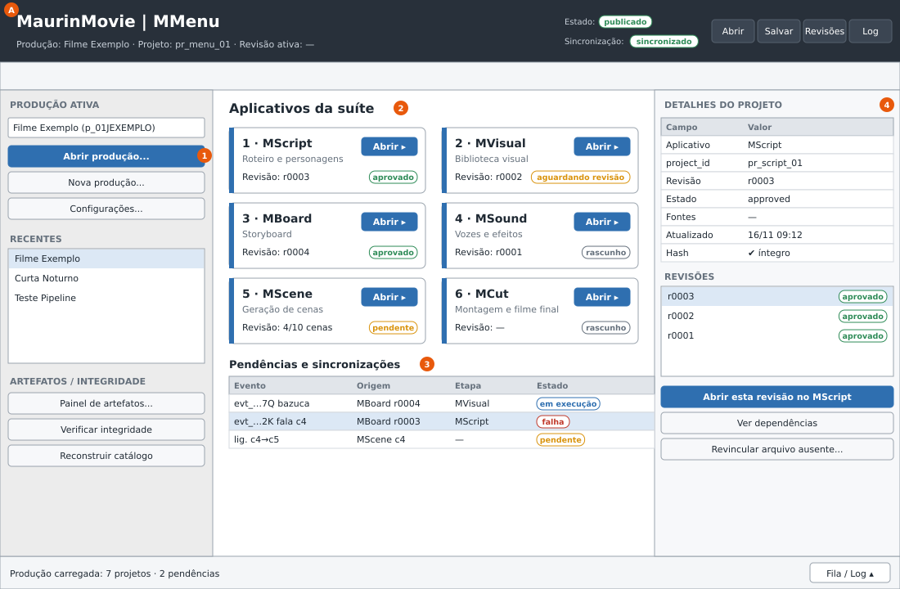
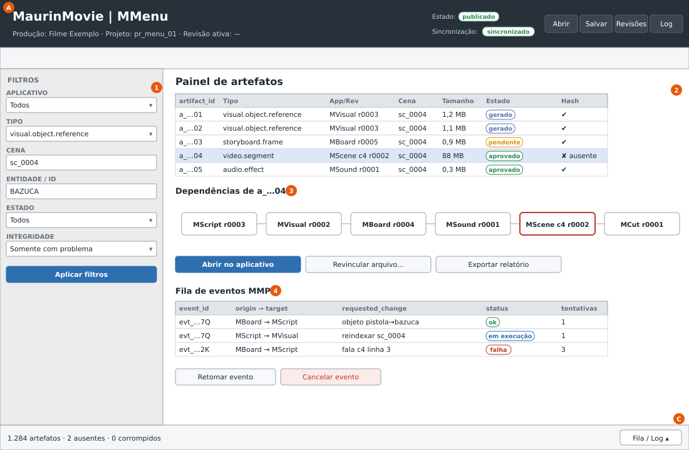
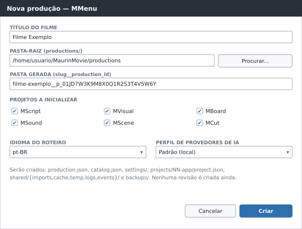
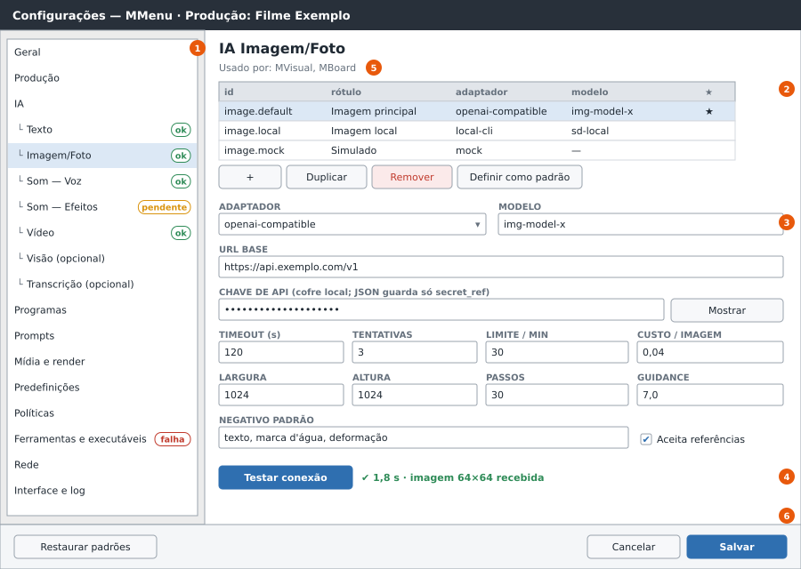

# MMenu — Software 0 · Portal da suíte

> Especificação para implementação. Requisitos-fonte: [00-mmenu](../00-mmenu.md), [11-protocolo](../11-protocolo-projetos-artefatos.md), [12-arquivos-de-projeto](../12-arquivos-de-projeto.md). Regras gerais: [00-comum](00-comum.md).
> Código: `src/mmenu/` (já existe uma primeira versão em `ummenumain.pas`, ver §12).

## 1. Objetivo e limites

O MMenu é a porta de entrada e o **único lugar de configuração da suíte**: cria e abre produções, guarda todos os parâmetros de configuração (IA de texto, imagem/foto, som e vídeo, padrões de cada programa, ferramentas e executáveis), mostra os seis aplicativos e o estado de cada projeto, lança o aplicativo certo **no projeto e na revisão exatos**, e acompanha pendências, eventos e transações de cascata.

O MMenu **não** edita conteúdo editorial, **não** grava `project.json` nem revisões de outros aplicativos, e **não** consolida os dados dos apps num arquivo único. As escritas fora do próprio projeto que ele faz são: criar a estrutura de uma produção nova, atualizar `catalog.json` (índice reconstruível) e gravar a configuração em `settings/` (que só ele grava).

## 2. Usuário e cenários

| # | Cenário |
|---|---|
| C1 | Criar uma produção nova e já abrir o MScript nela |
| C2 | Abrir uma produção existente e ver em que etapa está cada app |
| C3 | Abrir o MVisual numa revisão antiga para consulta (somente leitura) |
| C4 | Ver que uma cascata falhou no MScript, abrir o detalhe e retomar |
| C5 | Encontrar todos os arquivos de uma cena, achar um vídeo ausente e revinculá-lo |
| C6 | Configurar onde estão os executáveis dos apps |
| C7 | Configurar a IA de texto, imagem/foto, som (voz e efeitos) e vídeo, testar a conexão, e ver os outros programas passarem a usá-la |
| C8 | Dentro do MVisual, clicar em "Alterar no MMenu…" e cair direto na aba IA Imagem |

## 3. Requisitos funcionais

| ID | Requisito | Origem |
|---|---|---|
| RF-MM-01 | Exibir os seis apps (MScript, MVisual, MBoard, MSound, MScene, MCut) com grafia exata, número, descrição curta, revisão ativa e selo de estado | docs/00 §1, aceite 1 |
| RF-MM-02 | Abrir produção selecionando `production.json`; validar `schema = mmp.production/1`; recusar arquivo com outro nome ou schema | código atual + docs/11 |
| RF-MM-03 | Criar produção nova (tela §6.3): pasta `<slug>__<production_id>`, `production.json`, `catalog.json`, `settings/`, `projects/NN-app/project.json` de cada app selecionado (sem revisões), `shared/*`, `backups/` | docs/11, docs/12 |
| RF-MM-04 | Lista de produções recentes (máx. 10) persistida em `mmenu.ini`; item inexistente aparece riscado com opção "Localizar…" | docs/00 §2 |
| RF-MM-05 | Para cada app: ler `project.json` e o `manifest.json` da revisão ativa; mostrar revisão, rótulo (`revision_labels`), `state`, `updated_at`, fontes e hash ✔/✘ | docs/00 §2 |
| RF-MM-06 | Abrir app com `--production`, `--project-id`, `--revision` (e `--scene-id` no MScene). Para revisão não ativa, o app abre em somente leitura | docs/00 §3, docs/11 |
| RF-MM-07 | Listar revisões de cada projeto e permitir abrir qualquer uma | docs/00 §8 |
| RF-MM-08 | Painel "Pendências e sincronizações": transações (`shared/transactions`) e eventos (`shared/events`) não concluídos, com etapa onde falharam; ligações de cena pendentes do MScene; cenas sem vídeo; itens `pending_review` por app | docs/00 §4–5 |
| RF-MM-09 | Nunca exibir "concluído" para transação cujo `status` ≠ `complete` | docs/00 aceite 3 |
| RF-MM-10 | Retomar transação: lançar o app de origem com `--headless --resume-transaction`; cancelar transação (com confirmação) marca `cancelled`, sem apagar revisões publicadas | docs/11 §5 |
| RF-MM-11 | Painel de artefatos (tela §6.2): filtrar por app, tipo, cena, entidade/ID, estado, revisão, tamanho, integridade; mostrar cadeia de dependências; abrir no app correto | docs/11 "Administração" |
| RF-MM-12 | Verificar integridade: percorrer todos os manifestos, conferir existência, tamanho e SHA-256; relatório exportável (.md e .json) | docs/11 |
| RF-MM-13 | Revincular: quando um arquivo ou projeto não é encontrado, pedir o novo local, conferir SHA-256 e registrar o mapeamento em `catalog.json` (`relinks[]`); nunca alterar manifesto publicado | docs/00 §6, aceite 4 |
| RF-MM-14 | Reconstruir `catalog.json` a partir dos manifestos | docs/11 |
| RF-MM-15 | Tela **Configurações** (§6.4) centralizando **todos** os parâmetros de configuração da suíte; os outros programas não têm tela de configuração | pedido do usuário 16/11 |
| RF-MM-15a | Abas IA Texto, IA Imagem/Foto, IA Som (Voz e Efeitos), IA Vídeo e as opcionais IA Visão e IA Transcrição: cadastrar um ou mais provedores por tipo (adaptador, endpoint, modelo, chave, parâmetros, limites), escolher o padrão de cada tipo, botão Testar | pedido do usuário 16/11 |
| RF-MM-15b | Aba Programas: para cada app (MScript…MCut), escolher qual provedor de cada tipo ele usa e os padrões de geração (§12.4 de 00-comum) | pedido do usuário 16/11 |
| RF-MM-15c | Aba Produção: idioma, fps, resolução, proporção, áudio, estilo visual, duração-alvo, nome-base | pedido do usuário 16/11 |
| RF-MM-15d | Aba Executáveis e ferramentas: caminhos dos seis apps (botão Detectar, mantendo a descoberta atual `<dir do MMenu>/<app>` e `../bin/<app>`), ffmpeg, ffprobe, mpv, pasta padrão de produções | código atual + 00-comum §12 |
| RF-MM-15e | Chaves de API guardadas no cofre local (`secrets.ini`), nunca em `settings/`; campo de chave mascarado, com "Mostrar" | 00-comum §9.1 |
| RF-MM-15f | Validar antes de salvar (URL válida, modelo preenchido, todo tipo usado por algum app tem provedor habilitado); gravar com escrita atômica e `updated_at`; registrar a alteração no log | 00-comum §12.6 |
| RF-MM-15g | Abrir direto numa aba quando chamado por outro app (`--settings --tab <aba>`) | 00-comum §12.2 |
| RF-MM-15i | Abas Geral, Prompts, Mídia e render, Predefinições, Políticas, Rede, Interface e log cobrindo **todos** os itens do catálogo [08-recursos-e-configuracao](08-recursos-e-configuracao.md); botão Verificar ambiente | pedido do usuário 16/11 |
| RF-MM-15h | Sem produção aberta, a tela edita só o nível máquina (executáveis, ferramentas, chaves); as abas da produção ficam desabilitadas com "Abra uma produção" | [PROPOSTA] |
| RF-MM-16 | Distinguir **versão do executável** (Sobre, `--version` de cada app) de **revisão do projeto** | docs/00 §8 |
| RF-MM-17 | Atualizar a tela automaticamente quando arquivos da produção mudarem (varredura a cada 5 s de `updated_at` de `project.json`, `shared/events`, `shared/transactions`) | [PROPOSTA] |
| RF-MM-18 | Detectar se um app já está aberto na mesma produção (lock `.lock` ativo) e avisar antes de abrir outra instância | [PROPOSTA] |

## 4. Requisitos não funcionais

- Abrir uma produção com 7 projetos e 5.000 artefatos em menos de 2 s (lê só `project.json` e manifestos ativos; verificação completa de hash é sob demanda, em thread).
- Funciona sem rede e sem provedores de IA.
- Nunca bloqueia projetos de outros apps (só lê).

## 5. Linha de comando

`mmenu [--production <pasta>] [--settings [--tab <aba>]] [--log-level …] [--version] [--help]`. Com `--production`, abre a produção diretamente. Com `--settings`, abre direto a tela Configurações (se o MMenu já estiver aberto, a instância existente traz a tela para frente [PROPOSTA]); `<aba>` ∈ `geral`, `producao`, `ia-texto`, `ia-imagem`, `ia-voz`, `ia-efeitos`, `ia-video`, `ia-visao`, `ia-transcricao`, `programas`, `prompts`, `midia`, `predefinicoes`, `politicas`, `ferramentas`, `rede`, `interface`, `mscript`, `mvisual`, `mboard`, `msound`, `mscene`, `mcut` (as seis últimas abrem a aba Programas já no app indicado). O MMenu não tem modo headless de evento; mas aceita `--check-integrity --production <pasta>` [PROPOSTA] para rodar a verificação e sair (código 0 se íntegra, 4 se houver problema), útil em scripts.

## 6. Telas

### 6.1 Principal



| Marca | Elemento | Comportamento |
|---|---|---|
| A | Cabeçalho comum | Projeto = `pr_menu_…` (projeto do próprio MMenu). Botão Salvar publica um instantâneo do estado (§7.2) |
| 1 | Produção ativa + ações | "Abrir produção…" (`TOpenDialog` filtrando `production.json`), "Nova produção…" (§6.3), "Configurações…" (§6.4, toda a configuração da suíte); lista Recentes (duplo clique abre) e botões de integridade |
| 2 | Grade de apps (2 colunas × 3 linhas, cartões `TPanel`) | cada cartão: nº · nome, descrição, revisão ativa (ou "4/10 cenas" no MScene, "—" se não há revisão), selo de estado; botão "Abrir ▸" abre a revisão ativa; clique no cartão seleciona e preenche o painel 4. Cartão desabilitado (cinza) se o executável não for encontrado, com dica "Configure o caminho" |
| 3 | Pendências e sincronizações (`TListView` em modo relatório) | colunas Evento/Transação, Origem (app + revisão), Etapa atual, Estado; duplo clique abre detalhe (painel de artefatos, aba de eventos); menu de contexto: Retomar, Cancelar, Abrir app da etapa |
| 4 | Detalhes do projeto selecionado | tabela de campos, lista de revisões (selo por `state`), botões "Abrir esta revisão no <App>", "Ver dependências", "Revincular arquivo ausente…" |
| C | Rodapé | "Produção carregada: N projetos · M pendências" |

Sem produção carregada: grade visível mas botões "Abrir ▸" lançam o app sem argumentos (comportamento atual), e o painel 3 mostra "Nenhuma produção aberta".

### 6.2 Painel de artefatos e eventos



| Marca | Elemento | Comportamento |
|---|---|---|
| 1 | Filtros | combos preenchidos a partir do `catalog.json`; "Aplicar" filtra; filtro de integridade "Somente com problema" executa a verificação dos itens visíveis |
| 2 | Tabela de artefatos | colunas `artifact_id`, tipo (`kind`), app/revisão, cena, tamanho, estado, hash (✔, ✘ ausente, ✘ divergente). Ordenável por coluna. Paginação de 500 linhas |
| 3 | Dependências | cadeia de projetos/revisões de que o artefato depende (lidas de `sources` dos manifestos), nó com problema destacado; ações Abrir no aplicativo, Revincular, Exportar relatório |
| 4 | Fila de eventos MMP | todos os eventos (inbox + archive) com origem → destino, resumo de `requested_change`, status, tentativas; ações Retomar evento e Cancelar evento |

Abre como janela não modal a partir de "Painel de artefatos…".

### 6.3 Nova produção (diálogo modal)



Campos: Título (obrigatório, 1–120 caracteres), Pasta-raiz (padrão `~/MaurinMovie/productions` ou último usado), pasta gerada (somente leitura: `slug` = título minúsculo sem acentos, espaços → `-`, máx. 40 caracteres, `__` + `production_id`), apps a inicializar (todos marcados), idioma do roteiro, perfil de provedores (Padrão = simulado). "Criar" falha se a pasta já existir. Ao criar, pergunta "Abrir o MScript agora?".

### 6.4 Configurações centralizadas



Janela modal redimensionável (900×640), aberta por "Configurações…", pelo menu Ferramentas de qualquer app ("Configurações (MMenu)…") ou por `--settings`.

| Marca | Elemento | Comportamento |
|---|---|---|
| 1 | Navegação (`TTreeView`) | **Geral** (usuário, verificar ambiente) · **Produção** · **IA**: Texto, Imagem/Foto, Som — Voz, Som — Efeitos, Vídeo, Visão, Transcrição · **Programas** (MScript…MCut) · **Prompts** · **Mídia e render** · **Predefinições** · **Políticas** (aprovação, custos e limites, público e privacidade, armazenamento e backup) · **Ferramentas e executáveis** · **Rede** · **Interface e log**. Item com problema mostra ⚠. Cada aba corresponde a uma seção de [08-recursos-e-configuracao](08-recursos-e-configuracao.md) |
| 2 | Provedores do tipo selecionado (`TListView`) | id, rótulo, adaptador, modelo, ★ padrão, habilitado; botões +, Duplicar, Remover (bloqueado se algum app usa o provedor), Definir como padrão |
| 3 | Formulário do provedor | adaptador (combo), URL base, modelo, chave (mascarada, gravada no cofre local; o JSON guarda só `secret_ref`), timeout, tentativas, limite por minuto, parâmetros do tipo (texto: temperatura, máx. tokens; imagem: resolução, passos, guidance, estilo, negativo; voz: taxa, formato, permitir clonagem; efeitos: taxa, duração máx.; vídeo: resolução, fps, duração máx. de segmento, sincronia labial) |
| 4 | Testar | chamada mínima ao provedor; mostra ✔ com latência ou ✘ com o erro |
| 5 | Uso | lista dos programas que usam este provedor (de `settings/apps.json`) |
| 6 | Rodapé | Restaurar padrões, Cancelar, **Salvar** (valida e grava; os apps abertos recarregam antes da próxima operação) |

Aba **Programas** (mesma janela): para o app escolhido, um combo de provedor por tipo que ele usa (MScript: texto; MVisual: texto e imagem; MBoard: texto e imagem; MSound: texto, voz e efeitos; MScene: vídeo; MCut: texto) e a grade de padrões de geração da seção do app em `settings/apps.json` (chave, valor, descrição), com validação por tipo.

Aba **Geral**: nome do usuário (autor/revisor das aprovações; obrigatório para aprovar), papel, botão **Verificar ambiente** (prontidão por programa, §12 de 08-recursos). Aba **Produção**: campos de `settings/production.json`. Aba **Prompts**: lista de prompts por programa, texto embutido × substituição da produção, validação de marcadores, Restaurar original. Aba **Mídia e render**: perfis de `media-profiles.json` e presets de exportação (um padrão). Aba **Predefinições**: listas editáveis de `presets.json`. Aba **Políticas**: `policies.json` em quatro grupos, com estimativa de custo acumulado da produção. Aba **Ferramentas e executáveis**: seis caminhos dos apps + ffmpeg, ffprobe, mpv, OpenSSL, pastas (produções, cache, banco de efeitos, músicas), cada um com Procurar…, Detectar, versão e indicador ✔/✘. Aba **Rede**: proxy, certificados, modo offline. Aba **Interface e log**: idioma, escala de fonte, tema, nível e retenção de log.

## 7. Dados

### 7.1 Configuração local (`GetAppConfigDir(False)/MaurinMovie/mmenu.ini`)

```ini
[Production]
Root=/home/u/MaurinMovie/productions/filme-exemplo__p_01JD…
[Recent]
0=/…/filme-exemplo__p_01JD…
1=/…/curta-noturno__p_01JC…
[Applications]
MScript=/opt/maurinmovie/bin/mscript
MVisual=
…
[Window]
Left=…
```

Formato atual do código preservado (`[Production] Root`, `[Applications] <App>`); seções `[Recent]` e `[Tools]` (`ffmpeg=`, `ffprobe=`, `mpv=`, `ProductionsDir=`) são novas. As chaves de API ficam em `secrets.ini` na mesma pasta (§12.1 de 00-comum).

A configuração da produção (`settings/production.json`, `settings/ai-providers.json`, `settings/apps.json`) está especificada em [00-comum §12](00-comum.md#12-configuração-centralizada-no-mmenu).

### 7.2 Projeto do MMenu (`projects/00-mmenu/`)

`project.json` padrão (`application: "MMenu"`). Cada revisão publicada (`Salvar`) contém `workspace/registry.json` (`kind: workspace.registry`) e `workspace/sync-status.json` (`kind: sync.status`), um instantâneo de:

```json
{
  "workspace_id": "pr_menu_…",
  "workspace_name": "Filme Exemplo",
  "project_refs": [
    {"software_id": 1, "application": "MScript", "project_id": "pr_script_…", "revision_id": "r0003",
     "uri": "projects/01-mscript/project.json", "checksum": "sha256…", "status": "approved"}
  ],
  "sync_jobs": [
    {"event_id": "evt_…", "transaction_id": "tx_…", "source_revision": "MBoard r0004",
     "affected_projects": ["pr_script_…", "pr_visual_…"], "stage": "MVisual", "status": "failed",
     "error": "…"}
  ],
  "missing_links": [{"artifact_id": "a_…", "expected_uri": "…", "detected_at": "…"}]
}
```

Serve de registro histórico ("como estava a produção no dia X"). O registro de executáveis é local da máquina e fica no `.ini`, não na produção.

### 7.3 `catalog.json`

```json
{
  "schema": "mmp.catalog/1",
  "production_id": "p_…",
  "generated_at": "…",
  "projects": [{"application": "MScript", "project_id": "…", "active_revision": "r0003", "revisions": ["r0001","r0002","r0003"]}],
  "artifacts": [{"artifact_id": "a_…", "application": "MVisual", "project_id": "…", "revision_id": "r0003",
                 "kind": "visual.object.reference", "scene_id": "sc_…", "entity_id": "ob_…",
                 "uri": "…", "sha256": "…", "bytes": 0, "status": "generated"}],
  "relinks": [{"artifact_id": "a_…", "old_uri": "…", "new_uri": "…", "sha256_verified": true, "at": "…"}]
}
```

## 8. Fluxos

### 8.1 Abrir app numa revisão

```mermaid
flowchart TD
  A[Usuário clica Abrir ▸ ou 'Abrir esta revisão'] --> B[Resolver executável: ini → ao lado do MMenu → ../bin]
  B -- não achou --> E[Diálogo: configurar caminho]
  B --> C{Lock ativo do app nesta produção?}
  C -- sim --> D[Aviso: já aberto por PID x. Abrir somente leitura?]
  C -- não --> F[TProcess: exe --production P --project-id ID --revision R]
  D --> F
  F --> G[Status: 'MScript iniciado (r0003)']
  F -- exceção --> H[MessageDlg erro, log]
```

### 8.2 Monitoramento

Timer de 5 s: relê `updated_at` dos `project.json`, lista `shared/events/inbox/*` e `shared/transactions/*`; atualiza cartões e painel de pendências sem perder a seleção.

### 8.3 Revinculação

1. Usuário escolhe o arquivo novo. 2. MMenu calcula SHA-256. 3. Se igual ao do manifesto: grava em `catalog.json.relinks` e informa "Revinculado". 4. Se diferente: avisa "Arquivo diferente do registrado (hash)"; não revincula.

Os apps, ao não encontrar um `uri`, consultam `catalog.json.relinks` antes de declarar ausência.

## 9. Mensagens

| Situação | Mensagem |
|---|---|
| Arquivo não é `production.json` | "Selecione o arquivo production.json da produção." (já existe) |
| Schema desconhecido | "Esta produção usa o protocolo <schema>, que esta versão do MMenu não reconhece." |
| Executável ausente | "Executável de <App> não encontrado. Configure o caminho em Configurações." (já existe) |
| Transação com falha | "A sincronização tx_… parou em <App>: <erro>. Nada foi marcado como concluído." |

## 10. Critérios de aceite (testáveis)

1. Grade mostra exatamente MScript, MVisual, MBoard, MSound, MScene, MCut, nessa ordem.
2. Com uma produção de fixture, "Abrir esta revisão" em r0002 lança o processo com `--production <pasta> --project-id <id> --revision r0002` (verificável com um executável falso que grava os argumentos).
3. Uma transação com estágio `failed` aparece com a etapa e o erro, e o MMenu nunca mostra `complete` para ela.
4. Mover um vídeo de lugar → verificação acusa "ausente"; revincular com o arquivo certo resolve; com arquivo errado é recusado.
5. Depois de usar o MMenu, nenhum `project.json`/manifesto de outro app teve `mtime` alterado.
6. Nova produção cria a árvore completa e `production.json` válido (com `settings/` preenchido com os provedores simulados); criar de novo na mesma pasta falha.
7. Trocar o modelo da IA de imagem no MMenu e salvar: a próxima geração do MVisual registra o novo `model` e `settings_sha256` em `GenerationMeta`, sem reiniciar o MVisual.
8. Nenhum arquivo em `settings/` contém chave de API; `mmenu --settings --tab ia-video` abre direto na aba IA Vídeo.
9. Nenhum outro programa grava em `settings/` (teste: `mtime` inalterado após usar cada app).

## 11. Estrutura de código sugerida

- `ummenumain.pas` — formulário (já existe; migrar a montagem em código para `.lfm` é opcional).
- `ummenuproduction.pas` — leitura de produção, cartões, pendências (sem LCL).
- `ummenulauncher.pas` — resolução de executável e `TProcess` (extrair de `OpenApp`/`FindExecutable` atuais).
- `ummenuartifacts.pas` + `.lfm` — janela do painel de artefatos.
- `ummenunewprod.pas` + `.lfm` — diálogo de nova produção.
- `ummenusettings.pas` + `.lfm` — tela Configurações (§6.4), substitui o diálogo sequencial atual; usa `mmpsettings` para ler e uma unidade `ummenusettingswriter.pas` para validar e gravar.
- `ummenusecrets.pas` — cofre local de chaves.

## 12. Situação do código atual e diferenças

O `ummenumain.pas` atual já faz: janela com cabeçalho/painel/6 botões/status, escolha de `production.json`, `mmenu.ini`, descoberta de executáveis, lançamento com `--production`. Falta: `--project-id`/`--revision`, leitura de projetos e revisões, pendências, criação de produção, painel de artefatos, integridade, revinculação. O array local `AppNames` deve passar a usar `MMAppNames` de `mmpcommon`.
