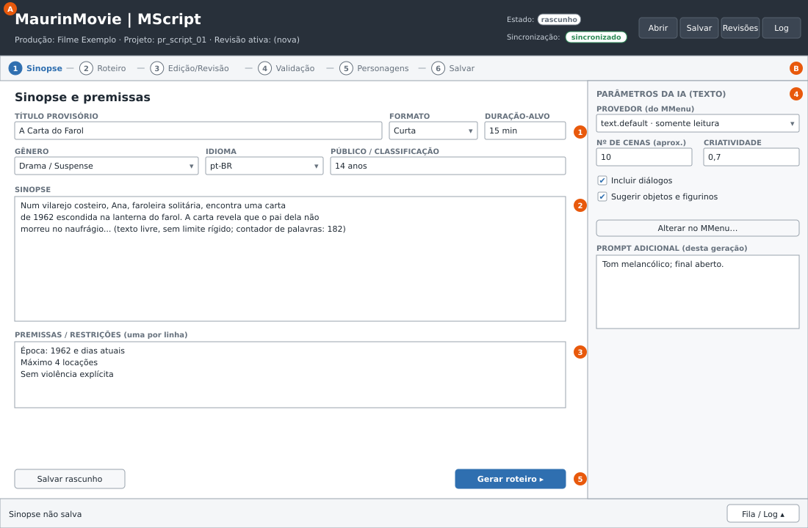
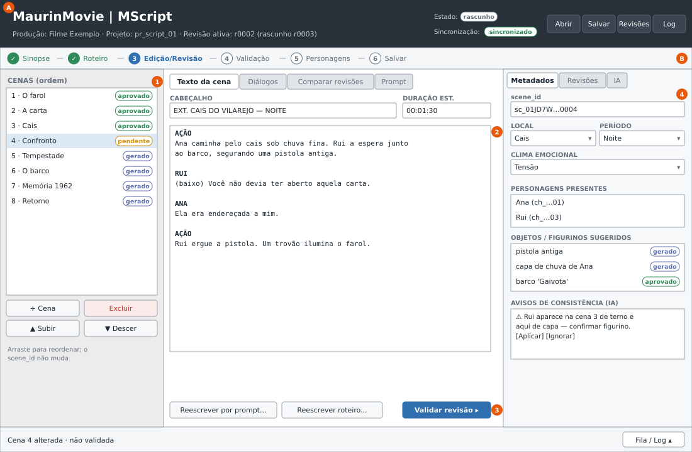
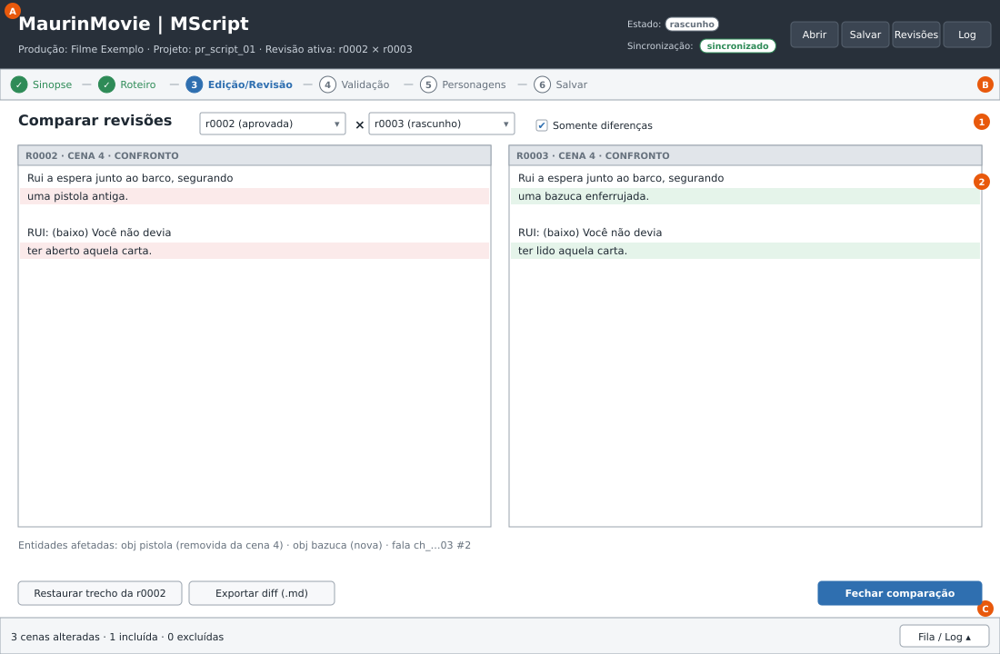
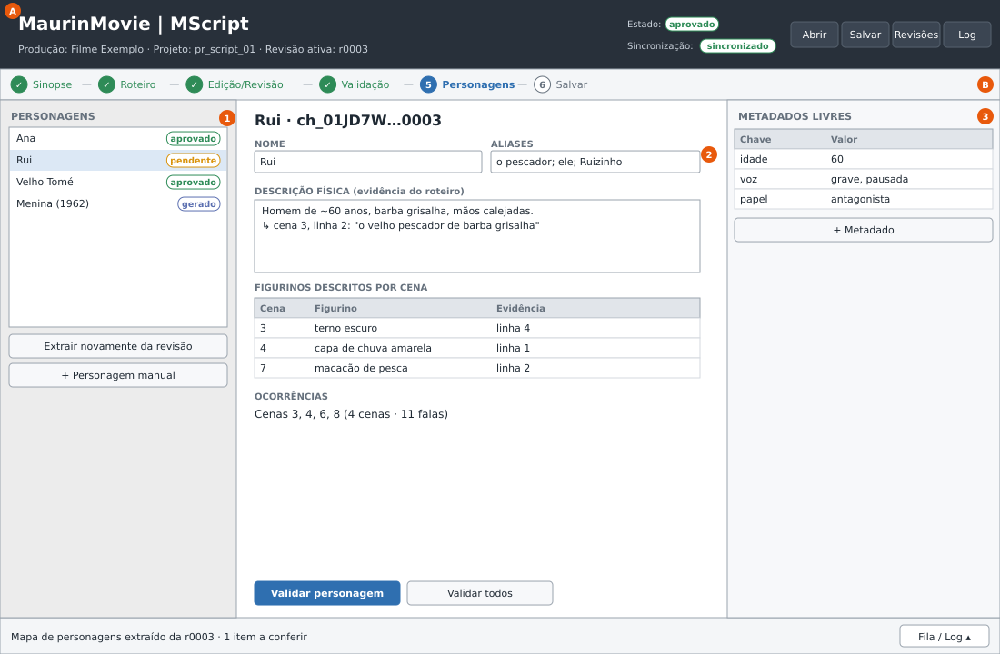
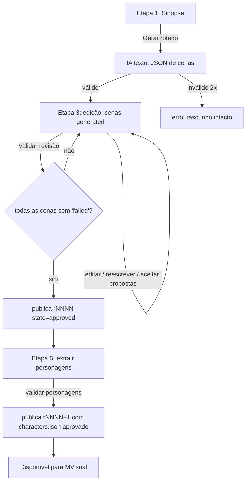

# MScript — Software 1 · Sinopse, roteiro e personagens

> Requisitos-fonte: [01-roteiro](../01-roteiro.md), [03-modelo-de-dados](../03-modelo-de-dados.md) (Projeto 1), [04-validacao](../04-validacao-e-revisoes.md) (Software 1). Regras gerais: [00-comum](00-comum.md). Código: `src/mscript/`.

## 1. Objetivo e limites

Transformar uma sinopse em roteiro dividido em cenas com IDs estáveis, permitir edição manual e por prompt, validar revisões explicitamente e extrair o mapa de personagens/figurinos que alimenta o MVisual. O roteiro aprovado é a **fonte editorial de verdade** da produção.

Fora do escopo: imagens, som, vídeo. Aplicar mudanças vindas do MBoard **sem abrir a janela** (modo headless, §8.4) faz parte do escopo.

## 2. Etapas (barra de etapas)

| # | Etapa | Pré-requisito para entrar |
|---|---|---|
| 1 | Sinopse | — |
| 2 | Roteiro (geração) | sinopse com ≥ 20 palavras e título |
| 3 | Edição/Revisão | roteiro gerado ou ≥ 1 cena manual |
| 4 | Validação | nenhuma cena em `failed` |
| 5 | Personagens | revisão validada (`approved`) |
| 6 | Salvar/Publicar | sempre (publica o que houver; estado conforme aprovações) |

## 3. Requisitos funcionais

| ID | Requisito | Origem |
|---|---|---|
| RF-MS-01 | Editar sinopse, título provisório, formato (curta/média/longa), gênero(s), duração-alvo opcional, idioma, classificação e premissas (lista) | docs/01 fluxo 1 |
| RF-MS-02 | Gerar roteiro por IA a partir da sinopse, com parâmetros: nº aproximado de cenas, incluir diálogos, sugerir objetos/figurinos, criatividade, prompt adicional | docs/01 fluxo 2 |
| RF-MS-03 | Cada cena gerada tem: `scene_id` permanente, ordem, título, cabeçalho (INT/EXT, local, período), ação, personagens presentes, diálogos, duração estimada, clima emocional, objetos e figurinos sugeridos | docs/01 fluxo 2 |
| RF-MS-04 | Gerar com resposta em JSON validado por schema (§7.3); resposta inválida → 1 nova tentativa com mensagem de correção; persistindo → erro mostrado, nada substituído | [PROPOSTA] |
| RF-MS-05 | Edição manual de qualquer campo da cena; incluir, excluir (vira `archived` se já publicada antes), reordenar por arrastar ou botões; reordenar **não muda** `scene_id` | docs/01 regras |
| RF-MS-06 | Reescrever por prompt: (a) a cena selecionada, (b) um trecho selecionado, (c) o roteiro inteiro. O resultado aparece como proposta lado a lado (aceitar/descartar por cena) | docs/01 fluxo 3 |
| RF-MS-07 | Comparar duas revisões quaisquer (ou revisão × rascunho) cena a cena, destacando inclusões, exclusões e alterações de texto e entidades; restaurar trecho da revisão antiga para o rascunho | docs/01 fluxo 3 |
| RF-MS-08 | Avisos de consistência gerados por IA (figurino trocado, personagem que some, local inconsistente), cada um com "Aplicar sugestão" (cria alteração no rascunho, ainda não aprovada) e "Ignorar" | docs/01 regras |
| RF-MS-09 | Validar revisão: ação explícita "Validar revisão", com resumo das mudanças e campo de comentário; publica revisão com `state: approved` | docs/01 fluxo 4 |
| RF-MS-10 | Voltar ao rascunho a partir de qualquer revisão ("Criar rascunho a partir desta revisão"); revisões anteriores sempre acessíveis em somente leitura | docs/01 fluxo 4 |
| RF-MS-11 | Após validação, extrair mapa de personagens: nome, aliases, descrição física, figurinos por cena, metadados livres, ocorrências, sempre com evidência (cena + trecho) | docs/01 fluxo 5 |
| RF-MS-12 | Conferir e validar cada personagem (ou todos); personagens adicionados manualmente marcados como tal | docs/01 fluxo 5 |
| RF-MS-13 | Mapa de personagens validado é publicado como parte de nova revisão (o roteiro não muda; a revisão inclui `characters.json` aprovado) | docs/01 fluxo 6 |
| RF-MS-14 | Exportar roteiro em Markdown (`scripts/roteiro.md`, gerado a cada publicação) e importar roteiro de JSON MMP | docs/01 saídas, docs/11 |
| RF-MS-15 | Aplicar evento `script.patch` (vindo do MBoard ou de outro app) em modo headless, criando nova revisão só com as cenas afetadas, preservando IDs (§8.4) | docs/01 integração |
| RF-MS-16 | Guardar autoria e histórico: cada alteração registra autor (`user:`/`ai:`/`cascade:`), data, prompt (se IA) e resumo | docs/01 regras |
| RF-MS-17 | Somar durações estimadas e comparar com a duração-alvo (aviso se diferença > 15%) | [PROPOSTA] |
| RF-MS-18 | Provedores e parâmetros padrão vêm da configuração centralizada do MMenu (`settings/ai-providers.json`, seção `MScript` de `settings/apps.json`, `settings/production.json`), lidos via `mmpsettings` e recarregados antes de cada operação; o app não tem tela de configuração e nunca grava em `settings/`. O painel de parâmetros mostra esses valores em somente leitura com "Alterar no MMenu…" (`mmenu --settings --tab mscript`); só o pedido da vez (prompt adicional, semente de uma regeneração) é ajustável no app | pedido do usuário 16/11; 00-comum §12 |

## 4. Telas

### 4.1 Sinopse (etapa 1)



| Marca | Elemento |
|---|---|
| 1 | Metadados do filme: título (`TEdit`), formato (`TComboBox`: Curta, Média, Longa), duração-alvo (`TEdit` com máscara `HH:MM` ou minutos), gênero, idioma, classificação |
| 2 | Sinopse (`TMemo`, quebra automática, contador de palavras no rodapé) |
| 3 | Premissas/restrições (`TMemo`, uma por linha) |
| 4 | Parâmetros de IA de texto **vindos do MMenu** (somente leitura): provedor, nº de cenas, criatividade, diálogos, sugerir objetos/figurinos, com "Alterar no MMenu…". Editável aqui só o **prompt adicional** desta geração |
| 5 | "Salvar rascunho" e "Gerar roteiro ▸". Se já houver roteiro no rascunho, "Gerar" pergunta: Substituir tudo / Gerar como proposta para comparar / Cancelar |

Sem painel esquerdo nesta etapa.

### 4.2 Roteiro e edição (etapas 2–4)



| Marca | Elemento |
|---|---|
| 1 | Lista de cenas (`TListView` ou `TTreeView`): "ordem · título" + selo de estado; arrastar para reordenar; botões + Cena, Excluir, ▲, ▼ |
| 2 | Abas centrais: **Texto da cena** (cabeçalho, duração, corpo em editor monoespaçado no formato de roteiro: blocos AÇÃO / NOME + fala / parêntese de direção); **Diálogos** (grade: personagem, fala, parêntese, ordem); **Comparar revisões** (§4.3); **Prompt** (histórico de prompts aplicados a esta cena) |
| 3 | Ações: "Reescrever por prompt…" (cena ou seleção), "Reescrever roteiro…", "Validar revisão ▸" |
| 4 | Painel direito: `scene_id` (somente leitura, botão copiar), local (combo com locais já usados ou novo), período (Dia, Noite, Amanhecer, Entardecer, Contínuo), clima emocional, personagens presentes (lista com +/−), objetos e figurinos sugeridos (com selo), avisos de consistência |

Editor do corpo da cena [PROPOSTA]: `TSynEdit` com realce simples (linhas em CAIXA ALTA = nome de personagem; linhas entre parênteses = direção). Ao salvar, o texto é convertido para a estrutura de §7.2 (`action_blocks[]` e `dialogue[]`). Linhas de diálogo preservam `line_id` quando o texto muda pouco (similaridade ≥ 60%) para manter vínculos de MSound/MBoard.

### 4.3 Comparar revisões



Duas colunas sincronizadas (rolagem conjunta), seletor de revisões, "Somente diferenças". Linhas removidas em vermelho claro à esquerda, incluídas/alteradas em verde claro à direita. Rodapé lista entidades afetadas (cenas, personagens, objetos). Ações: restaurar trecho, exportar diff `.md`.

### 4.4 Personagens (etapa 5)



| Marca | Elemento |
|---|---|
| 1 | Lista de personagens com selo; "Extrair novamente da revisão" (reexecuta IA; mantém `character_id` por correspondência de nome/alias; itens aprovados não são sobrescritos, divergências viram aviso); "+ Personagem manual" |
| 2 | Ficha: nome, aliases (separados por `;`), descrição física **com evidência** (clicar na evidência abre a cena no trecho), figurinos por cena (cena, descrição, evidência), ocorrências (cenas e nº de falas) |
| 3 | Metadados livres chave/valor (idade, voz, papel…) |

"Validar personagem"/"Validar todos" mudam o estado para `approved` (somente por clique).

## 5. Linha de comando

Comuns de [00-comum §4](00-comum.md#4-linha-de-comando-protocolo-mmp-v1). Específico: `--focus sc_…` abre na cena; `--headless --event <arquivo>` aplica `script.patch`.

## 6. Fluxo principal



Gerar nunca aprova. "Validar revisão" aprova todas as cenas do rascunho de uma vez (é a decisão editorial do usuário sobre a revisão inteira) e registra uma `Approval` por cena com o mesmo comentário.

## 7. Dados

### 7.1 Arquivos de uma revisão (`projects/01-mscript/revisions/rNNNN/`)

| Arquivo | kind | Conteúdo |
|---|---|---|
| `manifest.json` | — | comum |
| `scripts/roteiro.json` | `script.scene` (um artefato por arquivo; cenas dentro) | filme + cenas + diálogos |
| `scripts/characters.json` | `script.character` | mapa de personagens (presente a partir da etapa 5) |
| `scripts/roteiro.md` | `script.export` | exportação legível (derivada, não é fonte) |
| `history/changes.json` | — | `HistoryEntry[]` desde a revisão-mãe |

### 7.2 `roteiro.json`

```json
{
  "schema": "mmp.mscript.script/1",
  "project_id": "pr_script_…",
  "revision_id": "r0003",
  "parent_revision_id": "r0002",
  "film": {
    "title": "A Carta do Farol", "format": "short", "genres": ["drama", "suspense"],
    "target_duration_ms": 900000, "language": "pt-BR", "rating": "14",
    "synopsis": "…", "premises": ["Época: 1962 e dias atuais"]
  },
  "locations": [{"location_ref": "lo_…cais", "name": "Cais do vilarejo"}],
  "scenes": [
    {
      "scene_id": "sc_01JD…0004",
      "sequence": 4,
      "title": "Confronto",
      "heading": {"int_ext": "EXT", "location_ref": "lo_…cais", "time_of_day": "night"},
      "action_blocks": [
        {"block_id": "ab_…1", "text": "Ana caminha pelo cais sob chuva fina. Rui a espera junto ao barco, segurando uma pistola antiga."}
      ],
      "dialogue": [
        {"line_id": "dl_…1", "order": 1, "character_id": "ch_…03", "parenthetical": "baixo",
         "text": "Você não devia ter aberto aquela carta."},
        {"line_id": "dl_…2", "order": 2, "character_id": "ch_…01", "text": "Ela era endereçada a mim."}
      ],
      "characters_present": ["ch_…01", "ch_…03"],
      "mentions": [{"name": "pistola antiga", "kind": "object", "evidence": {"block_id": "ab_…1", "start": 74, "end": 88}}],
      "estimated_duration_ms": 90000,
      "mood": "tensão",
      "status": "approved",
      "notes": ""
    }
  ]
}
```

Os blocos de ação e diálogos se intercalam pela ordem: `action_blocks[].order` e `dialogue[].order` compartilham a mesma sequência [PROPOSTA] (campo `order` em ambos).

### 7.3 Contrato com a IA de texto (geração)

Saída exigida (validada antes de aceitar): `{"scenes":[{"title","int_ext","location","time_of_day","action","dialogue":[{"character","parenthetical?","text"}],"characters":[…],"objects":[…],"costumes":[{"character","description"}],"estimated_duration_seconds","mood"}]}`. O MScript atribui todos os IDs; a IA nunca inventa IDs.

### 7.4 `characters.json`

```json
{
  "schema": "mmp.mscript.characters/1",
  "characters": [
    {"character_id": "ch_…03", "name": "Rui", "aliases": ["o pescador", "Ruizinho"],
     "description": "Homem de ~60 anos, barba grisalha, mãos calejadas.",
     "description_evidence": [{"scene_id": "sc_…3", "field": "action", "start": 10, "end": 45, "quote": "o velho pescador de barba grisalha"}],
     "wardrobe_descriptions": [{"scene_id": "sc_…3", "description": "terno escuro", "evidence": {…}}],
     "metadata": {"idade": "60", "papel": "antagonista"},
     "origin": "ai", "status": "approved"}
  ]
}
```

## 8. Regras de negócio detalhadas

### 8.1 Preservação de `scene_id` ao reescrever

Ao aceitar um roteiro reescrito inteiro, cada cena nova é casada com uma cena antiga se (a) a IA devolveu o mesmo índice e o título/local coincide, ou (b) similaridade de texto ≥ 0,5 (Jaccard de palavras). Casada → mantém `scene_id`; sem par → novo ID; antiga sem par → `archived`. A tela de proposta mostra os pares e permite corrigir manualmente antes de aceitar.

### 8.2 Validação

Revisão só é `approved` por "Validar revisão". Publicar sem validar gera `state: published` (útil para salvar marcos). O MVisual só importa revisões `approved` (docs/04 MVisual etapa 1, aceite 1).

### 8.3 Exclusão

Cena excluída do rascunho: se nunca publicada, removida; se publicada antes, mantida com `status: archived` e fora da numeração (`sequence: null`).

### 8.4 Aplicação de `script.patch` (headless)

Operações aceitas em `requested_change.operations`:

| op | Campos | Efeito |
|---|---|---|
| `replace_text` | `scene_id`, `field` (`action`\|`dialogue`\|`title`\|`heading`), `line_id?`, `from`, `to` | substitui a ocorrência exata; `from` não encontrado → falha código 7 |
| `set_dialogue` | `scene_id`, `line_id`, `text`, `parenthetical?` | altera fala existente |
| `add_dialogue` / `remove_dialogue` | `scene_id`, `after_line_id?`/`line_id`, … | inclui/remove fala |
| `replace_entity` | `scene_id`, `from_id`/`from_name`, `to_name`, `to_kind` | troca menção de objeto/figurino/local |
| `set_duration` | `scene_id`, `estimated_duration_ms` | altera duração |
| `set_scene_field` | `scene_id`, `field` (`mood`, `time_of_day`, `location_ref`), `value` | altera metadado |

Algoritmo: carregar `source_revision` (deve ser a ativa; se não for, falha código 7 "fonte desatualizada"); verificar idempotência; aplicar operações numa cópia; atualizar `mentions` e `characters_present` das cenas tocadas; publicar nova revisão com `state: approved` (a aprovação veio do MBoard: registrar `Approval.reviewer = event.approved_by`, `comment = "cascata evt_…"`), `change_event_id = event_id`; **não** emitir evento de volta para o MBoard. Se existir rascunho aberto em `work/`, o patch é aplicado na revisão ativa e o rascunho recebe aviso "a base mudou para rNNNN; mesclar?".

## 9. Integração

| Direção | Com | O quê |
|---|---|---|
| Fornece | MVisual, MBoard, MSound, MScene, MCut | revisão `approved` de `roteiro.json` + `characters.json` |
| Recebe | MBoard (e futuramente MSound/MScene/MCut) | eventos `script.patch` |
| Abre | — | não abre outros apps (é a primeira fonte) |

## 10. Mensagens principais

- "Esta revisão ainda não foi validada; o MVisual não poderá importá-la."
- "A IA devolveu um roteiro em formato inválido. Nada foi alterado. Tente de novo ou ajuste o prompt."
- "A cena 4 foi alterada pela sincronização tx_… (MBoard). Nova revisão r0004."

## 11. Critérios de aceite

1. Sinopse → roteiro com N cenas, cada uma com `scene_id` único e todos os campos de RF-MS-03 (provedor simulado).
2. Reordenar cenas e publicar: `scene_id` inalterados; `sequence` atualizado.
3. Reescrita por prompt não apaga a revisão anterior; comparar mostra as diferenças.
4. Revisão só fica `approved` após "Validar revisão"; gerar nunca aprova.
5. Personagens extraídos têm evidência que aponta para texto existente na cena.
6. Fechar e reabrir restaura rascunho, revisões e personagens.
7. `script.patch` "pistola antiga → bazuca enferrujada" cria r+1, altera só a cena 4, mantém todos os IDs e é idempotente (reaplicar não cria r+2).

## 12. Estrutura de código sugerida

`umscriptmain` (form), `umscriptframesynopsis`, `umscriptframeeditor`, `umscriptframecompare`, `umscriptframecharacters`, `umscriptmodel` (TMSScript, TMSScene, TMSDialogueLine, TMSCharacter), `umscriptservice` (gerar, reescrever, validar, extrair, publicar), `umscriptpatch` (aplicação de eventos), `umscriptdiff` (comparação), `prompts/gerar_roteiro.txt`, `prompts/reescrever_cena.txt`, `prompts/extrair_personagens.txt`, `prompts/consistencia.txt`.
