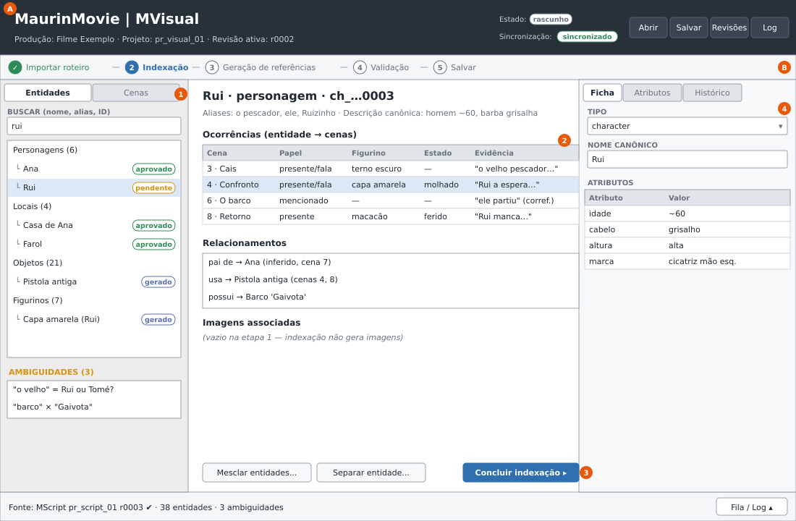
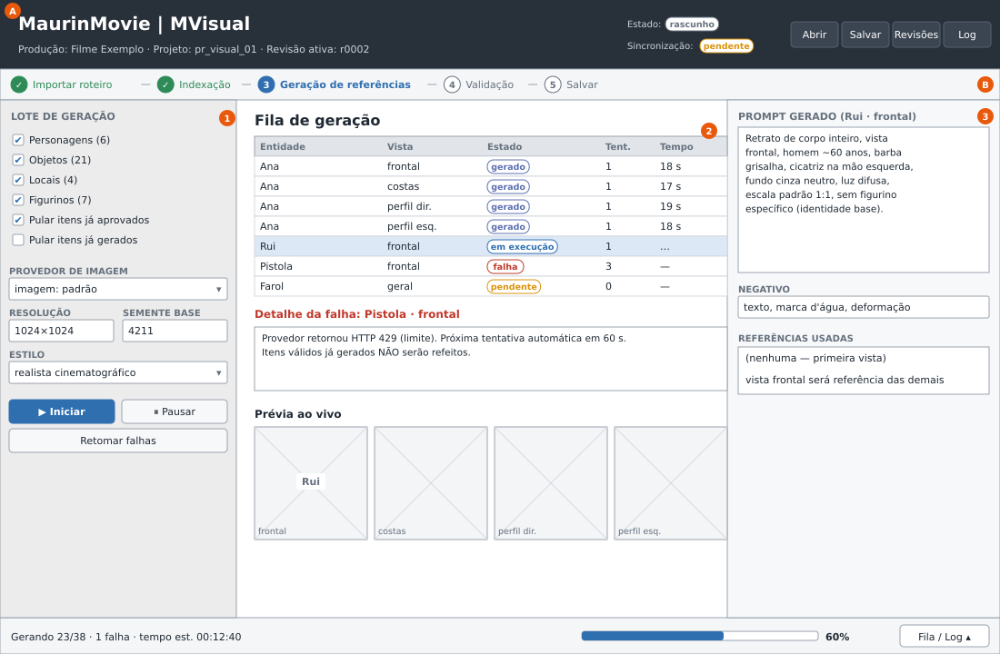
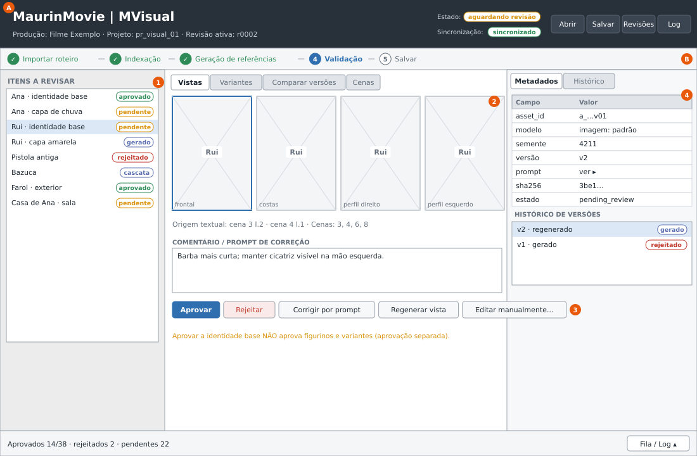
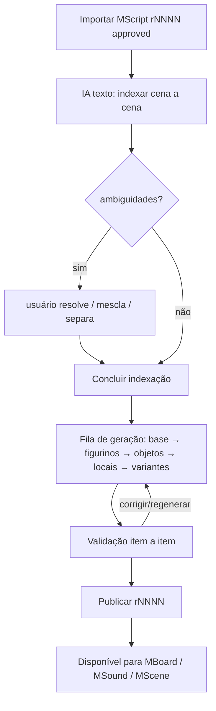

# MVisual — Software 2 · Indexação, referências visuais e continuidade

> Requisitos-fonte: [02-biblioteca-visual](../02-biblioteca-visual.md), [03-modelo-de-dados](../03-modelo-de-dados.md) (Projeto 2), [04-validacao](../04-validacao-e-revisoes.md) (Software 2, etapas 1–3). Regras gerais: [00-comum](00-comum.md). Código: `src/mvisual/`.

## 1. Objetivo e limites

A partir de uma revisão **aprovada** do MScript, identificar e indexar personagens, locais, objetos e figurinos (sem imagens), depois gerar referências visuais padronizadas para cada entidade, e por fim validar item a item. Mantém a biblioteca visual consistente entre cenas e responde a eventos de cascata automaticamente.

Fora do escopo: vídeo, animação, modelagem 3D, áudio. Nunca altera o roteiro.

## 2. Etapas

| # | Etapa | Pré-requisito |
|---|---|---|
| 1 | Importar roteiro | revisão `approved` do MScript disponível |
| 2 | Indexação (sem imagens) | importação íntegra |
| 3 | Geração de referências | indexação concluída (nenhuma ambiguidade em aberto bloqueante, §8.2) |
| 4 | Validação | ≥ 1 ativo gerado |
| 5 | Salvar/Publicar | sempre |

## 3. Requisitos funcionais

| ID | Requisito | Origem |
|---|---|---|
| RF-MV-01 | Importar projeto/revisão do MScript, registrar `SourceRef` com `manifest_sha256`; recusar revisão não `approved`; nunca modificar a origem | docs/02 et.1, aceite 1 |
| RF-MV-02 | Indexar por IA cada cena: personagens, locais, objetos relevantes, figurinos, menções indiretas e correferências (João / o protagonista / ele), sempre com evidência | docs/02 et.1 |
| RF-MV-03 | Cada entidade: `entity_id` permanente, tipo (`character`, `location`, `object`, `costume`), nome canônico, aliases, descrição canônica, atributos, evidências, relacionamentos | docs/02 et.1, docs/03 |
| RF-MV-04 | Personagens reutilizam o `character_id` do MScript (não criar novo ID) | docs/03 regras |
| RF-MV-05 | Índice bidirecional: entidade → cenas e cena → entidades, com papel, estado, figurino e contexto por ocorrência | docs/02 et.1 |
| RF-MV-06 | Listar ambiguidades, duplicidades e divergências; nunca fundir entidades incertas automaticamente; ações Mesclar e Separar manuais | docs/02 et.1 |
| RF-MV-07 | Consulta por nome/alias, ID, cena, categoria e atributo; antes da geração mostra fichas e ocorrências; depois também imagens | docs/02 et.1, consultas |
| RF-MV-08 | Indexação **não** gera imagens | docs/04 et.1 aceite 5 |
| RF-MV-09 | Gerar referências em lote, com fila, progresso, pausa, falha individual e retomada sem refazer itens válidos | docs/02 et.2 |
| RF-MV-10 | Personagem: identidade base sem figurino específico, 4 vistas (frontal, costas, perfil direito, perfil esquerdo) com enquadramento, escala e fundo padronizados | docs/02 et.2 |
| RF-MV-11 | Figurino: entidade separada, derivada das descrições do MScript, vinculada a personagem e cenas; gera as mesmas 4 vistas usando a identidade base aprovada como referência | docs/02 et.2 |
| RF-MV-12 | Objeto: vistas frontal, traseira, direita, esquerda; opcional superior/inferior; estados (aberto, fechado, danificado…) quando o roteiro indicar | docs/02 et.2 |
| RF-MV-13 | Local/cenário: vista geral + ângulos documentados (§8.3) e relações espaciais quando houver | docs/02 et.2 |
| RF-MV-14 | Variantes controladas (pose, expressão, iluminação, estado, ângulo) vinculadas à base, sem redefinir identidade | docs/02 et.2 |
| RF-MV-15 | Registrar para cada imagem: prompt, negativo, modelo, parâmetros, semente, referências usadas, versão, vínculo com entidade | docs/02 et.2 |
| RF-MV-16 | Revisão item a item: ver vistas, variantes, origem textual, cenas, histórico; Aprovar, Rejeitar, Editar manualmente (importar imagem editada externamente), Corrigir por prompt, Regenerar vista, Comparar versões | docs/02 et.3 |
| RF-MV-17 | Aprovação da identidade base separada da aprovação de figurinos e variantes; nova versão nunca sobrescreve ativo aprovado | docs/02 et.3 |
| RF-MV-18 | Ao receber nova revisão do MScript (manual ou por evento): comparar, classificar inclusões/exclusões/alterações, propor revisão incremental; em modo manual, o usuário confirma a proposta; em evento de cascata, aplicar automaticamente (§8.5) | docs/02 revisões e cascata |
| RF-MV-19 | Cascata: reindexar só cenas afetadas, gerar novas entidades/vistas (ex.: bazuca), regenerar variantes de interação dependentes, reutilizar ativos aprovados não afetados; itens novos `generated_by_cascade` → `pending_review` | docs/02 cascata |
| RF-MV-20 | Entidades removidas do roteiro ficam `archived`, nunca apagadas | docs/03 integridade |
| RF-MV-21 | Respostas às consultas exemplo: "Ator X", "Casa do protagonista", "Cena 10" (tela de busca com resultado agrupado) | docs/02 consultas |
| RF-MV-22 | Provedores e parâmetros padrão vêm da configuração centralizada do MMenu (`settings/ai-providers.json`, seção `MVisual` de `settings/apps.json`, `settings/production.json`), lidos via `mmpsettings` e recarregados antes de cada operação; o app não tem tela de configuração e nunca grava em `settings/`. O painel de parâmetros mostra esses valores em somente leitura com "Alterar no MMenu…" (`mmenu --settings --tab mvisual`); só o pedido da vez (prompt adicional, semente de uma regeneração) é ajustável no app | pedido do usuário 16/11; 00-comum §12 |

## 4. Telas

### 4.1 Indexação (etapa 2)



| Marca | Elemento |
|---|---|
| 1 | Abas **Entidades** (árvore agrupada por tipo, com contagem e selo) e **Cenas** (árvore cena → entidades). Campo de busca (nome, alias, ID, atributo `chave:valor`). Lista de ambiguidades (duplo clique abre diálogo de resolução: "São a mesma entidade" / "São diferentes" / "Atribuir a…") |
| 2 | Ocorrências da entidade: cena, papel (`present_speaking`, `present`, `mentioned`), figurino, estado, evidência (clicar mostra o trecho do roteiro num popup somente leitura) |
| 3 | Relacionamentos (`pai de`, `usa`, `possui`, `está em`…) e área de imagens (vazia nesta etapa). Botões Mesclar entidades…, Separar entidade…, Concluir indexação ▸ |
| 4 | Ficha editável: tipo, nome canônico, aliases, descrição canônica, atributos chave/valor, histórico |

### 4.2 Geração de referências (etapa 3)



| Marca | Elemento |
|---|---|
| 1 | Lote: tipos a incluir e pular já gerados (escolhas desta execução); provedor de imagem, resolução, semente base, estilo e "pular aprovados" exibidos em somente leitura a partir da configuração do MMenu, com "Alterar no MMenu…"; Iniciar, Pausar, Retomar falhas |
| 2 | Fila (`TListView`): entidade, vista, estado, tentativas, tempo; detalhe da falha selecionada; prévia ao vivo das 4 vistas da entidade em geração |
| 3 | Prompt gerado da vista selecionada (editável antes de gerar quando a fila está pausada), negativo, referências usadas |

Ordem de geração: identidades base de personagens → figurinos → objetos → locais → variantes. Para cada entidade, a vista frontal é gerada primeiro e usada como referência das demais [PROPOSTA].

### 4.3 Validação (etapa 4)



| Marca | Elemento |
|---|---|
| 1 | Lista de itens a revisar (identidades base, figurinos, objetos, locais, variantes), filtro por estado; itens `cascata` destacados |
| 2 | Abas Vistas (4 imagens lado a lado; clique amplia em janela com zoom), Variantes, Comparar versões (duas versões lado a lado), Cenas (lista de cenas que usam o item) |
| 3 | Comentário/prompt de correção; Aprovar, Rejeitar, Corrigir por prompt, Regenerar vista, Editar manualmente… (escolhe arquivo PNG/JPEG; vira nova versão com `origin: manual`) |
| 4 | Metadados do ativo e histórico de versões |

Aviso fixo: "Aprovar a identidade base NÃO aprova figurinos e variantes".

## 5. Linha de comando

Comuns. `--focus <entity_id|scene_id>`. `--headless --event <arquivo>` aplica `visual.update_from_script` (§8.5).

## 6. Fluxo principal



## 7. Dados

### 7.1 Arquivos de uma revisão (`projects/02-mvisual/revisions/rNNNN/`)

| Arquivo | Conteúdo |
|---|---|
| `manifest.json` | comum; artefatos `visual.character.reference`, `visual.object.reference`, `visual.location.reference`, `visual.costume.reference` [PROPOSTA], `visual.variant` [PROPOSTA] |
| `indexes/entities.json` | entidades, ocorrências, relacionamentos, variantes |
| `indexes/approvals.json` | `Approval[]` |
| `indexes/change_log.json` | mudanças desde a revisão-mãe e evento de origem |
| `images/<tipo>/<entity_id>_<view>_v<N>.png` | ou blob por hash (docs/11) |

### 7.2 `entities.json`

```json
{
  "schema": "mmp.mvisual.index/1",
  "source": {"application": "MScript", "project_id": "pr_script_…", "revision_id": "r0003", "manifest_sha256": "…"},
  "entities": [
    {"entity_id": "ch_…03", "type": "character", "canonical_name": "Rui",
     "aliases": ["o pescador", "ele", "Ruizinho"], "description": "homem ~60, barba grisalha",
     "attributes": {"idade": "~60", "cabelo": "grisalho"},
     "evidence": [{"scene_id": "sc_…3", "field": "action", "start": 10, "end": 45, "quote": "…"}],
     "status": "pending_review"},
    {"entity_id": "co_…07", "type": "costume", "canonical_name": "Capa amarela de Rui",
     "owner_entity_id": "ch_…03", "description": "capa de chuva amarela, gasta", "status": "generated"},
    {"entity_id": "ob_…12", "type": "object", "canonical_name": "Bazuca enferrujada",
     "states": ["intacta"], "replaces_entity_id": "ob_…05", "status": "generated_by_cascade"}
  ],
  "appearances": [
    {"entity_id": "ch_…03", "scene_id": "sc_…4", "role": "present_speaking", "costume_id": "co_…07",
     "state": "molhado", "notes": "", "evidence_span": {"field": "action", "start": 40, "end": 60}}
  ],
  "relationships": [{"from": "ch_…03", "type": "uses", "to": "ob_…12", "scene_ids": ["sc_…4"]}],
  "assets": [
    {"asset_id": "a_…v01", "entity_id": "ch_…03", "view": "front", "variant_id": null, "version": 2,
     "file_ref": "images/personagens/ch_…03_front_v2.png", "checksum": "sha256…",
     "generation_metadata": {"provider": "image.default", "prompt": "…", "seed": 4211, "references": []},
     "approval_status": "pending_review", "revision_id": "r0002", "origin": "ai"}
  ],
  "variants": [
    {"variant_id": "vr_…1", "entity_id": "ch_…03", "variant_type": "pose", "base_asset_ids": ["a_…v01"],
     "applicable_scene_ids": ["sc_…4"], "attributes": {"pose": "segurando bazuca no ombro"}}
  ],
  "ambiguities": [
    {"ambiguity_id": "am_…1", "kind": "coreference", "text": "o velho", "scene_id": "sc_…6",
     "candidates": ["ch_…03", "ch_…09"], "resolution": null}
  ]
}
```

Vistas (`view`): `front`, `back`, `right`, `left`, `top`, `bottom`, `wide`, `reverse`, `detail`, `plan` (planta) [PROPOSTA para locais].

## 8. Regras de negócio

### 8.1 Indexação

Uma chamada de IA por cena (com a lista de entidades já conhecidas no contexto, para manter IDs), saída JSON: `{"entities":[{"name","type","is_new","matches_existing_id?","aliases","evidence":{"field","quote"}}],"coreferences":[…]}`. O MVisual localiza `quote` no texto para calcular `start/end`; citação não encontrada → entidade marcada com aviso "evidência não localizada".

### 8.2 Ambiguidades

Ambiguidade de correferência com candidatos de tipos diferentes ou de personagem é **bloqueante** para a etapa 3 (não se gera imagem de quem não se sabe quem é). Duplicidades de objetos de figuração não bloqueiam.

### 8.3 Padronização de vistas

| Tipo | Vistas obrigatórias | Enquadramento |
|---|---|---|
| Personagem (base) | front, back, right, left | corpo inteiro, câmera à altura do peito, fundo cinza neutro #808080, luz difusa, mesma escala |
| Figurino | front, back, right, left | igual à base, usando a base aprovada como referência |
| Objeto | front, back, right, left (+ top/bottom opcionais) | objeto centralizado, fundo neutro, sombra suave |
| Local | wide + ≥ 2 ângulos (definidos pelo usuário ou sugeridos pela IA) | 16:9, sem personagens |

### 8.4 Versões e aprovação

Regenerar cria nova `version`; a anterior permanece (rejeitada ou `superseded`). Aprovar uma versão torna `superseded` a versão aprovada anterior da mesma vista. Identidade base aprovada é requisito para gerar figurinos e variantes do personagem (aviso se não estiver).

### 8.5 Atualização a partir do MScript

Evento `visual.update_from_script` (`requested_change: {"script_revision_before","script_revision_after","affected_scene_ids":[…]}`), ou ação manual "Atualizar para nova revisão do roteiro":

1. Diferença por `scene_id` entre as duas revisões do roteiro.
2. Reindexar só cenas alteradas/novas; cenas removidas → ocorrências removidas; entidade sem ocorrência → `archived`.
3. Entidade nova (ex.: bazuca): criar, gerar vistas obrigatórias (`generated_by_cascade`).
4. Entidade com descrição alterada: gerar nova versão das vistas (não sobrescreve).
5. Variantes cujas `applicable_scene_ids` incluem cena alterada e que referenciam a entidade alterada: regenerar.
6. Ativos aprovados não afetados: reaproveitados (mesmo `asset_id`).
7. Publicar nova revisão `state: published` com `change_event_id`; `sync_status` do evento = `complete` somente se todas as gerações obrigatórias terminaram e os hashes conferem; caso contrário evento `failed` (retomável) e nada é publicado.

Modo manual: os passos 1–6 viram uma proposta exibida em lista (incluir/excluir/alterar) e o usuário aplica tudo ou item a item.

## 9. Integração

| Direção | Com | O quê |
|---|---|---|
| Lê | MScript | `roteiro.json`, `characters.json` (revisão exata) |
| Fornece | MBoard, MSound (IDs de objetos/ações), MScene | `entities.json` + imagens aprovadas |
| Recebe | orquestrador de cascata | `visual.update_from_script` |
| Abre | MScript | "Abrir fonte" na revisão exata, focando a cena da evidência |

## 10. Critérios de aceite

1. Importa revisão aprovada sem alterar a origem (hash do manifesto do MScript igual antes/depois).
2. Indexação identifica pessoas, locais, objetos e figurinos por cena, cada um com evidência e ID; não gera imagens.
3. Consultas entidade → cenas e cena → entidades funcionam, inclusive por alias.
4. Geração em lote percorre todas as entidades, registra resultado ou erro por item e retoma falhas sem refazer as válidas.
5. Personagens e objetos têm as 4 vistas; locais têm o conjunto documentado.
6. Figurino separado da identidade base; aprovações independentes.
7. Nova revisão do roteiro gera proposta incremental (manual) ou revisão automática (cascata) sem sobrescrever aprovados.
8. Caso pistola → bazuca: bazuca nova com 4 vistas `generated_by_cascade`, pistola `archived` só se não aparece em outra cena, personagens e locais intocados.

## 11. Estrutura de código sugerida

`umvisualmain`, `umvisualframeindex`, `umvisualframegenerate`, `umvisualframereview`, `umvisualsearch`, `umvisualmodel` (TMVEntity, TMVAppearance, TMVAsset, TMVVariant), `umvisualindexer` (IA de indexação), `umvisualgenqueue` (fila com thread, pausa, retomada), `umvisualcascade` (§8.5), `prompts/indexar_cena.txt`, `prompts/vista_personagem.txt`, `prompts/vista_objeto.txt`, `prompts/vista_local.txt`, `prompts/figurino.txt`.
