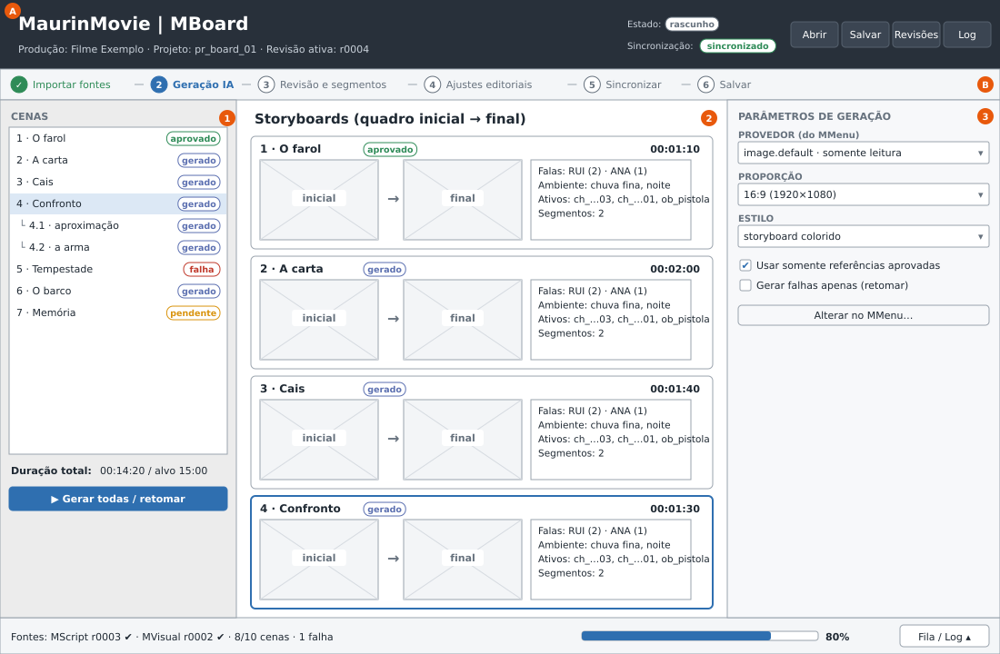
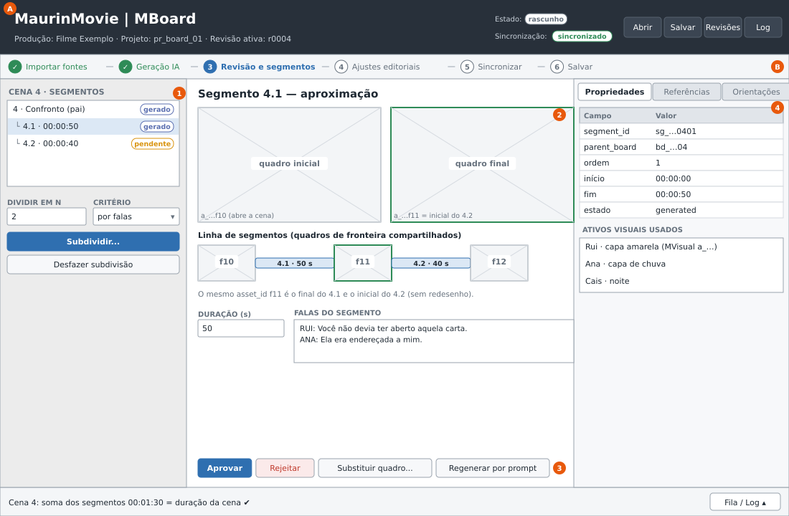
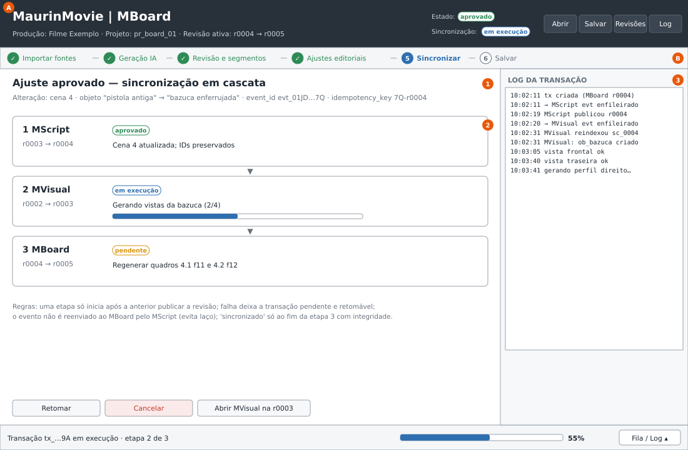
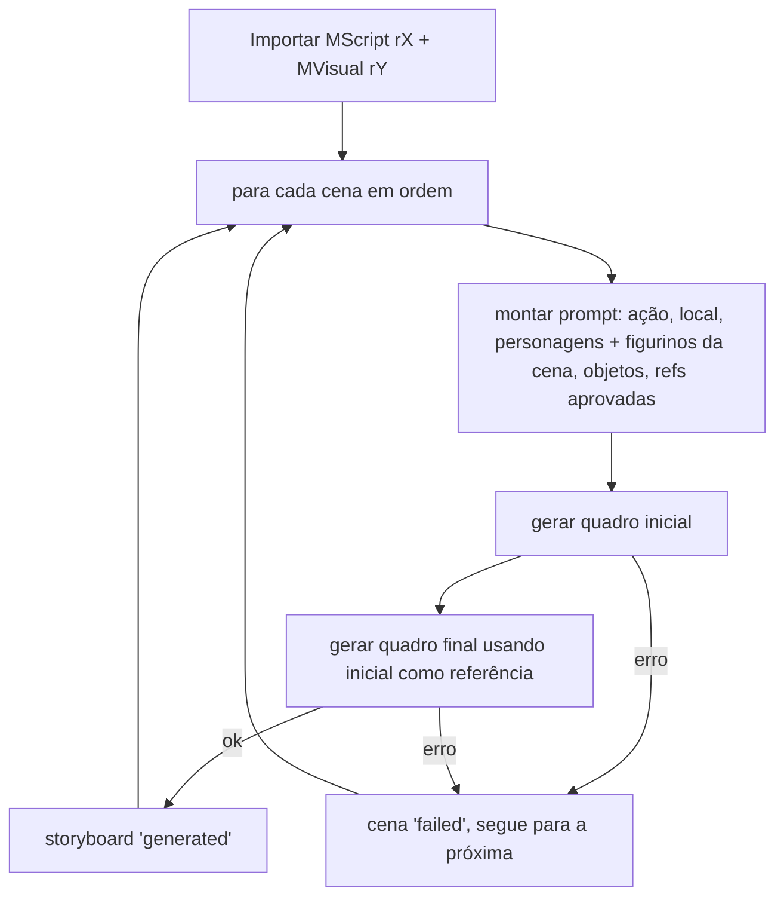

# MBoard — Software 3 · Storyboard, segmentos e sincronização em cascata

> Requisitos-fonte: [05-storyboard](../05-storyboard.md), [03-modelo-de-dados](../03-modelo-de-dados.md) (Projeto 3), [04-validacao](../04-validacao-e-revisoes.md) (Software 3). Regras gerais: [00-comum](00-comum.md). Código: `src/mboard/`.

## 1. Objetivo e limites

Gerar para **cada cena** um storyboard com quadro inicial e final, falas, orientações e duração; permitir revisão, troca de quadros e subdivisão em segmentos com quadros de fronteira compartilhados; e permitir ajustes editoriais que, ao serem aprovados, disparam a **cascata** MScript → MVisual → MBoard. O MBoard é o orquestrador dessa cascata.

Fora do escopo: vídeo animado, áudio.

## 2. Etapas

| # | Etapa | Pré-requisito |
|---|---|---|
| 1 | Importar fontes | MScript `approved` e MVisual publicada |
| 2 | Geração IA | importação íntegra |
| 3 | Revisão e segmentos | ≥ 1 cena gerada |
| 4 | Ajustes editoriais | ≥ 1 cena |
| 5 | Sincronizar | existe ajuste aprovado com transação aberta |
| 6 | Salvar/Publicar | sempre |

## 3. Requisitos funcionais

| ID | Requisito | Origem |
|---|---|---|
| RF-MB-01 | Importar revisões exatas do MScript e do MVisual, registrar IDs, hashes; nunca alterar os arquivos importados | docs/05 entradas |
| RF-MB-02 | Percorrer **todas** as cenas e gerar, por cena, quadro inicial e final, usando referências visuais aprovadas (ou as mais recentes, com aviso, se não houver aprovadas) | docs/05 et.1 |
| RF-MB-03 | Associar a cada storyboard: `scene_id`, ação, falas com personagens, orientações de ambiente, duração estimada (s e min), IDs dos ativos visuais usados | docs/05 et.1 |
| RF-MB-04 | Mostrar duração por cena e total (comparando com a duração-alvo do filme); falha isolada por cena com retomada | docs/05 et.1 |
| RF-MB-05 | Resultado da IA sempre `generated`; nunca aprovado automaticamente | docs/05 et.1 |
| RF-MB-06 | Revisar storyboard a storyboard com quadro inicial e final lado a lado, falas, referências e duração; Aprovar, Rejeitar, Substituir quadro (por arquivo, por outro ativo existente ou regenerando por prompt), Corrigir duração | docs/05 et.2 |
| RF-MB-07 | Subdividir um storyboard em N segmentos ordenados (critério: partes iguais, por falas, manual), cada um com quadro inicial, final, duração, falas, orientações, referências | docs/05 et.2 |
| RF-MB-08 | **Continuidade exata**: o quadro final do segmento i é o **mesmo `asset_id`** do inicial do segmento i+1; o primeiro inicial = inicial da cena e o último final = final da cena | docs/05 et.2, docs/03 |
| RF-MB-09 | Soma das durações dos segmentos = duração da cena; ao alterar uma, oferecer redistribuir proporcionalmente ou ajustar a duração da cena; divergência bloqueia a aprovação | docs/03 regras |
| RF-MB-10 | Alterar a divisão cria nova versão; divisões anteriores permanecem no histórico | docs/05 et.2 |
| RF-MB-11 | Editar no storyboard: falas, ações, objetos, personagens presentes, orientações de ambiente; enquanto rascunho, nada muda nas fontes | docs/05 et.3 |
| RF-MB-12 | "Aprovar ajuste" cria revisão do storyboard e abre transação de cascata com ID único: MScript (patch) → MVisual (atualização) → MBoard (regenera só quadros afetados) | docs/05 et.3 |
| RF-MB-13 | Preservar ativos não afetados; mudança de objeto não redesenha personagens/cenários sem necessidade | docs/05 et.3 |
| RF-MB-14 | Falha em qualquer estágio mantém transação `failed`, com detalhe; Retomar é idempotente; nunca declarar sincronização completa antes da integridade final | docs/05 et.3 |
| RF-MB-15 | Anti-laço: o MBoard não reage à nova revisão do MScript/MVisual gerada pela própria transação como se fosse mudança externa | docs/05 et.3 |
| RF-MB-16 | Ao abrir, se houver revisão mais nova do MScript/MVisual que a usada, oferecer "Atualizar fontes" (regenera só quadros das cenas afetadas, como no estágio 3 da cascata) | [PROPOSTA] |

## 4. Telas

### 4.1 Grade de storyboards (etapas 2–3)



| Marca | Elemento |
|---|---|
| 1 | Árvore de cenas e segmentos com selo; duração total × alvo; "▶ Gerar todas / retomar" |
| 2 | Cartões por cena (`TScrollBox` com frames): título, selo, duração, miniaturas inicial → final, resumo (falas por personagem, ambiente, ativos, nº de segmentos). Duplo clique abre a revisão do item (§4.2) |
| 3 | Parâmetros: provedor de imagem, proporção (16:9 padrão, 2.39:1, 4:3), estilo (storyboard colorido, esboço P&B, realista), usar só referências aprovadas, gerar só falhas |

### 4.2 Revisão e segmentos (etapa 3)



| Marca | Elemento |
|---|---|
| 1 | Hierarquia cena → segmentos; "Dividir em N", critério, Subdividir…, Desfazer subdivisão |
| 2 | Quadro inicial e final grandes (clique amplia); faixa "linha de segmentos" mostrando os quadros de fronteira compartilhados (o mesmo quadro aparece uma vez entre dois segmentos); duração (s); falas do segmento |
| 3 | Aprovar, Rejeitar, Substituir quadro…, Regenerar por prompt |
| 4 | Propriedades (`segment_id`, `parent_board_id`, ordem, início/fim relativos, estado), ativos visuais usados, orientações de direção |

Substituir um quadro de fronteira avisa: "Este quadro também é o inicial do segmento 4.2; ambos serão atualizados" (é o mesmo `asset_id` referenciado; a troca cria novo ativo e atualiza as duas referências).

### 4.3 Ajustes editoriais (etapa 4)

Mesma tela 4.2 com o painel direito na aba **Edição**: falas (grade editável), ação (memo), personagens presentes, objetos (lista: trocar/adicionar/remover, com busca nas entidades do MVisual ou nome novo), orientações de ambiente. Cada alteração aparece numa lista "Mudanças pendentes (rascunho)" com o diff textual. Botões: Descartar mudanças, **Aprovar ajuste e sincronizar ▸**. A aprovação mostra o resumo e a lista de apps que serão atualizados.

### 4.4 Sincronização (etapa 5)



| Marca | Elemento |
|---|---|
| 1 | Descrição da alteração, `event_id`, `idempotency_key` |
| 2 | Estágios 1–3 com app, revisão antes → depois, selo, descrição e barra de progresso do estágio em execução |
| 3 | Log da transação em tempo real |

Botões: Retomar (só em `failed`), Cancelar (confirmação; revisões já publicadas nas outras etapas permanecem), Abrir <app> na revisão nova.

## 5. Linha de comando

Comuns. `--focus <scene_id|segment_id>`. `--headless --event` aplica `board.update_from_visual` (estágio 3 quando a cascata vem de outro app). `--headless --resume-transaction tx_…` retoma uma cascata originada no MBoard.

## 6. Fluxos

### 6.1 Geração



### 6.2 Cascata originada no MBoard

1. Usuário aprova ajuste → MBoard publica revisão `rN` do storyboard com as mudanças editoriais (quadros antigos ainda) e `sync_status: pending`.
2. Cria `tx_…` e `evt_a` (`script.patch`, operações derivadas das mudanças, §8.2) para MScript; lança `mscript --headless --event`.
3. Ao `evt_a` publicado (nova revisão do roteiro), cria `evt_b` (`visual.update_from_script`) e lança `mvisual --headless --event`.
4. Ao `evt_b` publicado, executa estágio próprio: importa novas revisões, regenera somente quadros das cenas/segmentos afetados (quadros que mostram a entidade alterada), publica `rN+1` com `sync_status: complete`.
5. Qualquer falha: estágio `failed`, transação `failed`, nada de "sincronizado". Retomar recomeça do estágio que falhou (os anteriores já publicados são reaproveitados pela idempotência).

Se o MSound/MScene/MCut dependerem das cenas afetadas, o MBoard **não** dispara esses apps nesta versão: registra em `transaction.downstream_notices[]` que eles estão desatualizados, e o MMenu mostra a pendência [PROPOSTA; ver lacuna L-08].

## 7. Dados

### 7.1 Arquivos (`projects/03-mboard/revisions/rNNNN/`)

| Arquivo | Conteúdo |
|---|---|
| `manifest.json` | artefatos `storyboard.frame` (PNG), `storyboard.segment` (registro no JSON) |
| `storyboard/scenes.json` | boards e segmentos |
| `storyboard/edits.json` | ajustes editoriais desta revisão (o que foi enviado em cascata) |
| `images/quadros/<asset_id>.png` | quadros |

### 7.2 `scenes.json`

```json
{
  "schema": "mmp.mboard.storyboard/1",
  "name_base": "FilmeExemplo",
  "sources": [
    {"application": "MScript", "project_id": "pr_script_…", "revision_id": "r0004", "manifest_sha256": "…"},
    {"application": "MVisual", "project_id": "pr_visual_…", "revision_id": "r0003", "manifest_sha256": "…"}
  ],
  "aspect": "16:9", "frame_size": [1920, 1080],
  "scene_boards": [
    {"board_id": "bd_…04", "scene_id": "sc_…4", "order": 4, "estimated_duration_ms": 90000,
     "opening_asset_id": "a_…f10", "closing_asset_id": "a_…f12",
     "dialogue_refs": ["dl_…1", "dl_…2"], "direction_notes": ["chuva fina", "trovão ilumina o farol no final"],
     "visual_entity_refs": ["ch_…01", "ch_…03", "co_…07", "ob_…12", "lo_…cais"],
     "status": "generated", "segment_ids": ["sg_…0401", "sg_…0402"]}
  ],
  "segments": [
    {"segment_id": "sg_…0401", "parent_board_id": "bd_…04", "order": 1, "duration_ms": 50000,
     "opening_asset_id": "a_…f10", "closing_asset_id": "a_…f11",
     "dialogue_refs": ["dl_…1", "dl_…2"], "direction_notes": [], "visual_entity_refs": ["…"], "status": "generated"},
    {"segment_id": "sg_…0402", "parent_board_id": "bd_…04", "order": 2, "duration_ms": 40000,
     "opening_asset_id": "a_…f11", "closing_asset_id": "a_…f12", "status": "pending_review"}
  ],
  "frames": [
    {"asset_id": "a_…f11", "file_ref": "images/quadros/a_…f11.png", "sha256": "…",
     "depicts_entity_ids": ["ch_…03", "ob_…12"], "generation_metadata": {…}, "status": "generated"}
  ]
}
```

`depicts_entity_ids` é usado para saber quais quadros regenerar quando uma entidade muda.

### 7.3 Transação: ver [00-comum §7.3](00-comum.md#73-transação-de-cascata-proposta). Cópia local em `storyboard/edits.json` com `transaction_id`.

## 8. Regras de negócio

### 8.1 Subdivisão

N segmentos geram N−1 quadros de fronteira novos (gerados por IA entre inicial e final, respeitando as falas do trecho). Critério "por falas": cortes entre falas, distribuindo a duração proporcional ao número de palavras. Critério "partes iguais": `duração/N` (resto em ms no último). Validações: N ≥ 2; cada segmento ≥ 1 s [PROPOSTA].

### 8.2 Conversão de edição em `script.patch`

| Edição no MBoard | Operação |
|---|---|
| texto de fala | `set_dialogue` |
| nova fala / fala removida | `add_dialogue` / `remove_dialogue` |
| trocar objeto | `replace_entity` + `replace_text` nas ações onde o nome aparece |
| ação | `replace_text` (`field: action`) |
| orientação de ambiente | `set_scene_field` ou `replace_text` no cabeçalho |
| duração | `set_duration` |

Orientações puramente visuais de enquadramento (ex.: "plano fechado") **não** geram patch: ficam só no MBoard.

## 9. Integração

| Direção | Com | O quê |
|---|---|---|
| Lê | MScript, MVisual | revisões exatas |
| Fornece | MSound, MScene | `scenes.json`, quadros, segmentos e durações |
| Emite | MScript, MVisual | eventos da cascata (orquestrador) |
| Recebe | — | `board.update_from_visual` quando a cascata é originada em outro app (futuro) |

## 10. Critérios de aceite

1. Todas as cenas importadas têm quadro inicial/final, falas e duração, ou falha individual registrada.
2. Segmentos: `closing_asset_id(i) == opening_asset_id(i+1)` e soma das durações = duração da cena (teste automático sobre `scenes.json`).
3. Editar em rascunho não altera nenhum arquivo do MScript/MVisual.
4. Ajuste aprovado gera, em ordem, nova revisão no MScript, nova no MVisual e nova no MBoard; os quadros não afetados mantêm o mesmo `asset_id`.
5. Pistola → bazuca: bazuca aparece nas vistas do MVisual e nos quadros da cena 4; quadros das outras cenas inalterados; ativos antigos preservados.
6. Matar o processo do MVisual no meio: transação `failed`; Retomar conclui sem criar revisão duplicada no MScript.
7. Status "sincronizado" só aparece com a transação `complete`.

## 11. Estrutura de código sugerida

`umboardmain`, `umboardframegrid`, `umboardframesegments`, `umboardframeedit`, `umboardframesync`, `umboardmodel` (TMBSceneBoard, TMBSegment, TMBFrame), `umboardgen` (fila de geração), `umboardsplit` (subdivisão e validações), `umboardpatch` (edições → script.patch), `umboardcascade` (usa `TMMCascade` de `mmpevents`), `prompts/quadro_inicial.txt`, `prompts/quadro_final.txt`, `prompts/quadro_fronteira.txt`.
