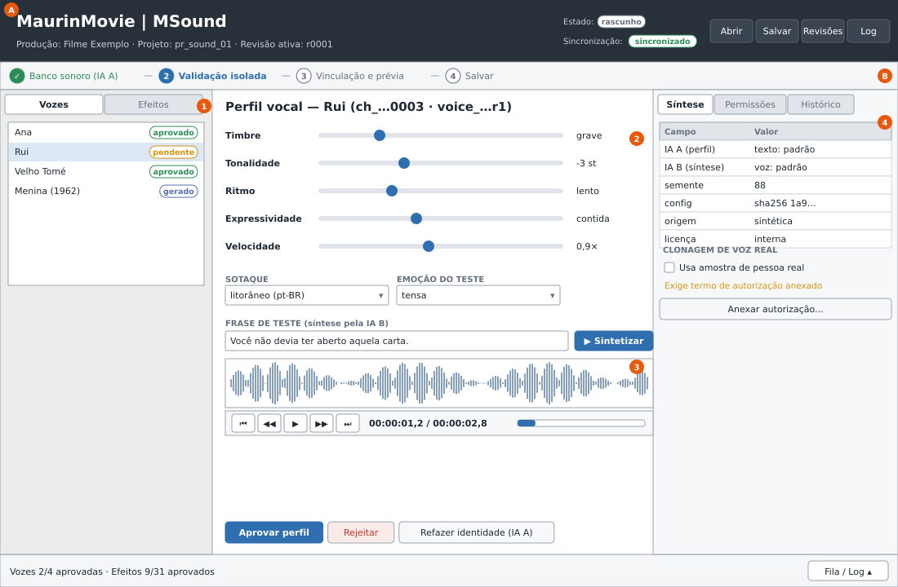
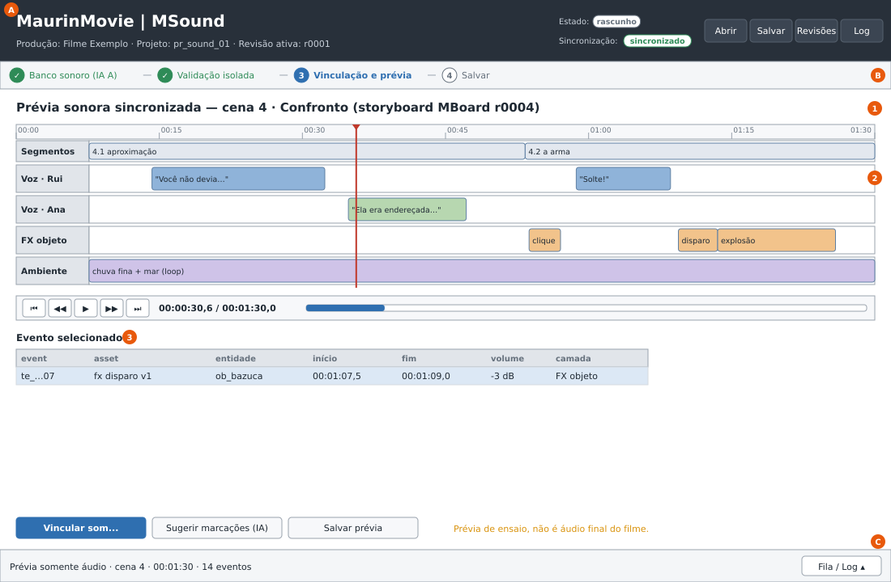
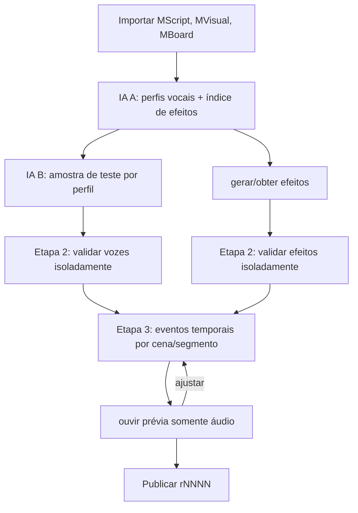

# MSound — Software 4 · Identidade vocal, efeitos e ensaio sonoro

> Requisitos-fonte: [06-identidade-sonora](../06-identidade-sonora.md), [03-modelo-de-dados](../03-modelo-de-dados.md) (Projeto 4). Regras gerais: [00-comum](00-comum.md). Código: `src/msound/`.

## 1. Objetivo e limites

Criar e aprovar um **banco sonoro reutilizável**: identidade vocal de cada personagem e efeitos de ambiente/objeto/ação, todos ligados a IDs persistentes do MScript, MVisual e MBoard; testar vozes e efeitos isoladamente; montar uma **prévia somente de áudio** por cena/segmento, sincronizada com o storyboard.

Fora do escopo: trilha musical, mixagem e áudio final do filme (docs/06 objetivo). As prévias são ensaio.

Duas IAs conceituais distintas (docs/06, aceite 3):
- **IA A** (texto): define perfis vocais e indexa efeitos necessários a partir do roteiro.
- **IA B** (voz/áudio): sintetiza ou clona a voz para frases de teste; gera efeitos sonoros [PROPOSTA: a geração de efeitos usa um provedor `sfx`, ver lacuna L-10].

## 2. Etapas

| # | Etapa | Pré-requisito |
|---|---|---|
| 1 | Banco sonoro (IA A) | MScript `approved`, MVisual e MBoard publicados |
| 2 | Validação isolada | ≥ 1 perfil ou efeito |
| 3 | Vinculação e prévia | ≥ 1 voz aprovada |
| 4 | Salvar | sempre |

## 3. Requisitos funcionais

| ID | Requisito | Origem |
|---|---|---|
| RF-SO-01 | Importar MScript, MVisual, MBoard com ID, URI, revisão exata e hash; abrir cada fonte no app de origem na revisão referenciada | docs/06 entradas |
| RF-SO-02 | IA A gera perfil vocal por personagem: timbre, tonalidade, ritmo, sotaque, dicção, forma de falar, expressividade; ligado ao `character_id` | docs/06 et.1 |
| RF-SO-03 | IA A indexa efeitos: ambiente, objeto, mecanismo, movimento, ação; vinculados a `entity_id` e à cena, **somente onde o roteiro indica** (ex.: bazuca → preparo, disparo, trajetória, explosão) | docs/06 et.1 |
| RF-SO-04 | IA B sintetiza frases de teste com configuração reproduzível (mesma config + semente → mesmo resultado quando o provedor permitir) | docs/06 et.1 |
| RF-SO-05 | Clonagem de pessoa real exige autorização anexada (arquivo + nome + data); sem ela, o botão de clonagem fica desabilitado | docs/06 et.1, docs/10 |
| RF-SO-06 | Cada som: `asset_id`, tipo, `entity_id`, `source_revision`, origem, parâmetros, licença/permissão, versão, estado | docs/06 et.1 |
| RF-SO-07 | Validação isolada: ouvir, comparar duas versões, ajustar timbre/tonalidade/ritmo/sotaque/emoção/velocidade/estilo, sintetizar frase livre ou falas reais do personagem, aprovar/rejeitar/refazer cada perfil | docs/06 et.2 |
| RF-SO-08 | Efeitos: ouvir, substituir (arquivo externo com licença), regenerar, aprovar/rejeitar cada um | docs/06 et.2 |
| RF-SO-09 | Etapa 2 não executa prévia sincronizada (separação de etapas) | docs/06 et.2 |
| RF-SO-10 | Vincular vozes e efeitos a eventos temporais de cenas e segmentos do MBoard: diálogo (`line_id`), início, fim, volume, camada | docs/06 et.3 |
| RF-SO-11 | Sugerir marcações por IA (tempos das falas pela duração do segmento e nº de palavras; efeitos pelos verbos de ação) | [PROPOSTA] |
| RF-SO-12 | Reproduzir **apenas áudio** de uma cena ou trecho, com todas as camadas no tempo certo; exportar a prévia como WAV (`audio.preview`) | docs/06 et.3 |
| RF-SO-13 | Alteração editorial aprovada no MSound que afete roteiro (ex.: mudar uma fala para caber no tempo) dispara cascata pelos apps afetados; mudança puramente vocal fica no MSound | docs/06 et.3 |
| RF-SO-14 | Salvar projeto versionado com banco de vozes e efeitos, perfis, aprovações, timeline sonora, prévias, referências 1–3 e histórico; verificar vínculos/arquivos ausentes; distinguir salvo de sincronização pendente | docs/06 et.4 |
| RF-SO-15 | Voz continua ligada ao personagem pelo ID mesmo após renomeação no MScript | docs/06 aceite 1 |

## 4. Telas

### 4.1 Vozes e efeitos (etapas 1–2)



| Marca | Elemento |
|---|---|
| 1 | Abas **Vozes** (personagens) e **Efeitos** (árvore: Ambiente / Objetos / Ações / Mecanismos → itens por entidade e cena) com selo |
| 2 | Perfil vocal: controles deslizantes (`TTrackBar`) Timbre (agudo↔grave), Tonalidade (−12…+12 semitons), Ritmo, Expressividade, Velocidade (0,5×…2×); combos Sotaque e Emoção do teste; descrição textual do perfil (gerada pela IA A, editável) |
| 3 | Frase de teste (livre ou escolher fala do roteiro), "▶ Sintetizar", forma de onda, controles de reprodução, histórico de testes (cada teste é um artefato descartável no cache, não publicado salvo se o usuário "Fixar amostra") |
| 4 | Síntese: IA A e IA B usadas, semente, hash da config, origem (sintética/clonada), licença; seção Clonagem com checkbox "usa amostra de pessoa real", anexar autorização |

Aba Efeitos (mesmo layout): centro mostra descrição do efeito, onda, duração, variações (ex.: disparo v1/v2); direito mostra entidade/cena de origem e licença. Botões Aprovar, Rejeitar, Regenerar, Substituir por arquivo….

### 4.2 Prévia sincronizada (etapa 3)



| Marca | Elemento |
|---|---|
| 1 | Seletor de cena/segmento (combo) e título com a revisão do MBoard |
| 2 | Linha do tempo multipista (componente próprio desenhado em `TPaintBox`): régua, faixa de segmentos (somente leitura, do MBoard), uma faixa de voz por personagem, faixa FX objeto, faixa Ambiente; clipes arrastáveis (início) e redimensionáveis (fim); cursor de reprodução; zoom com Ctrl+roda |
| 3 | Propriedades do evento selecionado: `event`, asset, entidade, início, fim, volume (dB), camada |

Botões: Vincular som… (escolhe asset aprovado e cria evento na posição do cursor), Sugerir marcações (IA), Salvar prévia (renderiza WAV pela mixagem simples com ffmpeg `amix` e `adelay`). Aviso fixo "Prévia de ensaio, não é áudio final do filme".

## 5. Linha de comando

Comuns. `--focus <character_id|scene_id>`. `--headless --event` aplica `sound.update_from_sources` (quando MScript/MBoard mudam: reabrir vínculos de falas alteradas como `pending_review`).

## 6. Fluxo principal



## 7. Dados

### 7.1 Arquivos (`projects/04-msound/revisions/rNNNN/`)

| Arquivo | Conteúdo |
|---|---|
| `manifest.json` | artefatos `audio.voice.profile`, `audio.voice.sample` [PROPOSTA], `audio.effect`, `audio.preview` |
| `voices/profiles.json` | perfis vocais |
| `effects/effects.json` | definições e ativos de efeitos |
| `timeline/events.json` | eventos temporais por cena/segmento |
| `audio/voices/…wav`, `audio/effects/…wav`, `audio/previews/…wav` | áudio (WAV PCM 48 kHz 24 bits) [PROPOSTA] |
| `permissions/<voice_id>/…` | termos de autorização de clonagem |

### 7.2 `profiles.json`

```json
{
  "schema": "mmp.msound.voices/1",
  "sources": [{"application": "MScript", "revision_id": "r0004", "…": "…"},
              {"application": "MVisual", "revision_id": "r0003"}, {"application": "MBoard", "revision_id": "r0005"}],
  "voice_profiles": [
    {"voice_id": "vo_…r1", "character_id": "ch_…03",
     "description": "voz grave, pausada, sotaque litorâneo, pouca expressividade",
     "timbre": 0.25, "pitch_semitones": -3, "rhythm": "lento", "accent": "litoraneo-ptBR",
     "diction": "arrastada", "expressiveness": 0.4, "speed": 0.9,
     "synthesis_config": {"provider": "voice.default", "voice_preset": "…", "seed": 88, "config_sha256": "…"},
     "origin": "synthetic", "permissions": null, "status": "approved", "version": 3,
     "approved_samples": ["a_…smp1"]}
  ]
}
```

### 7.3 `effects.json`

```json
{
  "effects": [
    {"fx_id": "fx_…disparo", "category": "object", "entity_id": "ob_…12", "action": "disparo",
     "scene_ids": ["sc_…4"], "description": "disparo de bazuca, grave, com eco no cais",
     "assets": [{"asset_id": "a_…fx7", "version": 1, "duration_ms": 1500, "file_ref": "audio/effects/…wav",
                 "origin": "ai", "license": "gerado", "status": "approved"}]}
  ]
}
```

### 7.4 `events.json`

```json
{
  "timeline_events": [
    {"event_id": "te_…05", "scene_id": "sc_…4", "segment_id": "sg_…0401", "layer": "voice:ch_…03",
     "asset_id": "a_…line1", "line_id": "dl_…1", "start_ms": 7000, "end_ms": 10200, "gain_db": 0},
    {"event_id": "te_…07", "scene_id": "sc_…4", "segment_id": "sg_…0402", "layer": "fx:object",
     "asset_id": "a_…fx7", "entity_id": "ob_…12", "start_ms": 67500, "end_ms": 69000, "gain_db": -3}
  ]
}
```

Tempos relativos ao início da cena; `segment_id` indica o segmento onde o evento começa. As falas usadas na prévia (`a_…line1`) são sínteses da fala real com o perfil aprovado (`kind: audio.guide` quando consumidas pelo MScene).

## 8. Regras de negócio

- Renomear personagem no MScript não afeta o vínculo (`character_id`).
- Fala alterada no roteiro (novo texto no mesmo `line_id`): áudio da fala marcado `superseded`, evento `pending_review`, nova síntese gerada automaticamente com o perfil aprovado.
- Evento não pode ultrapassar o fim da cena; sobreposição na mesma faixa de voz gera aviso (duas falas simultâneas do mesmo personagem).
- Clonagem sem autorização: bloqueada no serviço, não só na interface.

## 9. Integração

| Direção | Com | O quê |
|---|---|---|
| Lê | MScript, MVisual, MBoard | revisões exatas |
| Fornece | MScene | perfis aprovados, falas sintetizadas (áudio-guia), efeitos, `events.json` |
| Emite | MScript (via cascata) | `script.patch` quando uma fala é editada no MSound e aprovada |

## 10. Critérios de aceite

1. Renomear personagem no MScript e atualizar fontes: voz continua no mesmo personagem.
2. Objetos/ações recuperam efeitos por `entity_id` e ocorrência na cena.
3. Perfis (IA A) e sínteses (IA B) usam provedores distintos e registrados.
4. Etapa 2 toca itens isolados; etapa 3 toca a cena só em áudio com sincronia.
5. Revisões imutáveis; cada uma abre MScript/MVisual/MBoard nas revisões exatas.
6. Mudança só de voz não gera evento para outros apps.

## 11. Estrutura de código sugerida

`umsoundmain`, `umsoundframevoices`, `umsoundframeeffects`, `umsoundframepreview`, `umsoundtimeline` (componente de pistas), `umsoundmodel`, `umsoundprofileai` (IA A), `umsoundsynth` (IA B), `umsoundmix` (ffmpeg), `prompts/perfil_vocal.txt`, `prompts/indexar_efeitos.txt`.
