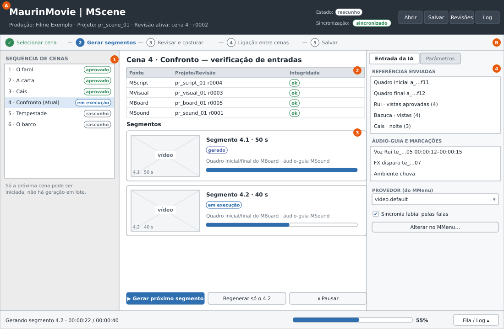
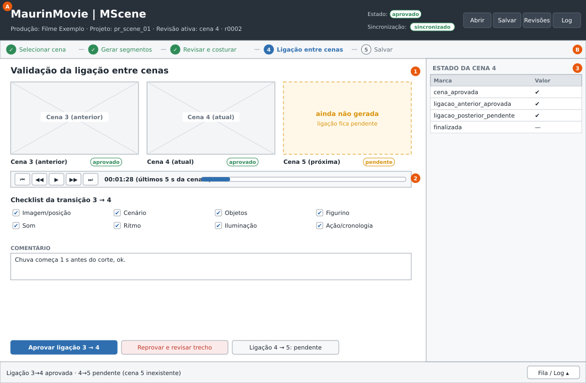
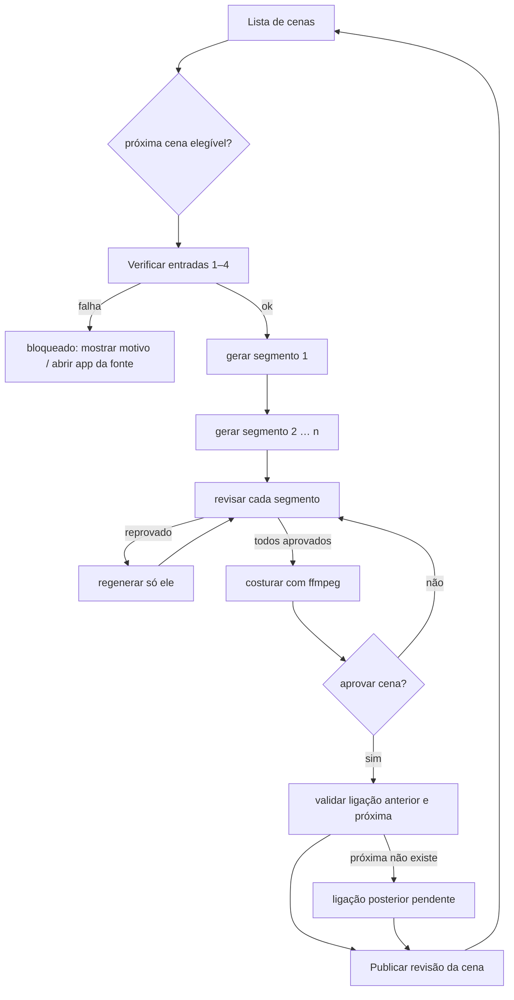

# MScene — Software 5 · Geração e montagem de cenas em vídeo

> Requisitos-fonte: [07-geracao-e-montagem-de-cenas](../07-geracao-e-montagem-de-cenas.md), [03-modelo-de-dados](../03-modelo-de-dados.md) (Projeto 5). Regras gerais: [00-comum](00-comum.md). Código: `src/mscene/`.

## 1. Objetivo e limites

Gerar o vídeo de **uma cena por vez**: cada segmento do storyboard individualmente, revisar e regenerar só o que for reprovado, costurar os segmentos num vídeo único da cena, validar a ligação com a cena anterior e a próxima (quando existir) e salvar um projeto versionado **por cena**.

Fora do escopo: montar o filme inteiro (é do MCut); gerar várias cenas em lote.

## 2. Etapas

| # | Etapa | Pré-requisito |
|---|---|---|
| 1 | Selecionar cena | fontes 1–4 disponíveis |
| 2 | Gerar segmentos | entradas da cena íntegras (§8.1) |
| 3 | Revisar e costurar | todos os segmentos gerados |
| 4 | Ligação entre cenas | cena costurada e aprovada |
| 5 | Salvar | sempre |

## 3. Requisitos funcionais

| ID | Requisito | Origem |
|---|---|---|
| RF-SC-01 | Listar as cenas na ordem do roteiro com estado; só permitir iniciar a **próxima** cena ainda não aprovada (as anteriores podem ser reabertas para revisão) | docs/07 et.1, aceite 1 |
| RF-SC-02 | Verificar entradas da cena: roteiro, visual, storyboard, som nas revisões selecionadas, hashes, e se a cena existe em todas | docs/07 et.1 |
| RF-SC-03 | Cena subdividida: gerar segmento 1, depois 2…; cena sem subdivisão: um segmento único (= board da cena) | docs/07 et.1 |
| RF-SC-04 | Entrada da IA de vídeo: quadros inicial/final do MBoard, referências aprovadas do MVisual (personagens, figurinos, objetos, local), prompt com ação e falas, áudio-guia do MSound (falas e efeitos com tempos), duração | docs/07 et.1 |
| RF-SC-05 | Sincronia labial, gestos, interação com objetos e efeitos guiados pelos eventos temporais do MSound | docs/07 et.1 |
| RF-SC-06 | Registrar por segmento: arquivo, modelo, prompt, parâmetros, dependências, erros, estado; retomar só o segmento com falha | docs/07 et.1 |
| RF-SC-07 | Reproduzir cada segmento e validar (checklist: enquadramento, identidade, movimento, sincronia labial, gestos, som, duração, coerência) | docs/07 et.2 |
| RF-SC-08 | Corrigir/regenerar só o segmento reprovado (com prompt de correção), sem refazer os aprovados | docs/07 et.2 |
| RF-SC-09 | Costurar segmentos aprovados em ordem num vídeo único (ffmpeg), mantendo continuidade nos quadros compartilhados e áudio sincronizado; exibir a cena integrada para aprovação humana | docs/07 et.2 |
| RF-SC-10 | Não iniciar automaticamente a cena seguinte | docs/07 et.2 |
| RF-SC-11 | Reproduzir anterior → atual → próxima (se existir), com opção de tocar só a junção (últimos/primeiros N s, padrão 5 s) | docs/07 et.3 |
| RF-SC-12 | Aprovar explicitamente cada ligação (anterior/atual e atual/próxima) com checklist (imagem/posição, cenário, objetos, figurino, som, ritmo, iluminação, ação/cronologia) e comentário | docs/07 et.3 |
| RF-SC-13 | Próxima cena inexistente → ligação `pending` (nunca aprovada por suposição); ao aprovar a cena seguinte, reabrir a verificação dessa ligação pendente | docs/07 et.3 |
| RF-SC-14 | Problema na ligação → revisar trecho/segmento afetado (desta cena ou da vizinha), preservando o resto e o histórico | docs/07 et.3 |
| RF-SC-15 | Salvar projeto por cena `<NomeBase>_Cena_<SceneID>_Video_RNNN` com segmentos, vídeo costurado, prévias, decisões, estado das ligações, referências às 4 fontes | docs/07 et.4 |
| RF-SC-16 | Marcas de estado independentes: `cena_aprovada`, `ligacao_anterior_aprovada`, `ligacao_posterior_pendente`, `finalizada` | docs/07 et.4 |
| RF-SC-17 | Alteração aprovada com impacto editorial (roteiro, visual, storyboard, som) registra impacto e inicia cascata; alteração só de renderização não propaga | docs/07 regras |
| RF-SC-18 | Provedores e parâmetros padrão vêm da configuração centralizada do MMenu (`settings/ai-providers.json`, seção `MScene` de `settings/apps.json`, `settings/production.json`), lidos via `mmpsettings` e recarregados antes de cada operação; o app não tem tela de configuração e nunca grava em `settings/`. O painel de parâmetros mostra esses valores em somente leitura com "Alterar no MMenu…" (`mmenu --settings --tab mscene`); só o pedido da vez (prompt adicional, semente de uma regeneração) é ajustável no app | pedido do usuário 16/11; 00-comum §12 |

## 4. Telas

### 4.1 Seleção e geração (etapas 1–2)



| Marca | Elemento |
|---|---|
| 1 | Sequência de cenas (ordem do roteiro) com selo; a próxima cena elegível tem botão "Iniciar"; cenas futuras desabilitadas com dica "Gere uma cena por vez" |
| 2 | Verificação de entradas: fonte, projeto/revisão, integridade; qualquer ✘ bloqueia "Gerar" com o motivo |
| 3 | Cartões de segmento: miniatura/vídeo, nome e duração, selo, origem dos quadros e do áudio-guia, progresso |
| 4 | Entrada da IA (referências enviadas, áudio-guia e marcações) e parâmetros vindos do MMenu em somente leitura (provedor de vídeo, resolução, fps, sincronia labial, duração máxima de segmento), com "Alterar no MMenu…" |

Botões: ▶ Gerar próximo segmento, Regenerar só o segmento selecionado, ⏸ Pausar.

### 4.2 Revisão e costura (etapa 3)

Layout igual ao §4.1, com o centro trocado por: player do segmento (mpv embutido), checklist de validação (8 itens de RF-SC-07), comentário/prompt de correção, Aprovar / Rejeitar / Regenerar com correção. Quando todos os segmentos estão aprovados, aparece "Costurar cena ▸"; depois o player mostra a cena integrada com marcadores nas junções e os botões Aprovar cena / Reprovar (escolher segmento a refazer).

### 4.3 Ligação entre cenas (etapa 4)



| Marca | Elemento |
|---|---|
| 1 | Três painéis: anterior, atual, próxima (próxima inexistente aparece tracejada "ainda não gerada — ligação fica pendente") |
| 2 | Player com reprodução em sequência; modos "Junção 3→4", "Junção 4→5", "Sequência completa" |
| 3 | Estado da cena (as quatro marcas de RF-SC-16) |

Checklist da transição, comentário, Aprovar ligação, Reprovar e revisar trecho.

## 5. Linha de comando

Comuns + `--scene-id <scene_id>` (abre o projeto daquela cena). Sem `--scene-id`, abre a lista de cenas. `--headless --event` aplica `scene.sources_changed` (marca segmentos afetados como `pending_review` e a cena como desatualizada; não regera vídeo automaticamente, por custo) [PROPOSTA].

## 6. Fluxo principal



Quando a cena k+1 é aprovada, o MScene abre automaticamente a etapa 4 da cena k+1, cuja "ligação anterior" é a pendência da cena k; aprová-la grava a decisão nos dois projetos (nova revisão da cena k com `ligacao_posterior_aprovada`).

## 7. Dados

### 7.1 Organização (docs/11, docs/12)

```
projects/05-mscene/
  project.json                       índice: cenas → project_id/revisão ativa
  scenes/<scene_id>/
    project.json                     projeto da cena (application "MScene", scene_id)
    revisions/rNNNN/
      manifest.json
      scene.json
      video/segments/<segment_id>_v<N>.mp4
      video/assembled/<scene_id>.mp4
      audio/guides/<segment_id>.wav
      previews/junction_<a>_<b>.mp4
```

`projects/05-mscene/project.json.settings.scenes` [PROPOSTA]:

```json
{"scenes": [{"scene_id": "sc_…4", "project_id": "pr_scene_…c4", "active_revision": "r0002",
             "flags": {"cena_aprovada": true, "ligacao_anterior_aprovada": true,
                       "ligacao_posterior_pendente": true, "finalizada": false}}]}
```

### 7.2 `scene.json`

```json
{
  "schema": "mmp.mscene.scene/1",
  "video_project_id": "pr_scene_…c4", "revision_id": "r0002", "scene_id": "sc_…4",
  "sources": [
    {"application": "MScript", "revision_id": "r0004", "…": "…"},
    {"application": "MVisual", "revision_id": "r0003"},
    {"application": "MBoard", "revision_id": "r0005"},
    {"application": "MSound", "revision_id": "r0001"}
  ],
  "render": {"width": 1920, "height": 1080, "fps": 24, "video_codec": "h264", "audio": "aac 48k"},
  "segments": [
    {"segment_id": "sg_…0401", "order": 1, "duration_ms": 50000, "video_asset_id": "a_…v41",
     "opening_frame_asset_id": "a_…f10", "closing_frame_asset_id": "a_…f11",
     "guide_audio_asset_id": "a_…g41", "status": "approved",
     "dependencies": ["a_…f10", "a_…f11", "a_…v01", "te_…05"],
     "generation_metadata": {…}, "review": {"checklist": {"lip_sync": true, "identity": true, "…": true},
     "comment": "", "reviewer": "user:…", "timestamp": "…"}}
  ],
  "assembled_scene_asset_id": "a_…sc4",
  "assembled_duration_ms": 90000,
  "adjacent_scene_links": [
    {"neighbor_scene_id": "sc_…3", "direction": "previous", "neighbor_revision": "r0001",
     "status": "approved", "checklist": {…}, "comment": "Chuva começa 1 s antes do corte, ok."},
    {"neighbor_scene_id": "sc_…5", "direction": "next", "neighbor_revision": null, "status": "pending"}
  ],
  "flags": {"cena_aprovada": true, "ligacao_anterior_aprovada": true,
            "ligacao_posterior_pendente": true, "finalizada": false},
  "approvals": [], "revision_history": []
}
```

`finalizada = cena_aprovada ∧ ligação anterior aprovada (ou é a primeira cena) ∧ ligação posterior aprovada (ou é a última cena)`.

## 8. Regras de negócio

### 8.1 Verificação de entradas da cena

Bloqueia se: cena não existe no MScript ativo; MBoard sem board da cena ou com segmentos cuja soma ≠ duração; personagens da cena sem identidade base aprovada no MVisual; personagens com fala sem perfil vocal aprovado no MSound. Avisa (não bloqueia) se: referências `pending_review`; efeitos não aprovados.

### 8.2 Geração

Para segmento i: `StartFrame = opening_frame`, `EndFrame = closing_frame`, `DurationMs = duration_ms`, `GuideAudio` = mix das falas e efeitos do segmento (ffmpeg a partir de `events.json`). Depois de gerar: `ffprobe` confere duração (tolerância ± 1 quadro); fora da tolerância → ajustar com ffmpeg (corte ou congelamento do último quadro) e registrar aviso.

### 8.3 Costura

`ffmpeg -f concat` dos segmentos aprovados, reencodando para o perfil `render` da cena; o áudio da cena final é o áudio do vídeo gerado se o provedor produzir áudio, senão o áudio-guia [PROPOSTA; ver lacuna L-11]. O quadro de fronteira não é duplicado: o último quadro do segmento i é descartado na junção quando idêntico ao primeiro do i+1.

### 8.4 Uma cena por vez

O serviço recusa iniciar geração de cena cujo predecessor não tem `cena_aprovada` (exceto a primeira). Reabrir uma cena já aprovada é permitido (gera nova revisão) e invalida as ligações dela (`pending` de novo).

## 9. Integração

| Direção | Com | O quê |
|---|---|---|
| Lê | MScript, MVisual, MBoard, MSound | revisões exatas |
| Fornece | MCut | `video.scene` aprovada por cena, duração, flags de ligação |
| Abre | qualquer fonte | "Abrir fonte" na revisão exata e no item (ex.: quadro do MBoard) |
| Recebe | MCut | pedido para abrir uma cena na revisão vinculada (`--scene-id --revision`) |

## 10. Critérios de aceite

1. Com 10 cenas no roteiro, iniciar a geração cria só a cena 1; a 2 só fica disponível após aprovar a 1.
2. Cena com 2 segmentos: gerados e aprovados individualmente, depois costurados em um MP4 com duração = soma ± 1 quadro.
3. Os quatro `sources` gravados com revisões exatas e hashes.
4. Eventos de fala do MSound coincidem com o tempo no vídeo (verificação: áudio-guia alinhado; teste manual de sincronia labial).
5. Etapa 4 reproduz anterior, atual e próxima quando existir.
6. Próxima cena inexistente → `ligacao_posterior_pendente`; ao aprovar a cena seguinte, a ligação é reaberta para decisão.
7. Projeto por cena salvo e reaberto com segmentos, decisões e vínculos.

## 11. Estrutura de código sugerida

`umscenemain`, `umsceneframelist`, `umsceneframegen`, `umsceneframereview`, `umsceneframelinks`, `umscenemodel`, `umsceneinputs` (verificação §8.1), `umscenegen` (fila de segmentos), `umsceneassemble` (ffmpeg), `umsceneplayer` (mpv embutido, de `mmpmedia`), `prompts/segmento_video.txt`.
