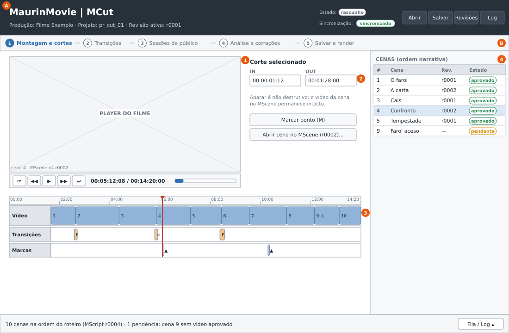
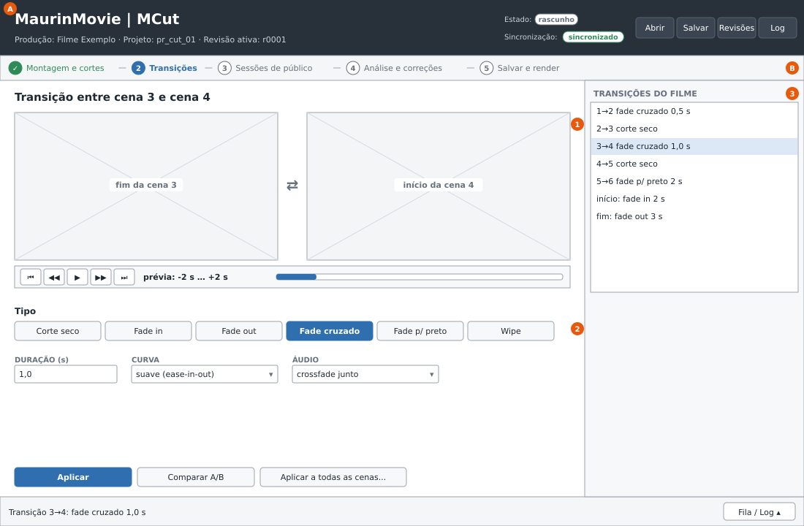
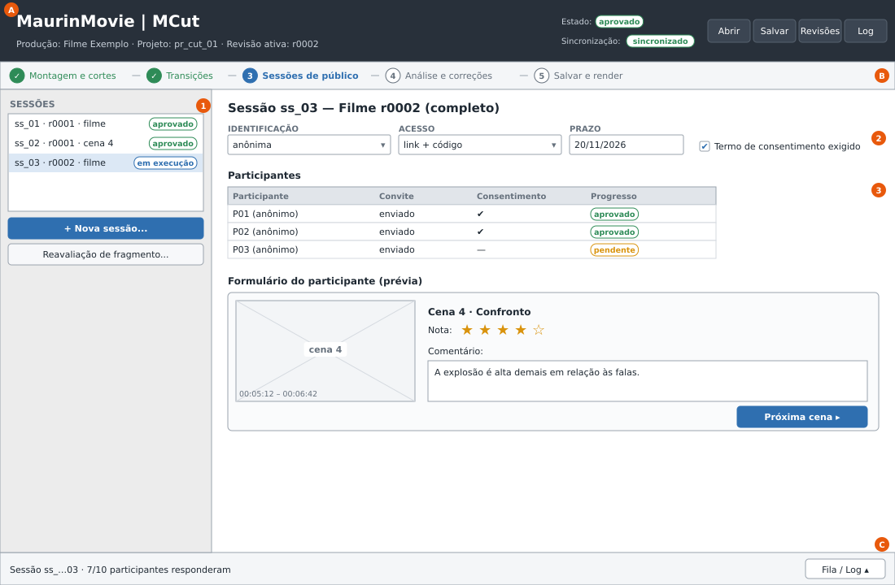
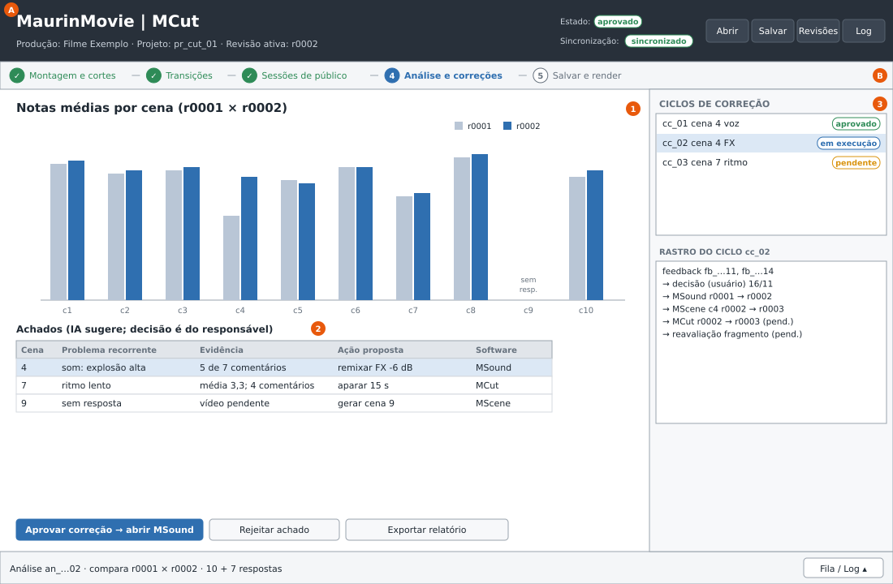
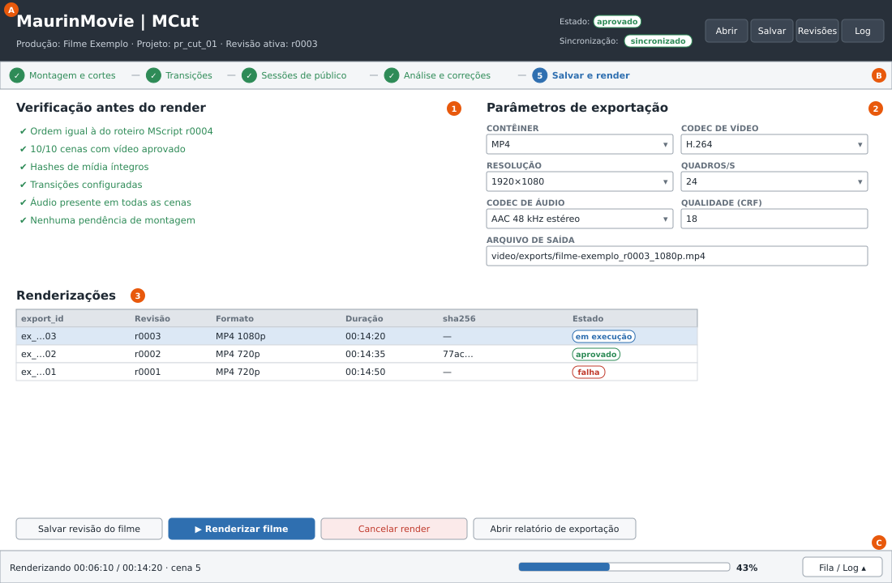
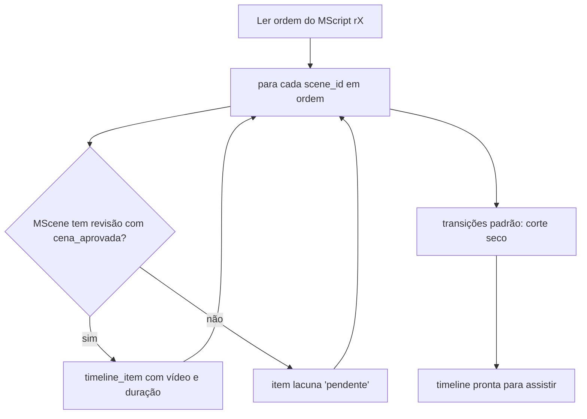
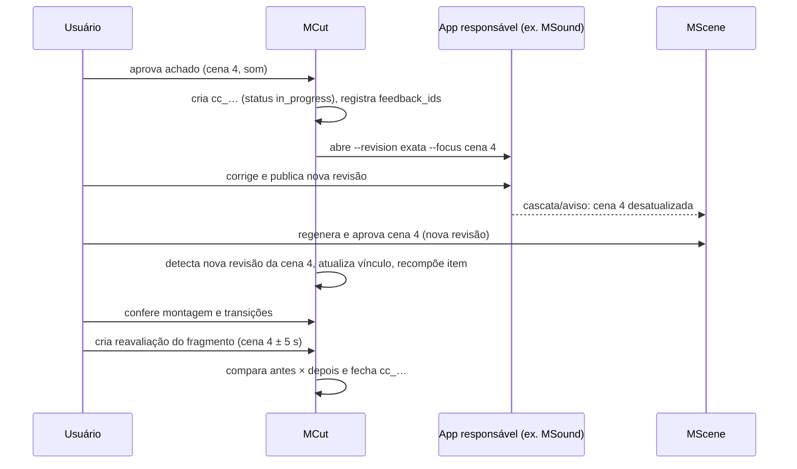

# MCut — Software 6 · Montagem final, avaliação de público e exportação

> Requisitos-fonte: [08-montagem-final](../08-montagem-final.md), [03-modelo-de-dados](../03-modelo-de-dados.md) (Projeto 6). Regras gerais: [00-comum](00-comum.md). Código: `src/mcut/`.

## 1. Objetivo e limites

Montar o filme completo na **ordem das cenas do roteiro** usando as cenas aprovadas do MScene; permitir assistir, aparar e cortar (não destrutivo), configurar transições, conduzir sessões de avaliação com público (nota e comentário por cena), analisar resultados, conduzir ciclos de correção que voltam aos apps de origem, e renderizar o filme inteiro.

O MCut é o **único** app que monta e renderiza o filme inteiro. Não altera o conteúdo interno das cenas: isso volta ao MScene (e, se preciso, em cascata aos apps 1–4).

## 2. Etapas

| # | Etapa | Pré-requisito |
|---|---|---|
| 1 | Montagem e cortes | MScript `approved` e ≥ 1 cena com vídeo aprovado |
| 2 | Transições | timeline existente |
| 3 | Sessões de público | revisão do filme publicada (a sessão exibe uma revisão identificada) |
| 4 | Análise e correções | ≥ 1 avaliação |
| 5 | Salvar e render | sempre (render exige verificação §8.4) |

## 3. Requisitos funcionais

| ID | Requisito | Origem |
|---|---|---|
| RF-MC-01 | Ler a ordem narrativa do MScript (revisão exata) e montar a timeline com a cena do MScene correspondente, uma a uma | docs/08 et.1 |
| RF-MC-02 | Cena ausente, reprovada ou com mídia quebrada aparece como **lacuna explícita** (cartão de "pendente", duração estimada do roteiro, tela preta na prévia); nunca substituída silenciosamente | docs/08 entradas |
| RF-MC-03 | Player do filme completo: play/pause, quadro a quadro, ir para cena, timecode, identificação da cena e revisão em exibição | docs/08 et.1 |
| RF-MC-04 | Marcar pontos (marcadores com nota), aparar início/fim de cada cena (in/out) e cortar dentro da cena (dividir item da timeline e remover trecho) sem alterar o arquivo-fonte | docs/08 et.1 |
| RF-MC-05 | "Abrir cena no MScene" na revisão vinculada; ao voltar, detectar nova revisão aprovada da cena, oferecer atualizar o vínculo e recompor só aquele item (preservando in/out se a duração permitir; senão, avisar) | docs/08 et.1 |
| RF-MC-06 | Registrar cada edição de timeline (quem, quando, o quê, duração resultante) | docs/08 et.1 |
| RF-MC-07 | Transições entre cenas: corte seco, fade in, fade out, fade cruzado, fade para preto/branco, wipe; duração, curva, comportamento do áudio; prévia ± 2 s; comparação A/B | docs/08 et.2 |
| RF-MC-08 | Transições são dados da montagem; não alteram vídeos-fonte | docs/08 et.2 |
| RF-MC-09 | Criar sessão de exibição de uma revisão do filme (completa ou cenas escolhidas); cadastrar participantes, convite, controle de acesso, consentimento, anonimato configurável, prazo | docs/08 et.3 |
| RF-MC-10 | Participante registra nota (1–5) e comentário **por cena**, opcionalmente instante/trecho; vinculado a `scene_id`, `revision_id`, sessão, participante (ou anônimo) | docs/08 et.3 |
| RF-MC-11 | Reavaliação dirigida de uma cena ou fragmento, com segundos de contexto antes/depois configuráveis | docs/08 et.3 |
| RF-MC-12 | Nunca misturar avaliações de revisões diferentes | docs/08 et.3 |
| RF-MC-13 | Análise por cena e por revisão: média, mediana, nº de respostas, distribuição, comentários; distinguir "sem resposta" de nota baixa; comparar antes/depois | docs/08 et.4 |
| RF-MC-14 | IA agrupa comentários em problemas recorrentes (duração, ritmo, compreensão, continuidade, som, transições) com evidências e propõe ações e o app responsável; a decisão é humana | docs/08 et.4 |
| RF-MC-15 | Ciclo de correção: correção aprovada identifica app responsável, abre a revisão de origem; o retorno atualiza a montagem; rastrear feedback → decisão → revisão no app → nova mídia → nova montagem → reavaliação | docs/08 et.4 |
| RF-MC-16 | Verificação antes do render: ordem, mídias íntegras, revisões, aprovações, áudio, transições, pendências | docs/08 et.5 |
| RF-MC-17 | Salvar projeto `<NomeBase>_Filme_RNNN` com timeline, transições, cortes, sessões, relatórios, decisões, histórico e referências 1–5 | docs/08 et.5 |
| RF-MC-18 | Renderizar o filme inteiro com parâmetros escolhidos (contêiner, codec, resolução, fps, áudio, qualidade); registrar versão do render, parâmetros, checksum, duração, relatório; falha nunca anunciada como sucesso | docs/08 et.5 |
| RF-MC-19 | Preservar projetos e renders anteriores; nova alteração → nova revisão | docs/08 et.5 |

## 4. Telas

### 4.1 Montagem e cortes (etapa 1)



| Marca | Elemento |
|---|---|
| 1 | Player (mpv embutido) com controles e timecode `HH:MM:SS:FF`; legenda inferior mostra cena e revisão de origem |
| 2 | Corte selecionado: IN/OUT editáveis (ou teclas I/O no player), "Marcar ponto (M)", "Abrir cena no MScene (rNNNN)…" |
| 3 | Timeline (componente `TPaintBox`): régua, faixa Vídeo (um clipe por cena, número da cena, ⚠ em lacunas), faixa Transições, faixa Marcas, cursor; arrastar bordas do clipe = aparar; S = dividir no cursor; Delete = remover trecho dividido; zoom Ctrl+roda |
| 4 | Lista de cenas em ordem narrativa: nº, título, revisão do MScene, estado |

Reordenar cenas **não** é permitido no MCut (a ordem vem do roteiro); para mudar a ordem, altera-se o MScript [decisão derivada de docs/08 et.1].

### 4.2 Transições (etapa 2)



| Marca | Elemento |
|---|---|
| 1 | Fim da cena anterior e início da seguinte; prévia da transição (-2 s…+2 s) |
| 2 | Tipo (botões de alternância), duração, curva, comportamento do áudio (crossfade junto, corte, manter) |
| 3 | Lista de todas as transições do filme, incluindo fade de abertura e encerramento |

Aplicar, Comparar A/B (alterna duas configurações na prévia), Aplicar a todas as cenas….

### 4.3 Sessões de público (etapa 3)



| Marca | Elemento |
|---|---|
| 1 | Lista de sessões (`ss_…`, revisão, escopo: filme ou fragmento); Nova sessão…, Reavaliação de fragmento… |
| 2 | Configuração: identificação (anônima/identificada), acesso, prazo, termo de consentimento |
| 3 | Participantes: convite, consentimento, progresso |

A coleta de avaliações acontece no **modo exibição** do próprio MCut [PROPOSTA; ver lacuna L-12]: o operador abre "Exibir para participante", que mostra o filme em tela cheia e, ao fim de cada cena (ou do filme), o formulário de nota ★1–5 e comentário (prévia na parte inferior da tela). Respostas gravadas imediatamente em `feedback/ratings.json` do rascunho.

### 4.4 Análise e correções (etapa 4)



| Marca | Elemento |
|---|---|
| 1 | Gráfico de barras agrupadas: nota média por cena, uma cor por revisão comparada; cena sem resposta mostra "sem resp." (não barra zero) |
| 2 | Achados: cena, problema recorrente, evidência (nº de comentários, média), ação proposta, app responsável; Aprovar correção → abrir <app>, Rejeitar achado, Exportar relatório |
| 3 | Ciclos de correção com estado e rastro completo |

### 4.5 Salvar e render (etapa 5)



| Marca | Elemento |
|---|---|
| 1 | Verificação (lista ✔/✘ de RF-MC-16); um ✘ bloqueia o render e mostra "Ir para o problema" |
| 2 | Parâmetros: contêiner (MP4, MKV, MOV), codec de vídeo (H.264, H.265, ProRes), resolução, fps, áudio, qualidade (CRF), arquivo de saída |
| 3 | Histórico de renders: `export_id`, revisão, formato, duração, sha256, estado |

## 5. Linha de comando

Comuns. `--focus <scene_id>` posiciona a timeline. `--headless --render --production … --revision rNNNN` [PROPOSTA] renderiza uma revisão já publicada sem interface (para render noturno), código 0/4/1.

## 6. Fluxos

### 6.1 Montagem inicial



### 6.2 Ciclo de correção



## 7. Dados

### 7.1 Arquivos (`projects/06-mcut/revisions/rNNNN/`)

| Arquivo | kind | Conteúdo |
|---|---|---|
| `timeline/timeline.json` | `film.timeline` | itens, cortes, transições, marcas |
| `feedback/sessions.json` | — | sessões e participantes (sem dados pessoais quando anônimo) |
| `feedback/ratings.json` | `feedback.rating` | avaliações |
| `analysis/report.json` (+ `.md`) | `analysis.report` | análises |
| `corrections/cycles.json` | — | ciclos de correção |
| `video/exports/…` | `video.film.export` | renders |
| `history/edits.json` | — | edições da timeline |

### 7.2 `timeline.json`

```json
{
  "schema": "mmp.mcut.timeline/1",
  "film_project_id": "pr_cut_…", "base_name": "FilmeExemplo", "revision_id": "r0003", "parent_revision_id": "r0002",
  "sources": [{"application": "MScript", "revision_id": "r0004", "…": "…"},
              {"application": "MScene", "project_id": "pr_scene_…c4", "scene_id": "sc_…4", "revision_id": "r0002"}],
  "fps": 24, "frame_size": [1920, 1080],
  "timeline_items": [
    {"item_id": "ti_…4", "scene_id": "sc_…4", "order": 4, "scene_video_revision_id": "r0002",
     "scene_video_asset_id": "a_…sc4", "in_ms": 1500, "out_ms": 88000,
     "cuts": [{"remove_from_ms": 40000, "remove_to_ms": 42500}],
     "duration_ms": 84000, "transition_in": "tr_…34", "transition_out": "tr_…45", "status": "ok"},
    {"item_id": "ti_…9", "scene_id": "sc_…9", "order": 9, "scene_video_revision_id": null,
     "status": "missing", "placeholder_duration_ms": 60000}
  ],
  "transitions": [
    {"transition_id": "tr_…34", "from_item": "ti_…3", "to_item": "ti_…4", "type": "crossfade",
     "duration_ms": 1000, "curve": "ease-in-out", "audio": "crossfade"}
  ],
  "markers": [{"marker_id": "mk_…1", "at_ms": 312000, "note": "ver ritmo"}]
}
```

Tipos de transição: `cut`, `fade_in`, `fade_out`, `crossfade`, `fade_to_black`, `fade_to_white`, `wipe_left`, `wipe_right`.

### 7.3 Avaliações e análises

```json
{
  "screenings": [{"session_id": "ss_…03", "film_revision_id": "r0002", "scope": {"type": "film"},
                  "identification": "anonymous", "access_policy": "code", "deadline": "2026-11-20",
                  "consent_required": true, "invited_participants": ["pt_…01", "pt_…02"], "created_at": "…"}],
  "feedback": [{"feedback_id": "fb_…11", "session_id": "ss_…03", "participant_id": "pt_…01",
                "scene_id": "sc_…4", "revision_id": "r0002", "fragment_range_ms": [0, 90000],
                "rating": 3, "comment": "A explosão é alta demais.", "timestamp": "…"}],
  "analyses": [{"analysis_id": "an_…02", "compared_revision_ids": ["r0001", "r0002"],
                "per_scene_metrics": [{"scene_id": "sc_…4", "revision_id": "r0002", "n": 7, "mean": 3.8,
                                      "median": 4, "histogram": [0,1,1,3,2], "no_response": 3}],
                "findings": [{"scene_id": "sc_…4", "category": "sound", "summary": "explosão alta",
                              "evidence_feedback_ids": ["fb_…11", "fb_…14"]}],
                "proposed_actions": [{"scene_id": "sc_…4", "application": "MSound", "action": "reduzir FX -6 dB",
                                      "decision": "approved", "decided_by": "user:…"}]}],
  "correction_cycles": [{"cycle_id": "cc_…02", "feedback_ids": ["fb_…11"], "decision": "…",
                         "affected_project_ids": ["pr_sound_…", "pr_scene_…c4"],
                         "before_after_revisions": [{"project_id": "pr_sound_…", "before": "r0001", "after": "r0002"}],
                         "status": "in_progress"}],
  "exports": [{"export_id": "ex_…03", "film_revision_id": "r0003", "file_uri": "video/exports/…mp4",
               "format": "mp4", "resolution": "1920x1080", "codec": "h264", "fps": 24, "duration_ms": 860000,
               "checksum": null, "status": "running", "params": {"crf": 18, "audio": "aac 48k stereo"},
               "app_version": "MCut 0.1.0", "report": "…"}]
}
```

Dados pessoais de participantes identificados ficam em `feedback/participants.json`, separados, e são excluídos de exportações da produção por padrão [PROPOSTA; política de retenção é lacuna L-13].

## 8. Regras de negócio

1. **Ordem**: a ordem dos itens é sempre `sequence` do MScript; nova revisão do MScript com outra ordem → MCut oferece "reordenar conforme roteiro rX" (nova revisão do filme).
2. **Não destrutivo**: `in/out/cuts` só existem no JSON; render aplica com ffmpeg (`trim`, `atrim`, `xfade`, `acrossfade`).
3. **Avaliação × revisão**: toda avaliação carrega `revision_id`; análises agrupam por revisão; comparação só entre revisões explicitamente escolhidas.
4. **Render**: gerar em `shared/temp/<job_id>/`, conferir duração com `ffprobe` (± 1 quadro da soma esperada), calcular SHA-256, então mover para `video/exports` (na publicação) e marcar `status: done`. Qualquer erro → `status: failed` com o log do ffmpeg anexado ao relatório.
5. **Lacunas** bloqueiam o render final, mas não bloqueiam assistir nem sessões de fragmentos já existentes.

## 9. Integração

| Direção | Com | O quê |
|---|---|---|
| Lê | MScript, MScene (e transitivamente 2–4) | ordem, cenas aprovadas |
| Abre | MScene (cena) e qualquer app de origem de uma correção | `--revision` exata + `--focus` |
| Emite | (via apps de origem) | as correções são feitas nos apps; o MCut não grava eventos de patch diretamente nesta versão |

## 10. Critérios de aceite

1. Dez cenas exibidas na ordem do roteiro, mesmo com flashback (ordem ≠ cronologia).
2. Aparar e cortar não alteram o arquivo da cena (hash igual); "Abrir cena no MScene" abre a revisão vinculada.
3. Prévia e configuração de fade in/out e transições entre cenas.
4. Avaliações por cena, participante e revisão; reexibir só fragmento corrigido com contexto.
5. Análise por cena compara revisões e distingue sem resposta.
6. Correção retorna ao MCut e atualiza só o item afetado, sem perder histórico.
7. Render gera o filme completo; mídia ausente ou erro de ffmpeg é reportado como falha.
8. Cada item da timeline aponta para a revisão exata do MScene, e dela às fontes 1–4.

## 11. Estrutura de código sugerida

`umcutmain`, `umcutframetimeline`, `umcutframetransitions`, `umcutframescreenings`, `umcutframeanalysis`, `umcutframeexport`, `umcuttimeline` (componente), `umcutmodel`, `umcutassemble` (montagem e lacunas), `umcutrender` (ffmpeg filtergraph), `umcutanalysis` (estatística + IA de agrupamento), `umcutviewer` (modo exibição para participante), `prompts/agrupar_comentarios.txt`.
